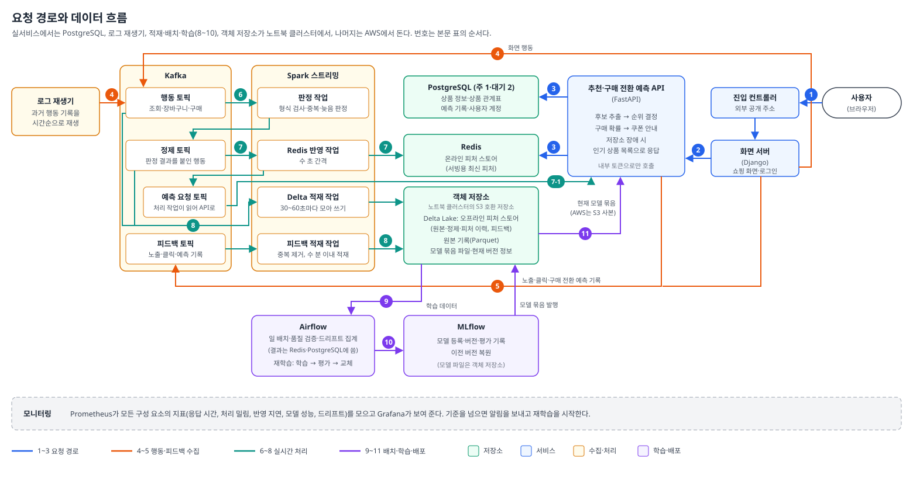

# 실시간 상품 추천과 자동 재학습 MLOps 파이프라인

| 항목 | 내용 |
|---|---|
| 과정 | MLO 1기 최종 프로젝트 |
| 팀 | 5팀 (이여찬, 이재원, 김영주, 오재석, 조성현) |
| 기간 | 2026.11.16 ~ 2027.01.07 |
| 대상 | 온라인 종합 쇼핑몰 |

## 1. 프로젝트 목표

1. **사용자 행동의 실시간 추천 반영**
   - 기존 사용자 및 신규 사용자의 행동을 수 초 안에 반영한 추천 상품 최신화
2. **모델 재학습과 교체의 자동화**
   - 정해진 주기, 성능 저하, 데이터 드리프트 발생 시 재학습 및 교체 자동화
3. **구매 확률 기반 쿠폰 대상 선별**
   - 세션별 구매 확률을 행동마다 갱신해 구매 확률이 중간인 세션을 쿠폰 대상으로 선별

### 시스템 구성



- 자세한 배치는 [시스템 구조도](docs/시스템_구조도.md) 참고

## 2. 팀과 역할

| 담당 | 역할 | 주요 업무 |
|---|---|---|
| 이여찬 | PM | 일정과 완료 확인, 담당 간 데이터 형식 결정, 기획·설계 문서, 통합 확인 |
| 이재원 | 데이터 | 실시간·배치 파이프라인 구현, 학습용·정답 데이터, 데이터 품질 검증 |
| 김영주 | ML | 추천 모델, 구매 전환 예측 모델, 재학습 파이프라인과 모델 등록 |
| 오재석 | 백엔드·서빙 | API, 쇼핑 화면, 서빙에 쓰는 데이터 |
| 조성현 | 인프라 | 클러스터 구축과 설치, 배포 자동화, 시연 환경 |

## 3. 산출물

| 문서 | 내용 | 제출 |
|---|---|---|
| [프로젝트 기획서](docs/프로젝트_기획서.md) | 추진 배경과 목적, 구축 내용, 시스템 구성, 목표 기준, 일정, 위험과 대응 | 1주 차(11-20) |
| [요구사항 정의서](docs/요구사항_정의서.md) | 기능·비기능 요구사항, 완료 기준, 검증 방법 | 1주 차(11-20) |
| [일정표(WBS)](docs/WBS.xlsx) | 마일스톤, 주별 목표, 작업과 요구사항 추적표 | 1주 차(11-20), 3주 차 작업까지 갱신 |
| [시스템 구조도](docs/시스템_구조도.md) | 요청 경로와 데이터 흐름, 클라우드(AWS)·노트북 클러스터 배치 | 2주 차 |
| [용어집](docs/용어집.md) | 팀 공통 용어와 코드 이름 규칙(토픽·필드·컬럼·키·지표·모델) | 2주 차 |
| [버전표](docs/버전표.md) | 프로그램·라이브러리 기준 버전과 호환 조건 | 2주 차 |

- 일정표는 엑셀 파일이라 GitHub 화면에서 바로 보이지 않음. 내려받아 열람

## 4. 폴더 구조

최상위 폴더는 따로 배포되는 구성 요소 단위로 나누고, 계층은 각 구성 요소 안에서 나눈다.

```
README.md        저장소 안내
docs/            팀 공용 문서: 산출물, 용어집, 메시지 형식, 구조도
libs/features/   공용 피처 계산 패키지(실시간·배치·학습이 함께 씀)
data-pipeline/   재생기, Spark 실시간·배치 작업, 품질 검증
ml/              추천·구매 전환 예측 모델 학습, 평가, 등록
serving/         추천·구매 전환 예측 API(FastAPI)
web/             쇼핑 화면(Django)
airflow/         Airflow 작업 정의(일일 배치, 재학습)
infra/           클러스터 설치, Kubernetes 설정, 배포 자동화, 인프라 문서
```

| 폴더 | 담당 | 통합 브랜치 |
|---|---|---|
| `docs/`, `README.md` | 이여찬 | `doc` |
| `libs/features/`, `data-pipeline/` | 이재원 | `dev` |
| `ml/` | 김영주 | `dev` |
| `serving/`, `web/` | 오재석 | `dev` |
| `airflow/` | 각 작업의 담당 | `dev` |
| `infra/` | 조성현 | `infra` |

### 4.1 구성 요소 안의 계층

```
<구성 요소>/
  README.md          하는 일, 실행 방법, 계층별 위치
  src/<패키지>/
    domain/          규칙: 계산, 판정, 점수 (외부 의존 없음)
    application/     흐름: 작업 하나의 처리 순서
    infrastructure/  연동: Kafka, Spark, Delta, Redis, PostgreSQL, MLflow
    presentation/    입출력: 명령줄, API 핸들러
  tests/             domain 중심 단위 테스트
  Dockerfile
```

- 의존 방향: presentation → application → domain, infrastructure → domain
- 프레임워크가 정한 구조가 있으면 그것을 따름(예: `web/`의 Django 앱 구조)
- 구성 요소끼리는 코드를 직접 불러오지 않음. Kafka 메시지 형식, Redis 키, API로만 주고받음. 예외는 `libs/features/`
- 폴더 이름은 하는 일로 지음. 작업 번호(예: `data06`)는 쓰지 않음
- 컨테이너 이미지는 구성 요소마다 하나. Kubernetes 배포 설정은 `infra/`에 둠

### 4.2 고칠 곳 찾기

| 하려는 일 | 고칠 곳 |
|---|---|
| 피처 계산 규칙 변경 | `libs/features/` |
| Kafka·Redis·Delta 연동 변경 | 해당 구성 요소의 `infrastructure/` |
| 판정·점수 같은 규칙 변경 | 해당 구성 요소의 `domain/` |
| API 응답 형식 변경 | `serving/`의 `presentation/` |
| 배포 설정 변경 | `infra/` |

## 5. 브랜치와 커밋

| 브랜치 | 용도 | 작업 브랜치 |
|---|---|---|
| main | 제출·확정본 | — |
| dev | 코드 통합 | `feat;#이슈번호` |
| doc | 문서 통합 | `doc;#이슈번호` |
| infra | 인프라(IaC) 통합 | `infra;#이슈번호` |

- 커밋: `[Add]`, `[Mod]`, `[Refactor]`, `[Doc]` + 내용 + `(#이슈번호)`
- 이슈 작성 형식과 자세한 규칙은 이슈 #1(GitHub 컨벤션)
- 각 통합 브랜치는 자기 폴더만 고침. 그래서 main으로 합쳐도 충돌하지 않음
