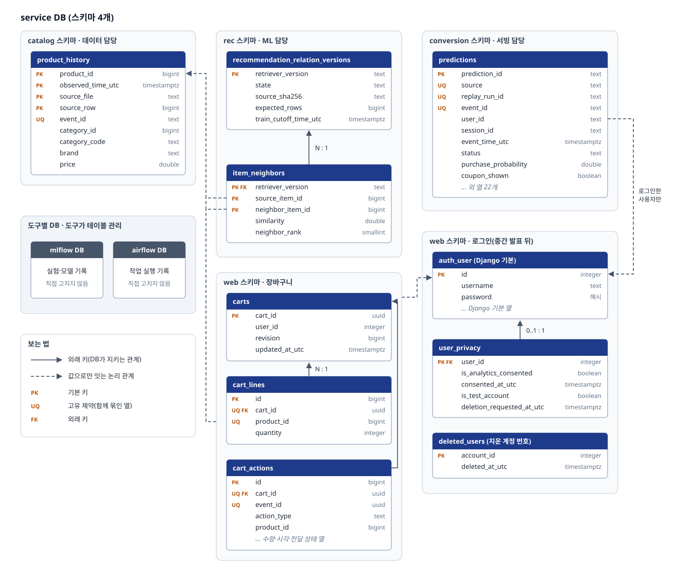

# DB 설계

| 항목 | 내용 |
|---|---|
| 작성 | PM 이여찬 |
| 기준일 | 2026-11-26 |
| 대상 | PostgreSQL 18, 이중화 관리 도구 CloudNativePG 1.30.2 |
| 관련 요구사항 | FR-DATA-04, FR-DATA-05, FR-REC-01, FR-SVC-01, FR-SVC-04, FR-INF-05, NFR-24 |

## 1. DB 구성

PostgreSQL 클러스터(주 1, 대기 2) 하나에 데이터베이스 세 개를 둔다. 서비스가 쓰는 테이블은 `service` DB에 모으고 영역마다 스키마(테이블 묶음)로 나눈다. MLflow와 Airflow는 각자 테이블을 자동으로 만들고 관리하므로 별도 DB를 준다. 도구의 내부 기록이 서비스 테이블과 섞이지 않고, 계정 권한도 DB 단위로 나뉜다.

| DB.스키마 | 테이블 | 담당(정의·적재) | 쓰는 곳 | 다시 만들 수 있나 | 만드는 시점 |
|---|---|---|---|---|---|
| `service.catalog` | `product_history` | 정의 데이터, 적재 서빙 | 화면 서버, API, 학습 데이터 | 원본으로 재적재 | 중간 발표 전 |
| `service.rec` | `recommendation_relation_versions` | 정의 ML, 적재 서빙 | 추천 API | 관계표 파일로 재적재 | 중간 발표 전 |
| `service.rec` | `item_neighbors` | 정의 ML, 적재 서빙 | 추천 API | 관계표 파일로 재적재 | 중간 발표 전 |
| `service.conversion` | `predictions` | 서빙(형식은 ML과 합의) | 구매 전환 예측 API, 정답 연결 | 없음 | 중간 발표 전 |
| `service.web` | `carts`, `cart_lines`, `cart_actions` | 서빙 | 화면 서버 | 없음 | 중간 발표 전 |
| `service.web` | Django 인증 테이블, `user_privacy`, `deleted_users` | 서빙 | 화면 서버 | 없음 | 중간 발표 뒤 |
| `mlflow` | MLflow 기록(도구 기본) | 인프라 | MLflow 서버 | 없음 | 중간 발표 전 |
| `airflow` | Airflow 기록(도구 기본) | 인프라 | Airflow | 일부(실행 이력은 없음) | 중간 발표 전 |

- DB 서버 운영(설치, 복제, 백업, 계정)은 인프라가 맡는다. 테이블 정의와 적재는 각 담당이 맡고, 모든 테이블이 3장 공통 규칙을 지키는지는 데이터 담당이 검토한다.
- `web` 스키마의 테이블은 화면 서버(Django)의 모델과 마이그레이션이 만든다. 이 문서는 열과 제약을 정하고, Django 모델이 이를 따른다. Django는 DB 접속 하나에서 한 스키마에만 테이블을 만들므로 장바구니와 로그인 테이블을 한 스키마에 둔다. 개인정보는 권한으로 지킨다(5.2절).
- 사용자 계정 테이블은 로그인 기능을 넣는 중간 발표 뒤에 만든다. 그 전까지 화면은 비로그인 응답만 한다.
- DB에 두지 않는 것: 집계값도 두지 않는다. 대체 추천용 인기 목록(최근 7일 구매자 수 순위)은 일 배치가 객체 저장소에 파일로 두고(대체 인기 목록 파일 형식), 추천 모델 입력용 상품별 집계(조회 수 등)는 데이터 파이프라인이 Redis에 둔다. 대기 한도를 넘었을 때 보여 줄 그 세션의 기존 추천은 브라우저가 들고 있다. Feast를 쓰면 피처 정의 기록은 객체 저장소 파일에 둔다. 화면 서버의 상품 목록 예비 파일도 객체 저장소에 둔다(4.1절).

## 2. ERD



- 실선은 외래 키로 DB가 지키는 관계, 점선은 값으로만 잇는 논리 관계다.
- 상품 이력 테이블은 한 상품이 시점마다 여러 행을 가지므로 상품 ID 하나로는 행이 정해지지 않아 외래 키로 가리킬 수 없다. 관계표의 상품 ID는 상품 ID 값으로만 잇는다.
- 예측 기록의 사용자 ID는 로그인한 사용자일 때만 사용자 계정과 이어진다. 재생 데이터의 사용자는 계정이 없다.
- 장바구니의 상품 ID도 상품 이력과 값으로만 잇는다. 화면에 보일 상품 정보는 시점 조회 함수로 붙인다.
- 장바구니의 사용자 ID는 인증 테이블을 만드는 중간 발표 뒤에 외래 키를 건다. 그 전까지는 값으로만 잇는다.

## 3. 공통 규칙

서비스 DB의 모든 테이블에 아래 규칙을 적용한다(도구가 관리하는 테이블은 제외). 4장 열 정의표의 "빈 값"은 NULL 허용 여부이고, 기본값이 없는 열은 기본값을 적지 않는다. 이름 표기는 용어집 9장 "이름 규칙"과 같다. 팀 코드의 이름이나 구조가 이 문서와 다르면 코드를 이 문서에 맞춘다.

### 3.1 시각

| 항목 | 규칙 |
|---|---|
| 자료형 | `timestamptz` |
| 기준 | UTC로 저장, 접속 세션 시간대도 UTC |
| 이름 | 사건 시각은 `_time_utc`, 생성·처리 시각은 `_at_utc`로 끝냄 |
| 재생 데이터 | 원본 시각(2019년)과 실제 시각을 다른 열에 둠 |
| 정밀도 | 메시지에서 받은 시각은 밀리초(`timestamptz(3)`) |

### 3.2 ID

| 대상 | 자료형 | 이유 |
|---|---|---|
| 상품·카테고리 ID | `bigint` | 원본 타입, 조회 색인을 숫자로 씀 |
| 이벤트·세션·예측 ID | `text` | 메시지에서 받은 문자열 그대로 |
| 메시지를 그대로 쌓는 표의 사용자 ID | `text` | 메시지와 같은 값으로 이음 |
| 사용자 계정의 ID | Django 기본(정수) | 인증 기능이 정함 |

로그인한 사용자의 행동 메시지 사용자 ID는 `web-` + Django 사용자 ID다(예: `web-17`). 재생 데이터의 숫자 사용자 ID와 겹치지 않는다. 세션 ID는 그 세션의 첫 통과 행동의 이벤트 ID이고, 판정 작업만 만든다. 메시지 키 안에서 30분 규칙으로 나눈다. 재생의 메시지 키는 사용자 ID이고, 화면·부하 시험은 로그인 여부와 상관없이 늘 원래 세션 값(브라우저마다 발급한 값)이다. 그래서 세션 도중 로그인해도 키가 바뀌지 않아 같은 세션이 이어지고, 같은 계정이라도 브라우저가 다르면 세션이 따로다. 화면 서버는 세션 ID를 만들지 않는다. 구매 전환 예측 요청은 Redis 반영 작업이 행동마다 그 행동까지 반영한 입력과 세션 ID로 만들어, Redis에 반영하기 전에 쓴다(4.3절). Django 계정 ID는 다시 쓰지 않는다.

Kafka 메시지는 ID를 문자열로 보낸다. 문자열 상품 ID로 `bigint` 열을 조회할 때는 조회 값 쪽을 바꾼다(`$1::bigint`, 배열이면 `$1::bigint[]`). 열 쪽을 문자열로 바꾸면 색인을 쓰지 못한다.

### 3.3 버전·이름·자료형

- 버전 값은 `text`로 두고 이름은 `_version`으로 끝낸다. 값 형식은 용어집을 따른다(예: `rec-2026.12.01-1`).
- 이름은 영어 소문자와 밑줄(`snake_case`)로 쓰고, 참·거짓 열은 `is_`로 시작한다. 메시지 필드를 그대로 쌓는 열은 메시지 이름을 따른다(예: `coupon_shown`).
- 확률과 가격 같은 실수는 `double precision`으로 둔다. 화면 표시 가격은 원본 값을 그대로 보여 준다.
- 버전이 있는 데이터는 새 버전을 다 넣고 검증한 뒤에 "준비" 상태로 바꾼다. 읽는 쪽은 준비된 버전만 읽는다.
- 사용자 계정 정보(이메일, 이름, 비밀번호)는 `web` 스키마에만 둔다. 다른 테이블과 Kafka·Delta·Redis에는 내부 사용자 ID만 둔다.

## 4. 테이블 정의

### 4.1 상품 이력

| 항목 | 내용 |
|---|---|
| 테이블 | `catalog.product_history` |
| 담는 것 | 상품의 카테고리·브랜드·가격을 시점별로 뽑은 이력 |
| 쓰는 곳 | 화면, API, 학습 데이터(시점 조회 함수로 읽음) |
| 원본 | 원본 행동 기록(언제든 다시 적재) |

| 열 | 자료형 | 빈 값 | 뜻 |
|---|---|---|---|
| `product_id` | `bigint` | 불가 | 상품 ID |
| `observed_time_utc` | `timestamptz` | 불가 | 이 속성 조합이 처음 관찰된 원본 행동 시각 |
| `source_file` | `text COLLATE "C"` | 불가 | 원본 파일명(바이트 순 정렬) |
| `source_row` | `bigint` | 불가 | 원본 파일 안 행 순번(0부터) |
| `event_id` | `text` | 불가 | 원본 이벤트 ID(파일명과 행 순번) |
| `category_id` | `bigint` | 가능 | 카테고리 ID |
| `category_code` | `text` | 가능 | 카테고리 이름 |
| `brand` | `text` | 가능 | 브랜드 |
| `price` | `double precision` | 가능 | 원본 가격 |

| 키·제약 | 열 | 용도 |
|---|---|---|
| 기본 키 | `product_id`, `observed_time_utc`, `source_file`, `source_row` | 시점 조회 |
| 고유 제약 | `event_id` | 같은 원본 행 중복 적재 방지 |
| 검사 | `source_row` 0 이상 | 잘못된 행 차단 |

**저장 규칙**
- 카테고리·브랜드·가격 조합이 바뀔 때만 행을 남긴다.
- 같은 상품·같은 시각이면 원본 파일명(바이트 순), 행 순번 순서를 실제 순서로 본다. 원본에서 같은 초에 가격이 다른 경우는 3,857건(상품·초 단위)이다.
- 원본 값을 그대로 저장한다. 빈 값은 앞 값으로 채우지 않고, 가격 0도 그대로 둔다.

**DB 밖에서 바꾸는 값** (학습과 서비스가 함께 쓰는 피처 코드, 화면)

| 값 | 규칙 |
|---|---|
| 카테고리 | 카테고리 이름 → 없으면 카테고리 ID → 둘 다 없으면 `unknown` |
| 브랜드 | 비면 `unknown` |
| 가격 | 비었거나 0이면 가격 없음. 화면은 "가격 정보 없음" |

- 가격 0은 조회·장바구니에만 나오고 구매에는 없어 누락값으로 본다.
- 원본에 상품 이름·사진이 없어 화면은 카테고리·브랜드·가격으로 상품을 보여 준다.

**조회 함수**

| 함수 | 쓰는 곳 | 돌려주는 것 |
|---|---|---|
| `catalog.product_at(상품 ID, 시각)` | 화면 상세 | 한 상품의 그 시각 값 |
| `catalog.product_at_event(상품 ID, 시각, 파일명, 행 순번)` | 재생·학습 데이터 | 한 상품의 그 원본 행 시점 값 |
| `catalog.products_at(상품 ID 배열, 시각)` | 화면 목록·장바구니, 화면 행동의 추천 | 여러 상품의 그 시각 값 |
| `catalog.products_at_event(상품 ID 배열, 시각, 파일명, 행 순번)` | 재생 행동의 추천 | 여러 상품의 그 원본 행 시점 값 |
| `catalog.products_snapshot_at(시각)` | 화면 상품 목록 | 그 시각까지 관측된 모든 상품 |

- "그 시각 값"은 그 시각까지(포함) 마지막 행의 값이다.
- 재생 요청은 시각과 함께 원본 파일명·행 순번을 넘긴다. 같은 초 안의 뒤 행에서 바뀐 가격을 미리 읽지 않기 위해서다.
  - 예: 요청이 10:05:00의 30번 행이고 가격이 같은 초의 31번 행에서 바뀌면, 시각만 넘긴 조회는 바뀐 가격을 돌려준다.
- 여러 상품 조회는 요청한 ID마다 한 행을 돌려준다. 관측된 적 없는 상품은 관찰 시각이 빈 행이다.
- 추천은 이웃 전체(관심 상품마다 최대 100개)·현재 상품·관심 상품을 한 번에 조회하고, 관측되지 않은 상품을 뺀 뒤 순위를 매긴다.
- 전체 목록 조회는 화면 서버가 시작할 때와 재생 시각이 크게 바뀔 때만 부르고 결과를 메모리에 둔다. 같은 내용을 객체 저장소에 예비 파일로 남겨, DB 없이 다시 켜질 때 쓴다.

### 4.2 추천 관계표

| 항목 | 내용 |
|---|---|
| 테이블 | `rec.recommendation_relation_versions`(버전), `rec.item_neighbors`(이웃) |
| 담는 것 | 기준 상품마다 함께 추천할 이웃 상품(최대 100개), 버전별 |
| 쓰는 곳 | 추천 API |
| 원본 | 객체 저장소의 버전별 관계표 파일(한 번 올리면 바꾸지 않음) |

| 열(버전) | 자료형 | 빈 값 | 뜻 |
|---|---|---|---|
| `retriever_version` | `text`, 기본 키 | 불가 | 관계표 버전 |
| `state` | `text` | 불가 | `loading`, `ready`, `failed` |
| `source_sha256` | `text` | 불가 | 관계표 원본 파일 검증값 |
| `expected_rows` | `bigint` | 불가 | 기대 행 수 |
| `train_cutoff_time_utc` | `timestamptz` | 불가 | 학습 데이터의 마지막 행동 시각(MLflow 태그와 같은 값) |

| 열(이웃) | 자료형 | 빈 값 | 뜻 |
|---|---|---|---|
| `retriever_version` | `text` | 불가 | 관계표 버전(버전 테이블 외래 키) |
| `source_item_id` | `bigint` | 불가 | 기준 상품 ID |
| `neighbor_item_id` | `bigint` | 불가 | 이웃 상품 ID |
| `similarity` | `double precision` | 불가 | 유사도(0 이상 1.000001 이하, 실수 오차 허용) |
| `neighbor_rank` | `smallint` | 불가 | 이웃 순위(1–100) |

| 키·제약 | 열 | 용도 |
|---|---|---|
| 기본 키 | `retriever_version`, `source_item_id`, `neighbor_item_id` | 같은 이웃 중복 방지 |
| 고유 제약 | `retriever_version`, `source_item_id`, `neighbor_rank` | 순위 중복 방지, 묶음 조회 색인 |
| 검사 | 기준 상품 ≠ 이웃 상품, 유사도·순위 범위 | 잘못된 행 차단 |

**담당**

| 일 | 담당 |
|---|---|
| 열·키 정의, 버전별 원본 파일(기대 행 수·검증값 포함) | ML |
| 조회 색인 | 서빙 |
| 적재 작업 | 서빙 |
| 적재 검증과 `ready` 판정 | 서빙 |

**적재 순서**
1. 새 버전 행을 `loading`으로 기록한다.
2. 이웃 행을 넣는다.
3. 행 수, 원본 검증값, 표본 조회를 확인한다. 모두 맞으면 `ready`, 하나라도 틀리면 `failed`다. 실패 이유는 적재 작업 로그에 남긴다.

**버전 고르기**
- 쓸 버전은 현재 버전 정보(모델 묶음)가 정한다.
- 재생에서는 학습 마감 시각이 요청 시각보다 앞선 버전을 호출하는 쪽이 고른다.
- 추천 요청 하나는 처음 고른 버전만 끝까지 쓴다.
- 조회는 `ready` 버전만 돌려준다. 적재 중이거나 실패한 버전이 넘어오면 빈 결과가 되어 대체 추천으로 넘어간다.

### 4.3 구매 전환 예측 기록

| 항목 | 내용 |
|---|---|
| 테이블 | `conversion.predictions` |
| 담는 것 | 예측 대상 행동마다 예측 한 건(확률, 입력, 모델 버전, 쿠폰 안내) |
| 쓰는 곳 | 구매 전환 예측 API(저장, 쿠폰 조회), 구매 정답 연결 작업(읽기) |
| 크기 | 11월 재생 한 번에 약 643만 건 |
| 원본 | 없음(백업으로만 지킴) |

#### 4.3.1 예측 대상

| 출처 | 대상 |
|---|---|
| 화면·부하 시험 | 판정을 통과한 첫 구매 전 조회·장바구니 행동 전부 |
| 재생 | 세션 ID 해시로 고른 세션 10%(설정값)의 같은 행동 |

재생 행동을 전부 예측하면 약 6,434만 건이라 표본 세션만 예측한다. 첫 구매 뒤 행동은 예측하지 않는다.

#### 4.3.2 저장까지의 흐름

1. Redis 반영 작업이 행동마다 그 행동까지 반영한 입력을 계산한다. 같은 배치에 행동이 여럿이면 하나씩 계산한다.
2. 예측 요청을 Kafka 예측 요청 토픽에 쓰고 쓰기 확인을 받는다.
3. Redis에 반영하고 배치 끝을 기록한다.
4. 예측 요청 처리 작업이 토픽을 읽어 구매 전환 예측 API를 부른다.
5. API가 계산해 이 테이블에 저장한 뒤 Kafka 피드백 토픽에 발행한다.

- 요청에는 기준 행동의 필드, 입력 버전, 입력 6개, 피처 리비전이 들어 있다. 입력의 마지막 행동은 늘 기준 행동이다.
- 처리 작업이 늦어도 Redis 반영은 늦어지지 않는다. 요청 토픽 쓰기가 막히면 그 배치의 Redis 반영도 기다린다.
- 목표 부하는 저장 초당 약 180건(가안)이다. 저장은 AWS의 API가 VPN을 건너 노트북 클러스터의 PostgreSQL에 하고, 동기 복제를 거친다.

#### 4.3.3 열

열은 32개다. 시각 열은 모두 `timestamptz(3)`이다.

식별과 기준 행동:

| 열 | 자료형 | 빈 값 | 뜻 |
|---|---|---|---|
| `prediction_id` | `text`, 기본 키 | 불가 | 예측 번호(Kafka 로그 ID와 같음) |
| `source` | `text` | 불가 | 출처: `replay`, `web`, `loadtest`, `test`(Kafka를 거치지 않는 시험) |
| `replay_run_id` | `text` | 재생은 불가 | 재생 실행 ID(화면·부하 시험은 재생 시계가 있을 때만) |
| `user_id` | `text` | 가능 | 사용자 ID. 로그인하지 않은 사용자는 빈 값 |
| `session_id` | `text` | 불가 | 30분 규칙의 세션 ID |
| `raw_session_id` | `text` | 가능 | 생산자가 보낸 원래 세션 값 |
| `event_id` | `text` | 불가 | 예측을 부른 행동 ID |
| `sequence` | `bigint` | 불가 | 행동 순번(재생은 원본 행 번호, 화면은 브라우저 순번) |
| `event_type` | `text` | 불가 | `view`, `cart`, `purchase` |

시각과 입력:

| 열 | 자료형 | 빈 값 | 뜻 |
|---|---|---|---|
| `event_time_utc` | 시각 | 불가 | 기준 행동 시각(재생은 원본 시각) |
| `replay_time_utc` | 시각 | 불가 | 요청을 만든 순간의 재생 시각 |
| `produced_at_utc` | 시각 | 불가 | Redis 반영 작업이 요청을 만든 실제 시각 |
| `created_at_utc` | 시각, 기본값 `clock_timestamp()` | 불가 | DB 저장 시각 |
| `input_event_id` | `text` | 정상 예측은 불가 | 입력에 들어간 마지막 행동 ID |
| `input_time_utc` | 시각 | 정상 예측은 불가 | 그 행동의 시각 |
| `input_version` | `text` | 정상 예측은 불가 | 입력 계산 규칙 버전 |
| `feature_revision` | `text` | 가능 | 요청에 실린 피처 리비전(해석하지 않고 저장) |
| `inputs` | `jsonb` | 정상 예측은 불가 | 모델에 넣은 입력 6개 |

결과, 버전, 안내, 발행:

| 열 | 자료형 | 빈 값 | 뜻 |
|---|---|---|---|
| `status` | `text` | 불가 | `ok` 정상, `invalid_input` 입력 오류 |
| `reason` | `text` | 정상 예측만 빈 값 | 입력 오류 사유 |
| `purchase_probability` | `double precision` | 정상 예측만 값 | 반올림 전 구매 확률(0–1) |
| `coupon_eligible` | `boolean` | 불가 | 쿠폰 조건 충족 여부 |
| `conversion_model_version` | `text` | 불가 | 모델 배포 버전(예: `conversion-2026.12.01-1`) |
| `model_format` | `text` | 가능 | 모델 형식 |
| `model_artifact_sha256` | `text` | 가능 | 모델 파일 검증값 |
| `model_bundle_sha256` | `text` | 가능 | 배포 묶음 검증값 |
| `coupon_rule_version` | `text` | 불가 | 적용한 쿠폰 규칙 버전 |
| `label_version` | `text` | 불가 | 정답 연결 규칙 버전 |
| `coupon_claimed_at_utc` | 시각 | 권리를 얻었을 때만 값 | 이 세션의 쿠폰 안내 권리를 얻은 시각 |
| `coupon_shown` | `boolean` | 가능 | 쿠폰을 응답에 실었는지(4.3.5절) |
| `coupon_shown_at_utc` | 시각 | 안내했을 때만 값 | 쿠폰을 응답에 실은 시각 |
| `published_at_utc` | 시각 | 발행 확인 전 빈 값 | Kafka 발행 확인 시각 |

- 열 이름은 피드백 토픽의 예측 메시지 필드와 같다. `created_at_utc`, `coupon_claimed_at_utc`, `published_at_utc`만 DB 운영용이다.
- 쿠폰 확률 구간은 쿠폰 규칙 버전마다 모델 묶음에 두고, DB에는 버전만 둔다.
- 재생 시계가 없을 때의 시각은 토픽 메시지 형식의 시각 규칙을 따른다.

| 키·제약 | 열 | 용도 |
|---|---|---|
| 기본 키 | `prediction_id` | 예측 번호 |
| 고유 제약 | 출처·재생 실행 ID·이벤트 ID | 같은 행동의 예측은 한 건 |
| 부분 고유 색인 | 출처·재생 실행 ID·세션 ID(권리를 얻은 행만) | 세션당 쿠폰 권리 하나 |
| 색인 | 출처·재생 실행 ID·세션 ID | 안내할 쿠폰 찾기, 정답 연결 |
| 색인 | 저장 시각(발행 안 된 행만) | 재발행할 예측 찾기 |
| 검사 | 상태·확률·입력·쿠폰 열 | 정상 예측은 확률·입력 필수, 입력 오류는 사유 필수, 쿠폰 상태 일관성 |

#### 4.3.4 중복과 실패

- 같은 행동(출처·재생 실행 ID·이벤트 ID)이 다시 오면 새로 만들지 않고 저장된 예측을 돌려준다.
- 같은 키인데 사용자·세션·행동 시각이 다르면 기존 행을 두고 충돌로 본다. 충돌은 API 로그와 지표로 센다.
- 입력 묶음의 필드 이름·자료형과 "마지막 행동 = 기준 행동"은 API가 저장 전에 입력 버전마다 검사한다.

Redis 반영 작업이 멈췄을 때:

| 멈춘 지점 | 다시 처리할 때 |
|---|---|
| 요청을 쓴 뒤, Redis 반영 전 | 같은 요청이 한 번 더 가고, 중복 규칙으로 한 건만 남음 |
| Redis 반영 뒤 | 그 행동은 계산에서 빠지지만 요청은 이미 나가 있음 |

예측 요청 처리 작업은 저장 성공 응답(이미 저장된 예측을 돌려받은 경우 포함)을 받은 뒤에만 읽은 위치를 기록한다.

| 실패 | 처리 |
|---|---|
| DB·VPN·API 장애, 모델 없음 | 행을 남기지 않고 다시 시도(요청은 토픽에 쌓임) |
| 입력값만 잘못됨 | `invalid_input` 행으로 저장하고 다음으로 |
| 필수 식별 값이 없거나 형식이 틀림 | 실패 요청 토픽(`conversion_request_failed`)으로 옮기고 다음으로 |

- 실패 요청 토픽에 1건이라도 들어가면 알린다.
- 처리가 밀린 정도는 토픽의 처리 지연으로 본다.

#### 4.3.5 쿠폰 안내

1. 예측은 `coupon_shown = false`로 저장한다.
2. 쿠폰 조건을 채우면 같은 트랜잭션 안에서 그 세션의 안내 권리를 얻는다. `coupon_claimed_at_utc`를 채우고 `coupon_shown`을 빈 값으로 바꾼다.
3. 다음 화면은 반영 확인이 끝난 뒤 쿠폰을 묻는다. 대기 한도를 넘긴 화면은 묻지 않는다.
4. API는 Redis의 현재 세션 기록을 읽고, 그 세션에 구매가 없으면 안내 전인 예측을 한 문장으로 "안내함"과 안내 시각으로 바꾼 뒤 예측 번호를 돌려준다.

| `coupon_shown` | 뜻 |
|---|---|
| 거짓 | 권리를 얻지 못함 |
| 빈 값 | 권리를 얻고 아직 안내 전 |
| 참 | 응답에 쿠폰을 실음 |

- 세션당 한 예측만 권리를 얻는다. 두 행동이 동시에 조건을 채우면 진 쪽은 권리만 잃고 예측은 남는다.
- 바꾼 요청 하나만 쿠폰을 받으므로 탭이 여럿이어도 한 번만 뜬다. 받은 화면이 닫히면 다시 띄우지 않는다.
- API가 Redis를 읽는 것은 쿠폰 조회뿐이다. 예측 계산·저장은 요청에 실린 입력만 쓴다.
- 현재 세션 기록은 새 재생 실행을 시작할 때 비운다.

#### 4.3.6 발행과 정답 연결

- Kafka 발행은 DB 저장 뒤에 하고, 확인하면 `published_at_utc`를 채운다.
- 비어 있는 행은 재발행 작업이 같은 예측 번호, 같은 내용으로 다시 보낸다. 두 번 가면 Delta 적재가 예측 번호로 하나만 남긴다.
- 메시지는 저장 시점 내용이다. 실제 안내 여부의 원본은 DB다.
- 정답 연결 작업은 세션이 끝난 뒤 이 테이블을 읽어 Delta에 예측별 정답 표를 만든다. 확정 시각과 보류 규칙은 서비스 연동 명세를 따른다.
- 노트북 클러스터나 VPN이 멈추면 저장이 멈추고, 요청은 토픽에 쌓였다가 복구 뒤 처리된다.

### 4.4 장바구니

| 항목 | 내용 |
|---|---|
| 테이블 | `web.carts`(장바구니), `web.cart_lines`(담긴 상품), `web.cart_actions`(처리 기록) |
| 담는 것 | 장바구니 수량, 담기·변경 요청의 처리 기록 |
| 쓰는 곳 | 화면 서버 |
| DB에 두는 이유 | 같은 요청은 한 번만, 다른 요청은 동시에 와도 모두 반영 |

쿠키에는 장바구니 ID만 담는다.

| 열(`carts`) | 자료형 | 빈 값 | 뜻 |
|---|---|---|---|
| `cart_id` | `uuid`, 기본 키 | 불가 | 장바구니 ID(쿠키에 담는 값) |
| `user_id` | Django 사용자 ID | 가능 | 로그인한 사용자. 로그인 전은 빈 값 |
| `revision` | `bigint`, 기본값 0 | 불가 | 바뀔 때마다 1씩 올리는 번호 |
| `updated_at_utc` | `timestamptz`, 기본값 `now()` | 불가 | 마지막 변경 시각 |

| 열(`cart_lines`) | 자료형 | 빈 값 | 뜻 |
|---|---|---|---|
| `id` | `bigint`, 기본 키 | 불가 | 자체 번호 |
| `cart_id` | `uuid`, 외래 키 | 불가 | 장바구니 |
| `product_id` | `bigint` | 불가 | 공용 상품 ID |
| `quantity` | `integer`, 기본값 1 | 불가 | 수량(1 이상) |

| 열(`cart_actions`) | 자료형 | 빈 값 | 뜻 |
|---|---|---|---|
| `id` | `bigint`, 기본 키 | 불가 | 자체 번호(반영 순서) |
| `cart_id` | `uuid`, 외래 키 | 불가 | 장바구니 |
| `event_id` | `uuid` | 불가 | 브라우저가 만든 행동 ID. 메시지 이벤트 ID는 `web:` + 이 값 |
| `action_type` | `text` | 불가 | `add`, `update`, `remove`, `clear` |
| `product_id` | `bigint` | 비우기만 빈 값 | 대상 상품 |
| `quantity_delta` | `integer` | 불가 | 수량 변화(담기는 +1) |
| `target_quantity` | `integer` | 담기만 빈 값 | 바꾼 뒤 수량(삭제·비우기는 0) |
| `created_at_utc` | `timestamptz`, 기본값 `now()` | 불가 | 처리 시각 |
| `delivery_status` | `text`, 기본값 `pending` | 불가 | Redis 반영 상태: `pending`, `applied` |
| `eligible_at_utc` | `timestamptz`, 기본값 `now()` | 불가 | 반영을 시작해도 되는 시각 |
| `applied_at_utc` | `timestamptz` | 반영 뒤 값 | Redis에 반영된 시각 |
| `confirmed_at_utc` | `timestamptz` | 반영 뒤 값 | 반영 완료를 확인한 시각 |

| 키·제약 | 대상 | 용도 |
|---|---|---|
| 고유 제약 | `cart_lines`: 장바구니·상품 | 같은 상품 한 줄 |
| 고유 제약 | `cart_actions`: 장바구니·행동 ID | 같은 요청 한 번 |
| 색인 | `cart_actions`: 반영 상태·시작 가능 시각 | 반영할 건 찾기 |
| 외래 키 | 줄·처리 기록 → `carts` | 장바구니 소속 |
| 외래 키 | `carts.user_id` → 인증 테이블 | 로그인 기능을 만들 때 추가 |

줄과 처리 기록은 여러 열 기본 키 대신 자체 번호를 쓴다. Django가 기본 키를 여러 열로 바꾸는 마이그레이션을 지원하지 않기 때문이다.

**담기·변경 처리**
1. 장바구니 행을 잠근다.
2. 같은 행동 ID의 처리 기록이 있으면 수량을 바꾸지 않고 현재 장바구니를 돌려준다. 종류·상품·목표 수량이 다르면 거절한다.
3. 없으면 수량 변경과 처리 기록 저장을 한 트랜잭션에서 한다.

**Redis 반영**

| 항목 | 내용 |
|---|---|
| 하는 곳 | 화면 서버 워커(장바구니 반영 작업) |
| 순서 | 같은 장바구니 안에서 처리 기록 번호 순서로 하나씩 |
| 키 | `cart:{장바구니 ID}:events`(반영한 행동 ID), `cart:{장바구니 ID}:counts`(상품별 수량) |
| 끝나면 | 상태를 `applied`로 바꿈 |
| 장애 | 로그를 남기고 다시 시도 |
| 복구 | Redis를 잃으면 DB 장바구니 표로 다시 만듦 |
| 새 재생 실행 | 비우지 않음 |

앞선 건이 끝나야 다음 건을 반영한다. 비우기보다 뒤에 담은 상품이 지워지지 않게 하기 위해서다.

**그 밖의 규칙**
- 상품 ID는 공용 상품 ID(`bigint`)다. 외래 키는 걸지 않고, 표시 정보는 `catalog.products_at`으로 붙인다.
- 가격 없는 상품은 소계를 "가격 정보 없음"으로 표시하고 합계에서 뺀다. 합계 옆에 빠진 상품이 있음을 표시한다.
- 로그인하면 장바구니에 사용자 ID를 적는다. 로그인 전후 장바구니를 합치는 규칙은 로그인 기능을 만들 때 정한다.
- PostgreSQL이 멈추면 담기는 막는다. 상품 목록·상세·대체 추천은 메모리의 상품 목록으로 계속 보여 준다.
- 시험용 문자 상품 번호로 만든 장바구니는 옮기지 않는다.

### 4.5 사용자 계정

| 항목 | 내용 |
|---|---|
| 테이블 | `web.auth_user`(로그인), `web.user_privacy`(분석 동의·삭제 요청), `web.deleted_users`(지운 계정 번호) |
| 로그인 방식 | Django 기본 인증(아이디·비밀번호) |
| 만드는 곳 | 인증 테이블은 Django가 `web` 스키마에 만듦(검색 경로 지정) |
| 만드는 시점 | 중간 발표 뒤 |

| 열(`user_privacy`) | 자료형 | 빈 값 | 뜻 |
|---|---|---|---|
| `user_id` | Django 사용자 ID, 기본 키·외래 키 | 불가 | 사용자 |
| `is_analytics_consented` | `boolean`, 기본값 거짓 | 불가 | 행동 기록 분석 동의 |
| `consented_at_utc` | `timestamptz` | 동의했을 때만 값 | 동의 시각 |
| `is_test_account` | `boolean`, 기본값 거짓 | 불가 | 팀 시험 계정 |
| `deletion_requested_at_utc` | `timestamptz` | 요청했을 때만 값 | 탈퇴·삭제 요청 시각 |

| 열(`deleted_users`) | 자료형 | 빈 값 | 뜻 |
|---|---|---|---|
| `account_id` | Django 사용자 ID, 기본 키 | 불가 | 지운 계정의 ID(외래 키 없음) |
| `deleted_at_utc` | `timestamptz`, 기본값 `now()` | 불가 | 계정을 지운 시각 |

**분석에서 빼는 계정**
- 동의하지 않은 계정(이 테이블에 행이 없거나 동의 값이 빈 계정 포함)
- 팀 시험 계정
- 삭제를 요청한 계정
- 이미 지운 계정

- 데이터 파이프라인은 분석 제외 뷰 `web.analysis_excluded_users` 하나만 읽는다. 뷰가 내주는 값은 행동 메시지의 사용자 ID(`web-` + 계정 ID)뿐이다.
- 학습·평가 데이터는 재생 출처만 쓴다. 로그인하지 않은 화면 행동은 분석 동의가 없어 분석에 쓰지 않는다.

**계정 삭제**
1. 같은 트랜잭션에서 계정 ID를 `deleted_users`에 먼저 넣는다.
2. 계정을 지운다.
3. 화면 서버 로그에도 남긴다.

- `deleted_users`는 지우지 않고 계속 둔다. 계정이 사라져도 Delta에 남은 과거 행동을 분석에서 빼기 위해서다. 개인정보 없이 번호와 시각만 둔다.
- 이미 만든 집계는 다음 일 배치에서 다시 계산한다.
- 백업으로 복원하면 복원 시점 뒤의 삭제를 로그에서 다시 넣은 뒤 분석을 재개한다.
- 나머지 열과 화면 세션 테이블은 로그인 기능을 만들 때 서빙 담당이 정한다.

### 4.6 MLflow·Airflow DB

두 도구는 자기 테이블을 스스로 만들고 바꾼다. 이 문서에서 정의하지 않고 직접 고치지도 않는다.

| 도구 | 테이블 만들기·고치기 |
|---|---|
| Airflow | `airflow db migrate` |
| MLflow | 빈 DB에서 서버를 처음 띄울 때 만들고, 버전을 올릴 때 `mlflow db upgrade` |

MLflow의 모델 파일은 DB가 아니라 객체 저장소에 둔다.

## 5. 접속·계정·백업

### 5.1 접속 주소

- 모든 프로그램은 CloudNativePG가 주는 대표 주소로 접속한다. 기본은 주 서버를 가리키는 쓰기 주소(`-rw`)다. 대기 서버를 읽는 주소(`-ro`)는 방금 쓴 값을 바로 읽지 않아도 되는 분석 작업만 쓴다. 주 서버가 바뀌어도 주소는 그대로다.
- 대표 주소는 노트북 클러스터 안에서만 닿는다. AWS의 화면 서버와 API를 위해 쓰기 주소 서비스를 VPN 쪽에서 닿게(노드 포트나 로드밸런서 주소) 따로 연다. 그래서 주 서버가 바뀌어도 AWS 쪽 주소가 새 주 서버를 따라간다.
- PostgreSQL 포트는 인터넷에 열지 않고 클러스터 내부와 VPN에만 연다.
- 프로그램은 DB가 다시 뜨거나 주 서버가 바뀌면 자동으로 다시 접속한다. 화면 서버는 DB를 읽지 못해도 비로그인 응답으로 화면을 띄운다.

### 5.2 계정과 권한

프로그램마다 계정을 따로 두고 필요한 권한만 준다. 계정은 클러스터 전체에 공유되므로 DB마다 접속 권한도 따로 준다. 모든 계정이 기본으로 갖는 DB 접속 권한(`PUBLIC`의 `CONNECT`)은 거두고, 표의 계정에만 준다. 스키마를 읽는 계정에는 그 스키마의 `USAGE`도 준다. 비밀번호는 Kubernetes 비밀 정보로 넣고 코드와 저장소에 두지 않는다.

| 계정 | 쓰는 프로그램 | 권한 |
|---|---|---|
| `catalog_writer` | 상품 이력 적재 스크립트(서빙) | `catalog` 쓰기 |
| `rec_writer` | 관계표 적재(재학습) | `rec` 쓰기 |
| `api` | 추천·구매 전환 예측 API | `catalog`·`rec` 읽기, `conversion` 읽기·쓰기 |
| `web` | 화면 서버 | `catalog` 읽기, `web` 스키마 소유(Django 테이블 생성) |
| `pipeline_reader` | 정답 연결, 품질 검증 | `conversion` 읽기, 분석 제외 뷰만 읽기(`web` 테이블은 못 읽음) |
| `mlflow`, `airflow` | 각 도구 | 자기 DB 소유 |

### 5.3 복제와 백업

- 주 서버 1대와 대기 서버 2대를 서로 다른 PC에 두고, 주 서버가 꺼지면 CloudNativePG가 대기 서버를 주 서버로 올린다.
- 복제는 동기 방식이다. 주 서버는 정상 대기 서버 한 대 이상이 받았다는 확인 뒤에 쓰기를 끝낸다(CloudNativePG 동기 복제 대상 수 1, `dataDurability: preferred`). 예측 기록처럼 다시 만들 원본이 없는 기록을 주 서버 장애 때 잃지 않기 위해서다.
- 정상 대기 서버가 하나도 없으면 확인 없이 쓰기를 끝낸다. 그동안 주 서버까지 장애가 나면 마지막 쓰기를 잃을 수 있으므로, 대기 서버가 모두 빠지면 알림을 낸다.
- 하루 한 번 클러스터 전체(세 DB 모두)를 노트북 클러스터의 객체 저장소에 백업한다. 꼭 지켜야 하는 것은 다시 만들 원본이 없는 예측 기록, 장바구니, 사용자 계정, MLflow 기록이다. 복원은 한 번 이상 시험하고, 장바구니 수량과 처리 기록이 함께 돌아오는지 본다.
- 상품 이력과 관계표는 원본과 관계표 파일로 다시 적재할 수 있다. 백업이 없어도 적재 스크립트로 되살린다.

## 부록 A. SQL

### A.1 상품 이력 시점 조회(재생 행동의 추천)

```sql
CREATE FUNCTION catalog.products_at_event(
    requested_ids bigint[], requested_at timestamptz,
    requested_source_file text, requested_source_row bigint)
RETURNS TABLE (product_id bigint, observed_time_utc timestamptz, category_id bigint,
               category_code text, brand text, price double precision)
LANGUAGE sql STABLE AS $$
    SELECT r.id, h.observed_time_utc, h.category_id, h.category_code, h.brand, h.price
    FROM unnest(requested_ids) AS r(id)
    LEFT JOIN LATERAL (
        SELECT * FROM catalog.product_history p
        WHERE p.product_id = r.id
          AND (p.observed_time_utc, p.source_file, p.source_row)
              <= (requested_at, requested_source_file COLLATE "C", requested_source_row)
        ORDER BY p.observed_time_utc DESC, p.source_file DESC, p.source_row DESC
        LIMIT 1
    ) h ON true
$$;

-- 재생 행동의 추천: 후보 상품을 한 번에
SELECT * FROM catalog.products_at_event($1::bigint[], $2::timestamptz, $3, $4::bigint);
```

- 전체 목록 조회(`products_snapshot_at`)는 상품별 마지막 행을 먼저 고른 뒤 카테고리로 거른다. 거른 뒤에 고르면 카테고리가 바뀐 상품의 예전 행이 다시 나타난다.

### A.2 추천 관계표 조회

```sql
SELECT n.source_item_id, n.neighbor_item_id, n.similarity
FROM rec.item_neighbors n
JOIN rec.recommendation_relation_versions v
  ON v.retriever_version = n.retriever_version AND v.state = 'ready'
WHERE n.retriever_version = $1 AND n.source_item_id = ANY($2::bigint[])
ORDER BY n.source_item_id, n.neighbor_rank;
```

### A.3 구매 전환 예측 기록

```sql
CREATE TABLE conversion.predictions (
    prediction_id         text PRIMARY KEY,
    source                text NOT NULL CHECK (source IN ('replay','web','loadtest','test')),
    replay_run_id         text,
    user_id               text,
    session_id            text NOT NULL,
    raw_session_id        text,
    event_id              text NOT NULL,
    sequence              bigint NOT NULL,
    event_type            text NOT NULL CHECK (event_type IN ('view','cart','purchase')),
    event_time_utc        timestamptz(3) NOT NULL,
    replay_time_utc       timestamptz(3) NOT NULL,
    produced_at_utc       timestamptz(3) NOT NULL,
    created_at_utc        timestamptz(3) NOT NULL DEFAULT clock_timestamp(),
    input_event_id        text,
    input_time_utc        timestamptz(3),
    input_version         text,
    feature_revision      text,
    inputs                jsonb,
    status                text NOT NULL
        CHECK (status IN ('ok','invalid_input')),
    reason                text,
    purchase_probability  double precision CHECK (purchase_probability BETWEEN 0 AND 1),
    coupon_eligible       boolean NOT NULL,
    conversion_model_version text NOT NULL,
    model_format          text,
    model_artifact_sha256 text,
    model_bundle_sha256   text,
    coupon_rule_version   text NOT NULL,
    label_version         text NOT NULL,
    coupon_claimed_at_utc timestamptz(3),
    coupon_shown          boolean,
    coupon_shown_at_utc   timestamptz(3),
    published_at_utc      timestamptz(3),
    -- 같은 행동의 예측은 한 건. 화면 요청은 재생 실행 ID가 비어 있어도 같은 행동으로 본다
    CONSTRAINT predictions_one_per_event
        UNIQUE NULLS NOT DISTINCT (source, replay_run_id, event_id),
    -- 재생 데이터는 재생 실행 ID가 있어야 한다
    CHECK (source <> 'replay' OR replay_run_id IS NOT NULL),
    CHECK (replay_run_id <> ''),
    -- 정상 예측은 확률과 입력을 모두 가진다
    CHECK ((status = 'ok') = (purchase_probability IS NOT NULL)),
    CHECK ((status = 'ok') = (reason IS NULL)),
    CHECK (status <> 'ok' OR (reason IS NULL
        AND inputs IS NOT NULL AND jsonb_typeof(inputs) = 'object'
        AND input_event_id IS NOT NULL AND input_time_utc IS NOT NULL
        AND input_version IS NOT NULL)),
    CHECK (status = 'ok' OR coupon_eligible = false),
    -- 안내했으면 표시 시각이 있고, 안내하지 않았거나 확인 전이면 없다
    CHECK ((coupon_shown IS TRUE) = (coupon_shown_at_utc IS NOT NULL)),
    CHECK (coupon_shown IS NOT TRUE OR coupon_eligible),
    -- 안내 권리는 조건을 채운 예측만 얻고, 화면 안내는 권리를 얻은 예측만 한다
    CHECK (coupon_claimed_at_utc IS NULL OR coupon_eligible),
    CHECK (coupon_shown IS NOT TRUE OR coupon_claimed_at_utc IS NOT NULL),
    -- 권리를 얻지 못한 예측은 안내하지 않음(거짓), 권리를 얻은 예측은 안내 전 빈 값
    CHECK (coupon_claimed_at_utc IS NOT NULL OR coupon_shown IS FALSE),
    CHECK (coupon_claimed_at_utc IS NULL OR coupon_shown IS NOT FALSE)
);

-- 쿠폰 안내는 같은 출처·실행·세션에서 한 번만.
-- 세션 ID는 출처·실행 안에서 한 사용자에게만 속하므로 사용자 ID는 키에 넣지 않는다(세션 도중 로그인해도 같은 세션)
CREATE UNIQUE INDEX predictions_one_coupon_per_session
    ON conversion.predictions (source, replay_run_id, session_id)
    NULLS NOT DISTINCT
    WHERE coupon_claimed_at_utc IS NOT NULL;

-- 다음 화면에서 띄울 쿠폰 찾기(권리를 얻고 아직 안내하지 않은 예측)
CREATE INDEX predictions_pending_coupon
    ON conversion.predictions (source, replay_run_id, session_id)
    WHERE coupon_claimed_at_utc IS NOT NULL AND coupon_shown IS NULL;

-- 세션이 끝난 뒤 구매 정답 연결
CREATE INDEX predictions_by_session
    ON conversion.predictions (source, replay_run_id, session_id);

-- Kafka 발행을 확인하지 못한 예측 찾기(시험 출처는 발행하지 않음)
CREATE INDEX predictions_unpublished
    ON conversion.predictions (created_at_utc)
    WHERE published_at_utc IS NULL AND source <> 'test';
```

- 검사 제약은 결과가 빈 값(NULL)이면 통과시키므로, 정상 예측의 입력에는 `inputs IS NOT NULL`을 따로 건다.
- 저장은 `INSERT … ON CONFLICT ON CONSTRAINT predictions_one_per_event DO NOTHING`으로 한다. 삽입되지 않았으면 같은 키(재생 실행 ID는 `IS NOT DISTINCT FROM`으로 비교)로 기존 행을 읽는다.
- 쿠폰 권리는 예측을 저장한 뒤 같은 트랜잭션의 세이브포인트 안에서 얻는다. 고유 색인 위반이 나면 세이브포인트까지만 되돌려 예측 행은 남긴다.
- 쿠폰 조회는 `UPDATE … SET coupon_shown = true, coupon_shown_at_utc = 지금 WHERE coupon_shown IS NULL … RETURNING`으로 한다.

### A.4 분석 제외 뷰

```sql
CREATE VIEW web.analysis_excluded_users AS
SELECT 'web-' || u.id AS event_user_id
FROM web.auth_user u
LEFT JOIN web.user_privacy p ON p.user_id = u.id
WHERE p.user_id IS NULL
   OR p.is_analytics_consented IS NOT TRUE
   OR p.is_test_account
   OR p.deletion_requested_at_utc IS NOT NULL
UNION
SELECT 'web-' || d.account_id FROM web.deleted_users d;
```
