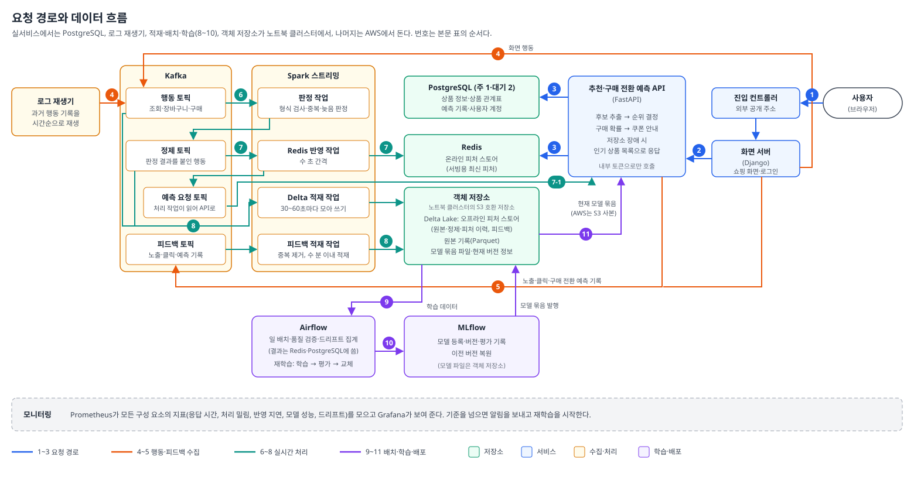

# 데이터 요구사항 정의서 — 전자상거래 실시간 상품 추천 MLOps 파이프라인

| 항목 | 내용 |
|---|---|
| 작성 | MLO 1기 5팀 PM 이여찬 |
| 기준일 | 2026-11-27 |
| 관련 요구사항 | 요구사항 정의서의 데이터 기능 요구사항(FR-DATA-01–08), 데이터 품질(NFR-12–16), 재현성(NFR-17·19) |

## 1. 목표와 범위

### 1.1 목적

**추천과 구매 전환 예측에 필요한 데이터를 실시간과 학습 양쪽에 같은 값으로 공급**

- 사용자 행동을 몇 초 안에 실시간 피처에 반영
- 학습·평가에는 예측 시점까지의 정보와 확정된 정답만 사용
- 같은 행동은 한 번만, 빠짐없이 저장하고 다시 처리해도 같은 결과
- 학습에 쓴 데이터를 고정해 같은 학습을 다시 할 수 있게 보존

### 1.2 범위

| 구분 | 내용 |
|---|---|
| 원천 데이터 | 공개 쇼핑몰 행동 로그(REES46) 2019년 10–12월 |
| 시스템이 만드는 데이터 | 화면 행동, 노출·클릭 로그, 재생 추천 결과 기록, 구매 전환 예측 기록, 장바구니 |
| 처리 | Kafka 수집 → Spark 판정·실시간 반영 → Redis·Delta Lake 저장 → Airflow 일 배치 |
| 다루지 않는 것 | 검색 로그, 상품명·설명, 결제 정보, 화면 사용자 행동으로 하는 학습 |

### 1.3 데이터 쓰임

데이터는 크게 추천, 구매 전환 예측, 모니터링에 쓰인다. 두 모델은 같은 행동 기록과 같은 세션 규칙에서 출발하고, 모니터링은 두 모델이 남긴 기록으로 성능과 데이터 변화를 본다. 쿠폰 안내와 대체 추천은 두 모델에 딸린 쓰임이다.

| 쓰는 곳 | 실시간에 읽는 데이터 | 학습·평가에 쓰는 데이터 | 남기는 데이터 |
|---|---|---|---|
| 추천 | 세션 피처, 사용자 구매 이력, 상품 관계표, 상품 정보 | 정제 행동, 피처 이력, 같은 세션의 이후 구매 | 노출·클릭 로그, 재생 추천 결과 기록 |
| 구매 전환 예측 | 예측 요청에 실린 입력 6개 | 최근 행동 5개 목록, 예측별 구매 정답 | 예측 기록 |
| 쿠폰 안내 | 현재 세션 기록, 예측 기록 | 해당 없음 | 쿠폰 안내 여부·시각 |
| 대체 추천 | 대체 인기 목록 | 해당 없음 | 노출 로그(대체 추천 표시) |
| 모니터링 | 처리 지연·밀림 지표 | 노출·클릭·예측 기록, 피처 분포 | 품질 검사 결과, 드리프트 지표 |

- 실시간에 읽는 곳(온라인 피처 스토어)은 Redis, 학습에 쓰는 곳(오프라인 피처 스토어)은 Delta Lake다. 두 곳은 같은 계산 함수로 채운다.
- 상품 정보, 상품 관계표, 예측 기록, 장바구니, 사용자 계정은 PostgreSQL에 둔다.

## 2. 데이터 흐름

행동은 Kafka를 거쳐 판정되고, 정제 토픽을 실시간 반영 작업과 Delta 적재 작업이 따로 읽는다. 실시간 경로는 수 초 안에 Redis를 갱신하고, 적재 경로와 일 배치가 학습 데이터를 만든다.

| 번호 | 흐름 | 데이터 |
|---|---|---|
| 4 | 재생기·화면 서버 → 행동 토픽 | 재생 행동, 화면 행동 |
| 5 | API → 피드백 토픽 | 노출·클릭·예측 기록 |
| 6 | 행동 토픽 → 판정 작업 → 정제 토픽 | 형식 검사, 중복·늦음 판정 결과 |
| 7 | 정제 토픽 → 실시간 반영 작업 → Redis | 실시간 피처(수 초) |
| 7-1 | 실시간 반영 작업 → 예측 요청 토픽 → 예측 요청 처리 작업 → 구매 전환 예측 API | 예측 대상 행동의 입력 6개, 예측 기록 저장 |
| 8 | 토픽 → 적재 작업 → Delta Lake | 원본·정제·피처 이력, 피드백(30–60초마다) |
| 9 | Delta Lake → Airflow | 일 배치 피처, 품질 검사, 드리프트 집계, 재학습 |
| 10 | Airflow → MLflow → 객체 저장소 | 학습 데이터 버전, 모델 묶음, 상품 관계표 |
| 11 | 객체 저장소 → API | 현재 모델 묶음(관계표·순위 모델·피처 정의를 한 묶음으로 교체·복원) |

- 실시간 반영과 Delta 적재는 서로 기다리지 않는다. 한쪽이 멈춰도 다른 쪽은 계속 돌고, 멈춘 쪽은 토픽에 남은 기록으로 이어서 처리한다. 판정 작업이 멈추면 두 경로가 함께 멈춘다.
- 구매 전환 예측은 예측 요청 토픽을 사이에 두어, 예측이 밀려도 실시간 피처 반영은 늦어지지 않는다. 토픽 쓰기 자체가 막히면 실시간 반영의 다음 배치가 늦어진다.
- 배치와 네트워크 구성은 시스템 아키텍처 구조도, 작업별 쓰기 규칙은 데이터 파이프라인·피처 스토어 설계서를 따른다.

## 3. 원천 데이터

원천 데이터는 공개 데이터셋인 REES46 종합몰 행동 로그의 2019년 10–12월 세 달이다. 10월은 학습, 11월은 실시간 재현, 12월은 최종 평가에만 쓴다.

### 3.1 규모

| 달 | 용도 | 행동 수 | 사용자 수 | 상품 수 | 구매 비율 |
|---|---|---|---|---|---|
| 2019-10 | 첫 학습과 개발 | 4,245만 | 302만 | 16.7만 | 1.75% |
| 2019-11 | 재생으로 실시간 상황 재현, 재생 중 재학습 | 6,750만 | 370만 | 19.1만 | 1.36% |
| 2019-12 | 두 모델 공통 최종 평가(학습·설정 선택에 쓰지 않음) | 6,754만 | 458만 | 20.5만 | 1.72% |

- 수치는 원본 전체를 센 실측값이다. 구매 비율은 전체 행동 중 구매 행동의 비율이다.
- 원본 크기는 세 달 CSV 24.0GB, Parquet(zstd 압축) 3.2GB다. 한 달씩 Parquet로 바꿔 보관한다.
- 11월 재생의 부하는 1분 평균 최대 초당 140건, 순간 최대 초당 243건이다(원본 시각 기준, 1배속).
- 개발 중에는 사용자 ID 해시로 고른 공용 표본을 쓴다. 누가 뽑아도 같은 사용자가 나오고 세 달에 걸쳐 이어지며, 작은 표본(0.5%)은 큰 표본(2%)에 모두 들어간다. 재생과 최종 평가는 전체 사용자로 한다.
- 11월 재생 전에 10월 말 상태(최근 7일 관심, 상품별 마지막 행동, 최근 30일 구매, 열린 세션)를 Redis에 적재한다. 재생 첫날부터 빈 상태가 아닌 실제와 같은 상태로 시작하기 위해서다.
- 원본을 다시 변환해도 행 수와 이벤트 ID가 같아야 한다.

### 3.2 필드

| 필드 | 뜻 | 쓰는 방식 |
|---|---|---|
| 행동 시각 | UTC 초 단위 | 재생 순서와 모든 시점 판단의 기준 |
| 행동 종류 | 조회, 장바구니 담기, 구매 | 장바구니 빼기는 원본에 없음 |
| 상품 ID, 카테고리 ID | 숫자 ID | 메시지·피처에서는 문자열 |
| 카테고리 이름, 브랜드 | 빈 값 있음 | 원본 값 그대로 저장 |
| 가격 | 통화 단위 없음 | 0은 가격 없음으로 봄 |
| 사용자 ID, 원본 세션 ID | 숫자 ID, 문자열 | 원본 세션 ID는 세션 구분에 쓰지 않음 |

자료형과 빈 값은 부록 A.1에 있다.

### 3.3 한계와 대응

| 한계 | 대응 |
|---|---|
| 행동 하나를 구별하는 ID가 없음 | 원본 파일 이름과 행 순번으로 이벤트 ID를 만듦 |
| 원본 세션 ID를 믿을 수 없음 | 같은 사용자의 행동 간격 30분 규칙으로 세션을 새로 나눔 |
| 상품명·설명이 없음 | 브랜드·카테고리·가격으로 표시명을 만듦 |
| 추천 노출 기록이 없음 | 같은 세션의 이후 구매로 평가하고, 화면 노출·클릭은 새로 기록 |
| 카테고리 이름 빈 행 32%, 브랜드 빈 행 14% | 카테고리는 이름 → ID → 알 수 없음, 브랜드는 알 수 없음 |
| 가격 0인 기록 25.7만 건 | 모델 입력에서 빈 값, 화면은 "가격 정보 없음" |
| 구매로 끝나는 세션이 일부 | 구매 전환 예측은 평균 정밀도(AP)로 평가 |
| 검색 로그가 없음 | 조회·장바구니·구매만으로 관심을 추정 |

- 빈 값과 가격 0의 수치는 10·11월 원본 실측이다. 원본 세션 ID는 서로 다른 사용자가 같은 값을 쓴 경우가 2,412개, 빈 행이 33건이다(세 달 실측).
- 빈 값과 가격 0의 비율은 데이터 품질 검증 보고서에 적는다.

## 4. 시스템이 만드는 데이터

원천 로그 외에 시스템이 실행 중에 만드는 데이터가 있다. 모든 기록에 출처를 붙여, 학습·평가에는 재생 출처만 쓴다.

### 4.1 출처

| 출처 | 만드는 쪽 | 학습·평가 사용 | 실시간 피처 반영 |
|---|---|---|---|
| 재생 | 로그 재생기(원본을 시간 순서대로 다시 보냄) | 사용 | 반영 |
| 화면 | 화면 서버(사람이 쇼핑 화면에서 한 행동) | 사용하지 않음 | 반영 |
| 부하 시험 | 부하 시험 도구 | 사용하지 않음 | 반영 |
| 시험 | 토픽을 거치지 않는 독립 시험 | 사용하지 않음 | 해당 없음 |

화면과 부하 시험 행동은 실시간 피처에 반영해 화면이 반응하게 하지만, 학습 데이터, 평가 구간, 드리프트 기준 분포, 일 배치 피처(상품 인기, 대체 인기 목록)에는 넣지 않는다.

### 4.2 종류

| 데이터 | 단위 | 만드는 쪽 | 저장 위치 |
|---|---|---|---|
| 행동 | 조회·담기·구매 한 건 | 재생기, 화면 서버, 부하 시험 도구 | 행동 토픽 → Delta 원본·정제 표 |
| 노출 로그 | 화면에 처음 보인 추천 카드 한 장 | 화면 서버 | 피드백 토픽 → Delta 피드백 표 |
| 클릭 로그 | 눌린 추천 카드 한 장 | 화면 서버 | 피드백 토픽 → Delta 피드백 표 |
| 재생 추천 결과 기록 | 표본 세션의 추천 응답 한 번 | 추천 API | 데이터 파이프라인 설계서에서 정함 |
| 예측 요청 | 예측 대상 행동 한 건 | 실시간 피처 반영 작업 | 예측 요청 토픽 → 예측 요청 처리 작업 |
| 예측 기록 | 구매 전환 예측 한 건 | 구매 전환 예측 API | PostgreSQL, 피드백 토픽 → Delta |
| 장바구니 | 담기·수량 변경·비우기 요청 | 화면 서버 | PostgreSQL |

- 모든 메시지는 JSON이고 스키마 버전, 출처, 재생 실행 ID, 시각 세 가지(행동 시각, 재생 시각, 실제 생성 시각)를 담는다.
- 노출 로그에는 추천 모델 버전, 대체 추천 여부, 실시간 피처 리비전(그 응답이 읽은 피처 값의 버전, 읽지 않았으면 빈 값)을 남긴다. 당시 입력으로 다시 평가하기 위해서다.
- 재생 추천 결과 기록은 실제로 화면에 보인 것이 아니라 추천이 내놓은 목록이다. 재생 데이터로 추천 품질을 평가하는 데 쓴다. 재생 세션 ID 해시로 고른 세션 10%만 남긴다(10배속에서 초당 약 127건).
- 예측 대상은 첫 구매 전의 조회·장바구니 행동이다. 화면·부하 시험은 전부, 재생은 세션 ID 해시로 고른 세션 10%만 예측한다. 11월 재생 한 번에 약 643만 건으로 추정한다.
- 예측 요청은 Kafka 쓰기 확인을 받은 뒤 Redis에 반영한다. 예측 요청 처리 작업은 예측 기록 저장이 확인된 요청까지만 읽은 위치를 넘긴다. 그래서 어느 단계에서 멈춰도 예측이 빠지지 않는다.
- 메시지 필드와 Delta 표 열은 부록 A에 있다. PostgreSQL 테이블 열은 DB 설계를 따른다.

## 5. 피처

피처는 계산 주기에 따라 실시간과 배치로 나눈다. 실시간 피처는 행동이 들어온 뒤 몇 초 안에 온라인 피처 스토어에 반영하고, 배치 피처는 재생 시각으로 하루에 한 번 계산한다.

### 5.1 실시간 피처

| 피처 | 단위 | 쓰는 곳 |
|---|---|---|
| 최근 본 상품 20개(같은 상품은 맨 앞으로) | 세션 | 추천 |
| 최근 조회·담기 5개(같은 상품 반복 보존) | 세션 | 구매 전환 예측 입력 6개 |
| 세션에서 본 카테고리·가격대, 카테고리 수 | 세션 | 추천 |
| 상품별 체류 시간(다음 행동까지, 마지막 행동은 빈 값) | 세션 | 추천 |
| 구매한 상품과 구매 시각(최근 30일) | 사용자 | 추천(최근 구매 상품 제외) |
| 현재 세션 기록(세션 ID, 구매 여부) | 브라우저·사용자 | 추천, 쿠폰 안내 |

- 구매 전환 예측 입력 6개는 행동 수, 연속 조회 수, 상품 전환 비율, 이전 상품 복귀, 행동 관계, 상품 패턴이다. 예측을 부른 행동까지 넣은 최근 행동 5개 목록 하나로 계산하며, 목록 형식은 최근 행동 목록 형식을 따른다.
- 추천 순위 모델의 피처 18개는 학습과 실시간에 같은 정의로 제공한다.
- 체류 시간은 다음 행동이 들어와야 알 수 있으므로, 예측 시점의 마지막 행동에는 값을 두지 않는다.

### 5.2 배치 피처

| 피처 | 단위 | 기간 | 쓰는 곳 |
|---|---|---|---|
| 선호 카테고리·브랜드 | 사용자 | 최근 30일 | 추천 |
| 상품 인기, 구매 전환율 | 상품 | 최근 1일·7일 | 추천 |
| 상품 관계표(상품 기반 협업 필터링) | 상품 쌍 | 최근 30일, 7일마다 새로 만듦 | 추천 후보 |
| 시점별 상품 정보 | 상품 | 바뀐 시점마다 | 화면, 추천 이유 |
| 대체 인기 목록(고유 구매자 수 순위) | 전체·카테고리 | 최근 7일 | 저장소 장애 때 대체 추천 |

- 상품 관계표는 PostgreSQL에 버전별로 두고, 대체 인기 목록은 S3에 파일로 둔다. 형식은 대체 인기 목록 파일 형식을 따른다.
- 사용자·상품 배치 피처를 피처 스토어 도구 Feast로 관리할지는 11-27 판정으로 정한다. 쓰지 않으면 같은 키 규칙으로 직접 구현한다.

### 5.3 두 저장소 일치

| 규칙 | 내용 |
|---|---|
| 계산 함수 | 실시간·배치·학습이 같은 기준 함수(다른 구현은 같은 값인지 시험) |
| 시각 세 가지 | 이벤트 시각, 기준 시각, 사용 가능 시각을 피처마다 남김 |
| 학습 때 붙이기 | 사용 가능 시각이 예측 시각보다 앞선 값만 붙임 |
| 버전 | 배치 피처는 정의 버전을 키에 넣음. 실시간 정의는 한 재생 실행 동안 고정 |
| 이력 | 실시간 피처가 바뀔 때마다 Delta 피처 이력에 남김 |
| 읽는 방법 | 서비스는 온라인 피처 읽기 라이브러리로만 읽음(값·기준 시각·리비전) |

## 6. 학습·평가 데이터

학습·평가 데이터는 재생 출처의 정제 행동으로 만들고, 예측 시점 뒤의 정보와 확정되지 않은 정답은 쓰지 않는다. 기준 시계는 실제 시각이 아니라 기록 속 시각(재생 시각)이다.

### 6.1 정답

| 모델 | 예측 단위 | 정답 | 정답 확정 |
|---|---|---|---|
| 추천 | 추천 요청 한 번의 후보 상품 | 요청 뒤 같은 세션 안에서 그 상품을 샀으면 1 | 세션 종료 뒤 |
| 구매 전환 예측 | 첫 구매 전 조회·담기 한 건 | 같은 세션에서 그 뒤 구매가 있으면 1, 없이 끝나면 0 | 세션 종료 뒤 |

- 세션은 출처·재생 실행·세션 키(재생은 사용자 ID, 화면·부하 시험은 브라우저 세션 값)가 같은 행동을 30분 규칙으로 나눈다. 마지막 행동 뒤 30분을 넘게 행동이 없으면 끝나고, 정확히 30분 뒤의 행동은 같은 세션이다. 늦게 오거나 중복된 행동은 세션을 열거나 늘리지 않는다.
- 정답은 세션이 끝나고 그 시각까지의 기록 처리가 끝났음을 확인한 뒤 확정한다. 데이터 쪽이 세션 결과 표, 예측별 정답 표, 추천 평가용 "요청 뒤 같은 세션에서 산 상품" 표를 만든다.
- 정답이 확정되지 않은 세션(재생이 끝날 때 열려 있던 세션, 평가 구간 경계를 넘은 세션)은 학습과 평가 분모에서 뺀다.
- 첫 구매와 같은 시각의 행동, 관측 시작 직후라 앞 기록이 모자란 행동은 제외로 표시하고 정답 0과 구분한다.

### 6.2 시점 규칙

| 대상 | 규칙 |
|---|---|
| 실시간 피처 | 예측을 부른 행동까지만 반영 |
| 같은 시각의 행동 | 정해진 처리 순서(원본 행 순번, 토픽 위치)까지만 사용 |
| 배치 피처 | 사용 가능 시각이 예측 시각보다 앞선 값만 |
| 상품 관계표 | 요청 시점 이전 기록으로 만든 버전만 |
| 재학습 | 그 시점 재생 시각까지 들어온 데이터만 |

### 6.3 기간

| 구분 | 기간 | 쓰는 방식 |
|---|---|---|
| 첫 학습 | 2019-10 | 첫 모델 학습과 설정 선택 |
| 재생 중 재학습 | 2019-11, 재생 시각까지 | 같은 마감 시각까지의 데이터로 두 모델을 다시 학습 |
| 교체 판정 | 학습에 쓰지 않은 최근 구간 | 정답이 확정된 구간에서 현재 모델과 비교 |
| 최종 평가 | 2019-12 | 11월 재생을 마친 모델을 고정해 한 번 평가 |

- 학습에 쓴 Delta 표 버전, 마감 시각, 코드 버전, 지표를 모델마다 MLflow에 남긴다. Delta 과거 버전은 데이터 파일까지 프로젝트 기간 이상 보존하거나 학습용 사본을 고정해, 같은 학습을 다시 할 수 있게 한다.
- 추천은 같은 세션의 이후 구매로 NDCG@10과 Recall@10(상위 10개 안의 구매 적중)을 본다. 구매 전환 예측은 세션마다 같은 무게를 준 평균 정밀도(AP)를 본다.
- 모델 교체는 두 모델 모두 학습에 쓰지 않은 확정 구간에서 현재 모델과 비교해, 개선이 우연한 차이가 아닐 때만 한다.

## 7. 품질 기준

데이터 품질은 "같은 행동이 한 번만, 빠짐없이, 정해진 순서로 두 저장소에 같은 값으로 들어간다"를 기준으로 본다. 중복·늦음·스키마는 실시간 판정 단계에서 행동마다 표시하고, 분포와 정합성은 일 배치의 품질 검사(Soda Core)에서 본다. 일 배치 검사가 실패하면 뒤따르는 피처 공개와 재학습을 멈추고 알림을 낸다.

| 항목 | 기준 | 처리 | 요구사항 |
|---|---|---|---|
| 중복 | 한 재생 실행 안에서 같은 이벤트 ID는 한 번만 반영 | 중복으로 표시, 피처에 반영하지 않음 | NFR-12 |
| 누락 | 강제 종료·재시작 뒤 빠지거나 겹친 이벤트 0건 | 실행 범위 안에서 이벤트 ID별 건수 대조 | NFR-12 |
| 늦은 도착 | 허용 지연을 넘거나 세션 순서를 거스르면 늦음 | 늦음으로 표시, 피처에 반영하지 않음 | FR-DATA-02 |
| 스키마 | 필수 필드, 자료형, 허용 값 | 스키마 오류로 표시, 원본에는 남김 | FR-DATA-06 |
| 두 저장소 일치 | 표본 키의 온라인 값과 다시 계산한 값 100% 일치 | 같은 리비전의 이력이 적재된 뒤 대조 | NFR-13 |
| 모델 입력 일치 | 같은 피처에서 학습·서비스의 입력이 같음 | 공용 전처리 함수를 모델 묶음에 포함 | NFR-15 |

- 판정 단계는 이벤트를 버리지 않고 판정 결과(통과·중복·늦음)를 붙여 모두 남긴다. 원본 표에는 판정 전 모든 이벤트가 남는다.
- 수만 세지 않고 이벤트 ID별 건수로 대조한다. 수만 세면 빠진 하나와 겹친 하나가 서로 상쇄된다.
- 새 재생 실행에서 같은 원본 행이 다시 나오는 것은 중복이 아니다. 대조는 재생 실행 단위로 한다.
- 예측 시점 이후 정보를 쓰지 않는 규칙(NFR-14)은 6.2절을 따른다.
- 빈 값 비율, 가격 0 비율, 세션 길이 분포도 매일 검사한다. 검사별 통과·실패와 실패 기준은 데이터 품질 검증 보고서(NFR-16)에 쌓는다.

## 8. 저장과 보존

데이터는 쓰임에 따라 다섯 곳에 둔다. 다시 만들 원본이 없는 데이터(화면 행동, 예측 기록, 장바구니, 사용자 계정)는 복제와 백업으로 지킨다.

| 저장소 | 담는 데이터 | 보존 |
|---|---|---|
| Kafka | 행동·정제·피드백·예측 요청 토픽 | 예상 장애 시간과 밀림 해소 시간보다 길게 |
| Redis | 실시간·배치 피처, 현재 세션 기록 | 세션 키는 세션이 끝나면 지움, 구매 이력은 30일 |
| Delta Lake | 원본·정제·피처 이력·피드백 표 | 과거 버전과 데이터 파일을 프로젝트 기간 이상 |
| PostgreSQL | 상품 정보, 상품 관계표, 예측 기록, 장바구니, 사용자 계정 | 하루 한 번 전체 백업 |
| S3·객체 저장소 | 원본 Parquet, 모델 묶음, 대체 인기 목록, DB 백업 | 게시한 버전은 덮어쓰지 않음 |

- Redis는 메모리가 가득 차면 쓰기를 거부하고 오래된 키를 자동으로 지우지 않는다. 사용량 70%·85%에서 알림을 낸다.
- PostgreSQL은 주 서버 1대와 대기 서버 2대로 둔다. 쓰기는 정상 대기 서버 한 대 이상이 받았다는 확인 뒤에 끝난다(동기 복제). 상품 정보와 관계표는 원본 파일로 다시 적재할 수 있다.
- Redis 값이 사라지거나 과거 상태로 돌아가면 Delta에서 다시 적재하고, 그 사이 빠졌을 수 있는 예측 요청도 다시 쓴다.
- 새 재생 실행은 실행 ID를 새로 받고 Redis 피처를 비운 뒤 시작한다. Delta와 예측 기록에는 실행 ID가 붙어 실행끼리 섞이지 않는다.

## 9. 개인정보

개인정보는 PostgreSQL 사용자 계정 테이블 한 곳에만 둔다. Kafka, Delta, Redis에는 내부 사용자 ID만 흐른다.

| 항목 | 규칙 |
|---|---|
| 계정 정보(아이디, 비밀번호) | PostgreSQL 사용자 계정 테이블에만 |
| 화면 계정의 행동 분석 | 분석에 동의한 계정만 |
| 분석에서 빼는 계정 | 동의하지 않은 계정, 팀 시험 계정, 삭제 요청 계정, 지운 계정 |
| 계정 삭제 | 지운 계정 번호를 남겨 Delta의 과거 행동도 분석에서 뺌 |
| 로그인하지 않은 사용자 | 브라우저 세션 값으로만 구분, 분석에 쓰지 않음 |

원천 데이터에는 계정 정보가 없고 사용자 식별 번호만 있다. 학습·평가는 재생 데이터만 쓰므로 화면 계정의 행동은 학습에 들어가지 않는다. 로그인 기능은 중간 발표 뒤에 만든다.

## 부록 A. 데이터 사전

ID는 모두 문자열, 시각은 모두 UTC다. 메시지의 시각은 ISO 8601 문자열로 밀리초까지 쓴다(예: `2019-11-01T00:00:03.000Z`).

### A.1 원천 로그

| 필드 | 자료형 | 빈 값 | 뜻 |
|---|---|---|---|
| `event_time` | 시각(초 단위) | 없음 | 행동 시각 |
| `event_type` | 문자열 | 없음 | `view`, `cart`, `purchase` |
| `product_id` | 정수 | 없음 | 상품 ID |
| `category_id` | 정수 | 없음 | 카테고리 ID |
| `category_code` | 문자열 | 있음(32%) | 카테고리 이름(예: `electronics.smartphone`) |
| `brand` | 문자열 | 있음(14%) | 브랜드 |
| `price` | 실수 | 없음(0 있음) | 가격. 통화 단위 없음 |
| `user_id` | 정수 | 없음 | 사용자 ID |
| `user_session` | 문자열 | 있음(33건) | 원본 세션 ID. 세션 구분에 쓰지 않음 |

빈 값 비율은 10·11월 원본 기준이다. 변환할 때 원본 파일 이름(`source_file`)과 0부터 세는 행 순번(`source_row`)을 붙이고, 둘을 이은 값이 이벤트 ID다.

### A.2 행동 메시지

재생기, 화면 서버, 부하 시험 도구가 행동 토픽에 보내는 메시지다. 메시지 키는 재생이면 사용자 ID, 화면·부하 시험이면 메시지 세션 값이다.

| 필드 | 자료형 | 필수 | 뜻 |
|---|---|---|---|
| `schema_version` | 문자열 | 예 | 형식 버전. 지금은 `"1"` |
| `event_id` | 문자열 | 예 | 이벤트 ID. 중복 판정 키 |
| `source` | 문자열 | 예 | `replay`(재생), `web`(화면), `loadtest`(부하 시험) |
| `replay_run_id` | 문자열 | 재생만 | 재생 실행 ID |
| `event_type` | 문자열 | 예 | `view`, `cart`, `purchase` |
| `event_time_utc` | 시각 | 예 | 행동 시각. 재생은 원본 시각, 화면·부하 시험은 받은 순간의 재생 시각 |
| `replay_time_utc` | 시각 | 예 | 메시지를 만든 순간의 재생 시각 |
| `produced_at_utc` | 시각 | 예 | 메시지를 만든 실제 시각 |
| `sequence` | 정수 | 예 | 같은 세션 값 안의 순서. 재생은 원본 행 순번 |
| `source_file`, `source_row` | 문자열, 정수 | 재생만 | 원본 파일 이름과 행 순번 |
| `user_id` | 문자열 | 아니오 | 사용자 ID. 로그인하지 않은 사용자는 `null` |
| `raw_session_id` | 문자열 | 아니오 | 생산자가 보낸 세션 값 |
| `product_id`, `category_id` | 문자열 | 예 | 상품 ID, 카테고리 ID |
| `category_code`, `brand` | 문자열 | 아니오 | 카테고리 이름, 브랜드 |
| `price` | 실수 | 예 | 가격 |

출처별 ID 규칙:

| 출처 | 이벤트 ID | 순서 번호 | 세션 값 |
|---|---|---|---|
| 재생 | `원본 파일명:행 순번` | 원본 행 순번 | 원본 세션 ID |
| 화면 | `web:` + 브라우저가 만든 UUID | 브라우저가 1부터 매김 | `web-` + 분석용 세션 ID |
| 부하 시험 | `load:` + 시험 실행 ID + 생성 순번 | 생성 순번 | `load-` + 시험 실행 ID + 세션 번호 |

판정 작업은 이 메시지에 아래 필드를 더해 정제 토픽에 쓴다.

| 필드 | 자료형 | 뜻 |
|---|---|---|
| `behavior_partition`, `behavior_offset` | 정수 | 행동 토픽에서 읽은 위치 |
| `session_id` | 문자열 | 30분 규칙 세션 ID(그 세션 첫 통과 행동의 이벤트 ID) |
| `judge_result` | 문자열 | `passed`(통과), `late`(늦음), `duplicate`(중복), `schema_error`(형식 오류) |
| `judge_run_id`, `judge_batch_number` | 문자열, 정수 | 판정 작업 실행 ID와 배치 번호 |
| `judged_replay_time_utc` | 시각 | 판정 배치의 처리 재생 시각 |

### A.3 피드백 메시지(노출·클릭·예측)

세 종류가 피드백 토픽 하나에 들어가고 `log_type`으로 나눈다.

공통 필드:

| 필드 | 자료형 | 필수 | 뜻 |
|---|---|---|---|
| `schema_version` | 문자열 | 예 | 형식 버전 |
| `log_id` | 문자열 | 예 | 중복 제거 키. 다시 보내도 같은 값 |
| `log_type` | 문자열 | 예 | `impression`(노출), `click`(클릭), `prediction`(예측) |
| `request_id` | 문자열 | 노출·클릭 | 한 추천 응답의 노출·클릭을 잇는 값 |
| `source` | 문자열 | 예 | 행동 메시지의 세 값과 `test`(예측만) |
| `replay_run_id` | 문자열 | 아니오 | 재생 실행 ID |
| `event_time_utc`, `replay_time_utc`, `produced_at_utc` | 시각 | 예 | 행동 메시지와 같은 뜻 |
| `user_id`, `raw_session_id` | 문자열 | 행동 메시지와 같음 | 행동 메시지와 같은 규칙 |

노출·클릭 필드:

| 필드 | 자료형 | 노출 | 클릭 | 뜻 |
|---|---|---|---|---|
| `impression_id` | 문자열 | 예 | 예 | 노출 ID. 클릭은 눌린 카드의 노출 ID |
| `prediction_id` | 문자열 | 아니오 | 아니오 | 함께 보인 구매 전환 예측 ID |
| `product_id` | 문자열 | 예 | 예 | 보이거나 눌린 상품 |
| `position` | 정수 | 예 | 예 | 목록 위치(1부터) |
| `rec_model_version` | 문자열 | 예 | 아니오 | 추천 모델 버전. 대체 추천이면 인기 목록 버전 |
| `is_fallback` | 불 | 예 | 아니오 | 대체 추천이면 `true` |
| `feature_revision` | 문자열 | 아니오 | 아니오 | API가 읽은 실시간 피처 리비전 |
| `feature_as_of_utc` | 시각 | 예 | 아니오 | 배치 피처 기준 시각 |

예측 필드(주요 항목, 전체 열은 DB 설계의 예측 기록 표와 같다):

| 필드 | 자료형 | 뜻 |
|---|---|---|
| `prediction_id` | 문자열 | 예측 ID(`log_id`와 같음) |
| `session_id` | 문자열 | 30분 규칙 세션 ID |
| `event_id`, `event_type`, `sequence` | 문자열, 문자열, 정수 | 예측을 부른 행동 |
| `input_event_id`, `input_time_utc` | 문자열, 시각 | 입력에 들어간 마지막 행동(늘 예측을 부른 행동) |
| `input_version`, `inputs` | 문자열, 객체 | 입력 계산 규칙 버전, 입력 6개 |
| `feature_revision` | 문자열 | 예측 요청에 실린 피처 리비전 |
| `status`, `reason` | 문자열 | `ok`(정상) 또는 `invalid_input`(입력 오류)과 사유 |
| `purchase_probability` | 실수 | 구매 확률(0–1). 정상일 때만 값 |
| `conversion_model_version` | 문자열 | 구매 전환 예측 모델 배포 버전 |
| `coupon_eligible`, `coupon_rule_version` | 불, 문자열 | 쿠폰 조건 충족 여부와 규칙 버전 |
| `coupon_shown`, `coupon_shown_at_utc` | 불, 시각 | 쿠폰을 응답에 실었는지와 그 시각 |
| `label_version` | 문자열 | 정답 연결 규칙 버전 |

### A.4 Delta 표

| 표 | 한 행 | 열 |
|---|---|---|
| 원본(`behavior_raw`) | 행동 토픽 메시지 한 건 | A.2 행동 메시지 전체 + 행동 토픽 위치 + 적재 시각 |
| 정제(`behavior_clean`) | 정제 토픽 메시지 한 건 | A.2 정제 필드까지 전체 + 정제 토픽 위치 + 적재 시각 |
| 실시간 피처 이력(`feature_history`) | 판정을 통과한 행동 한 건 | 아래 표 |
| 피드백(`feedback_raw`) | 피드백 메시지 한 건 | A.3 전체 + 피드백 토픽 위치 + 적재 시각 |

실시간 피처 이력은 그 행동을 반영한 직후의 세션 상태를 남긴다.

| 묶음 | 열 |
|---|---|
| 키 | `replay_run_id`, `session_id`, `feature_version`(피처 정의 버전), `feature_revision`(피처 리비전) |
| 위치·행동 | `behavior_partition`, `behavior_offset`, `event_id`, `event_time_utc`, `user_id` |
| 최근 목록 | `recent_products`(최근 본 상품 20개), `recent_actions`(최근 조회·담기 5개) |
| 개수·시간 | `view_count`, `cart_count`, `repeat_view_count`, `category_count`, `elapsed_ms` |
| 분포 | `category_ids`, `price_bands`, `dwell_mean_ms`, `dwell_max_ms` |
| 시각 | `hour_of_day`, `day_of_week` |

- 위치는 그 행을 읽은 Kafka 토픽의 파티션과 오프셋이고, 적재 시각(`ingested_at_utc`)은 Delta에 쓴 실제 시각이다.
- 사용자·상품 배치 피처 표는 Feast 사용 판정 뒤에 정한다.
- 정답 표(세션 결과, 예측별 정답, 추천 평가용 이후 구매)의 열은 학습 데이터를 만들 때 데이터 담당이 정한다.
