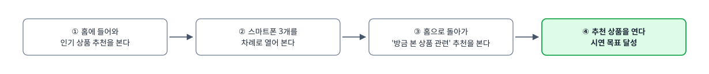
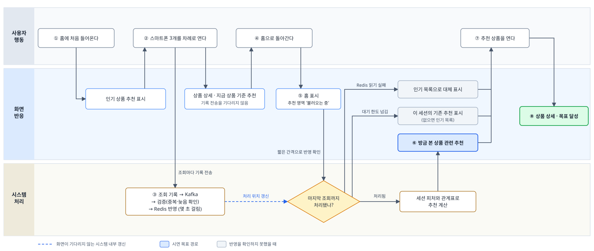
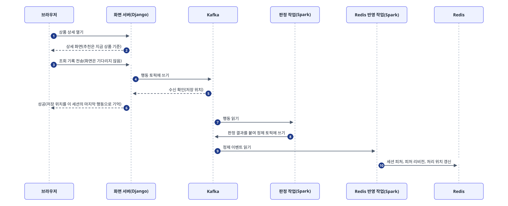
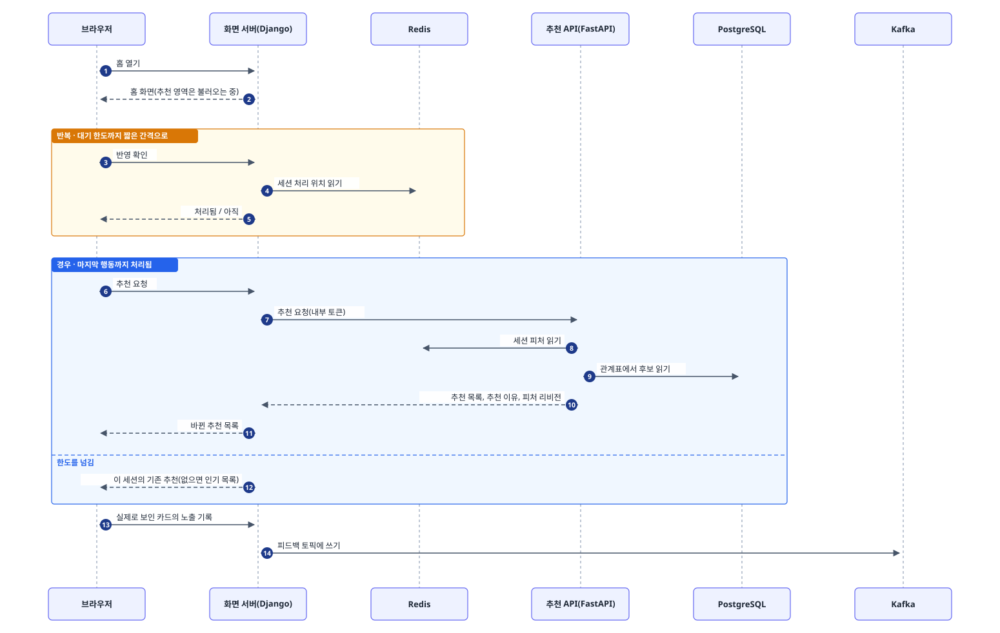

# 사용자·시스템 흐름도 (초안)

## 1. 누가 왜 들어오나

로그인하지 않은 처음 온 사용자가 스마트폰을 사려고 쇼핑몰에 들어온다. 데모 화면은 상품을 브랜드·카테고리·가격으로 보여 준다.

- **시작:** 사용자가 쇼핑몰 홈에 들어와 인기 상품 추천을 본다.
- **끝:** 스마트폰 3개를 본 뒤 홈으로 돌아가, 그 조회를 반영한 추천 목록에서 상품 하나를 연다.

이 흐름은 중간 발표 기준인 "새 사용자가 상품 3개를 보면 추천 목록이 바뀐다"를 시연하는 길이다. 추천 품질은 이 흐름이 아니라 따로 정한 지표로 평가한다.

## 2. 사용자 행동 순서

화면 이름은 아직 붙이지 않는다.

②에서 두 번째·세 번째 스마트폰은 목록이나 상품 상세의 '함께 본 상품'에서 연다.

**설명할 때 던질 질문:** "③에서 방금 본 스마트폰과 관련된 상품이 하나도 없다면, 시연은 성공했나요?" 답은 '아니요'다. 그래서 흐름은 처음과 달라진 추천을 확인하고 그중 하나를 여는 ④까지 간다.

- 장바구니 담기는 이 흐름에 넣지 않는다. 담기도 추천을 바꿀 수 있으므로, 넣으면 "조회 3개만으로 바뀌었는지"를 가릴 수 없다. 담기는 같은 흐름의 다음 시연에서 따로 보여 준다.
- 처음 홈의 인기 추천에 스마트폰이 이미 많으면 차이가 잘 안 보인다. 시연할 상품 3개는 실제 모델로 목록이 달라지는 것을 확인해 미리 고른다.

## 3. 화면 경계를 그을 때의 출발점

화면 경계는 서비스 담당이 정한다. 아래는 사례 조사에서 나온 출발점이다.

| 기준 | 내용 |
|---|---|
| 추천이 바뀌는 시점 | 보고 있는 화면은 그대로 두고 다음 화면을 열 때 바꾼다(결정 목록 34번) |
| 상품 상세의 추천 | 지금 보는 상품과 함께 많이 본 상품 |
| 홈·목록의 추천 | 이번 세션에서 본 상품·담은 상품 기준 |
| 장바구니 담기 | 페이지를 옮기지 않고 같은 화면에 작은 알림 |

## 4. 핵심 흐름 합의 뒤 덧붙일 것

- **쿠폰 안내(필수 기능):** 구매 전환 확률이 정한 구간에 들면 다음 화면을 열 때 세션당 한 번 표시. 탭이 여러 개여도 한 번이고, 받은 화면이 닫히면 다시 띄우지 않는다
- **장바구니 담기와 구매 버튼:** 결제 없는 구매 버튼, 구매한 상품을 다음 추천에서 빼기
- **화면 반응 그림(7장 시스템 흐름에 맞춤)**
  - 기록 전송 실패와 재전송
  - 홈을 열었을 때 마지막 조회가 아직 반영되지 않은 경우(한도까지 기다린 뒤 기존 추천)
  - 브라우저 뒤로 가기로 돌아온 경우
  - 저장소 장애 때 인기 상품으로 대체
- **로그인:** 중간 발표 뒤

## 5. 먼저 정해져 있어야 할 것

- 대기 한도를 넘겼을 때 보여 줄 기존 추천은 브라우저가 들고 있다(결정 목록 44번). 화면 서버가 여럿이어도 그대로 쓰고, 없으면 인기 목록을 보여 준다.
- 쿠폰은 반영 확인 뒤에 묻고, 대기 한도를 넘긴 화면에서는 묻지 않는다(결정 목록 44번). 다른 탭에서 산 직후에도 쿠폰이 뜨지 않도록, 구매를 처리한 화면 서버가 그 브라우저 세션 값에 "구매함"을 바로 표시하고 표시가 있으면 쿠폰을 묻지 않는다(결정 목록 47번).
- 세션 연결(결정 목록 40번): 화면 서버가 발급한 브라우저 세션 값이 행동 메시지의 키이고, 세션 도중 로그인해도 바뀌지 않는다. 30분 규칙의 세션 ID는 판정 작업이 만든다. 추천 API와 반영 확인은 Redis 반영 작업이 브라우저 세션 값마다 남긴 현재 세션 기록으로 현재 세션을 찾는다

## 6. 서비스 담당에게 부탁할 것

1. 위 행동 순서 위에 화면 경계를 긋고, 나눈 이유를 한 문장씩 적는다.
2. 화면마다 들어갈 정보와 버튼을 표로 적는다(완성 디자인이 아니라 스케치).
3. 핵심 흐름을 합의한 뒤 4장의 항목을 덧붙이고, 7장 시스템 흐름 위에 화면 반응을 맞춘다.

## 7. 시스템 흐름

사용자 행동 한 번에 시스템이 어떤 순서로 움직이는지 보여 준다. 이 장은 추천 경로만 그린다. 행동마다 남기는 구매 전환 예측과 쿠폰은 4장 항목과 함께 덧붙인다. 흐름은 둘로 나눈다. 행동을 기록하는 흐름(②의 상품 열기마다)과 다음 화면에서 추천을 받는 흐름(③)이다. 둘은 따로 돌고, 행동 기록 때문에 화면이 기다리지 않는다.

### 7.1 세 영역 흐름도: 조회 3개에서 바뀐 추천까지

**상황:** 로그인하지 않은 처음 온 사용자가 스마트폰 3개를 본 뒤 홈으로 돌아가 추천 상품을 열면 끝난다. 여기서는 **홈을 열면 왜 서로 다른 추천이 같은 자리에 나오는지** 확대해서 본다.

**화살표는 이렇게 읽는다.** ② 상품을 열 때마다 화면은 바로 상세를 보여 주고, 조회 기록은 뒤에서 시스템으로 간다(③) → ④ 홈으로 돌아가면 ⑤ 화면은 추천 자리에 "불러오는 중"을 띄우고 마지막 조회까지 처리됐는지 짧은 간격으로 묻는다 → 처리됐으면 ⑥ 방금 본 상품을 반영한 추천을, 대기 한도를 넘기면 기존 추천을, 저장소가 멈췄으면 인기 목록을 **같은 자리에** 보여 준다. 어느 경우든 사용자는 추천 상품을 열 수 있어 막다른 길이 없다.

**이 그림에서 화면 경계 정하기**

- **"불러오는 중"과 세 가지 결과는 같은 홈 화면이다.** 사용자는 같은 홈을 보고 있으니 추천 영역만 바꾼다.
- **상품 상세를 보는 동안에는 추천을 바꾸지 않는다.** 보고 있는 카드가 바뀌면 사용자가 누르려던 상품을 놓친다(결정 목록 34번).
- **목표 달성은 ⑥의 추천에서 상품을 열 때다.** 기존 추천이나 인기 목록에서 연 경우는 흐름은 이어지지만 시연 목표(조회 3개 반영)는 확인되지 않은 것으로 본다.

**그림에서 나오는 구현 정보**

- 화면을 만드는 사람: 추천 응답을 **바뀐 추천 / 기존 추천 / 대체 추천**으로 구분해 받고, 추천 영역에 "불러오는 중"을 둔다.
- 시스템을 만드는 사람: 반영 확인에 쓸 **처리 위치**와, 추천과 함께 **추천 이유·피처 리비전**을 돌려준다. 순서와 실패 처리는 7.2–7.4절에 있다.

### 7.2 행동 기록: 상품을 열 때마다

- 4–5번에서 Kafka가 실패하면 화면 서버는 실패로 답하고, 브라우저가 같은 이벤트 ID로 뒤에서 다시 보낸다. 사용자의 다음 동작은 막지 않는다.
- 7–10번은 몇 초 걸린다(반영 지연, 측정 뒤 목표를 정한다). 그사이 사용자가 다음 화면을 열 수 있으므로 7.3의 반영 확인이 필요하다.
- 판정에서 늦음·중복으로 나온 행동은 피처를 바꾸지 않는다. 그래도 처리 위치(판정을 마친 행동 토픽 위치)는 올라가므로 7.3에서 "처리됨"으로 확인되어 헛기다리지 않는다. 첫 행동이 걸러져 세션이 없어도 현재 세션 기록이 세션 ID 없이 만들어져 처리 위치가 올라간다(결정 목록 47번). 화면 서버는 처리 위치를 6번에서 받은 행동 토픽 위치와 비교한다.
- 정제 이벤트는 Delta 적재 작업도 읽어 Delta 표에 쌓는다. 이 경로는 화면 응답과 상관없어 그림에서 뺐다.

### 7.3 다음 화면에서 추천 받기: 홈으로 돌아갈 때

- 반영 확인은 Redis 값 하나만 읽는 짧은 요청이다. 화면 서버가 요청을 붙잡고 기다리지 않고, 브라우저가 짧은 간격으로 다시 묻는다.
- 브라우저는 아직 수신 확인을 못 받은 행동(전송 중·재전송 중)도 확인 대상에 넣는다. 세 번째 조회의 수신 확인이 오기 전에 홈을 열면, 두 번째 조회만 보고 반영 완료로 판단할 수 있기 때문이다.
- 뒤로 가기로 페이지가 복원되면 브라우저가 서버에 새 요청을 보내지 않을 수 있다. 그래서 브라우저가 복원을 감지해(`pageshow` 이벤트) 반영 확인부터 다시 시작한다.
- Redis를 읽지 못하면 기다리지 않고 바로 추천 API를 부른다. 추천 API가 대체 추천으로 응답한다(7.4).
- 보고 있는 화면의 카드는 바꾸지 않는다. 바뀐 목록은 이렇게 다음 화면을 열 때만 보인다(결정 목록 34번).
- 노출은 카드가 실제로 화면에 보인 시점에 기록하고, 클릭은 그 노출에 연결한다.

### 7.4 저장소가 멈췄을 때

| 멈춘 것 | 추천 응답 | 행동 기록 |
|---|---|---|
| Redis | 추천 API가 메모리의 인기 목록으로 대체 | 화면 서버가 재생 시계를 Redis에서 읽으므로 기록이 멈출 수 있음. 재적재 중에는 모든 행동 생산자를 멈춤 |
| PostgreSQL | 관계표 대신 인기 목록. 로그인을 막고 비로그인 응답 | 영향 없음 |
| Kafka | 추천은 계속(직전 피처 기준) | 행동·노출·클릭 기록 모두 실패 응답, 브라우저가 뒤에서 다시 보냄 |
| 판정·Redis 반영 작업 | 직전 피처로 응답 | Kafka에 쌓였다가 작업이 다시 뜨면 이어서 처리 |
| 구매 전환 예측 | 추천은 그대로, 확률과 쿠폰만 생략 | 영향 없음 |

- 어느 경우든 화면은 빈 칸이나 오류 대신 목록을 보여 준다. 대체 추천으로 응답한 비율은 지표로 센다.
