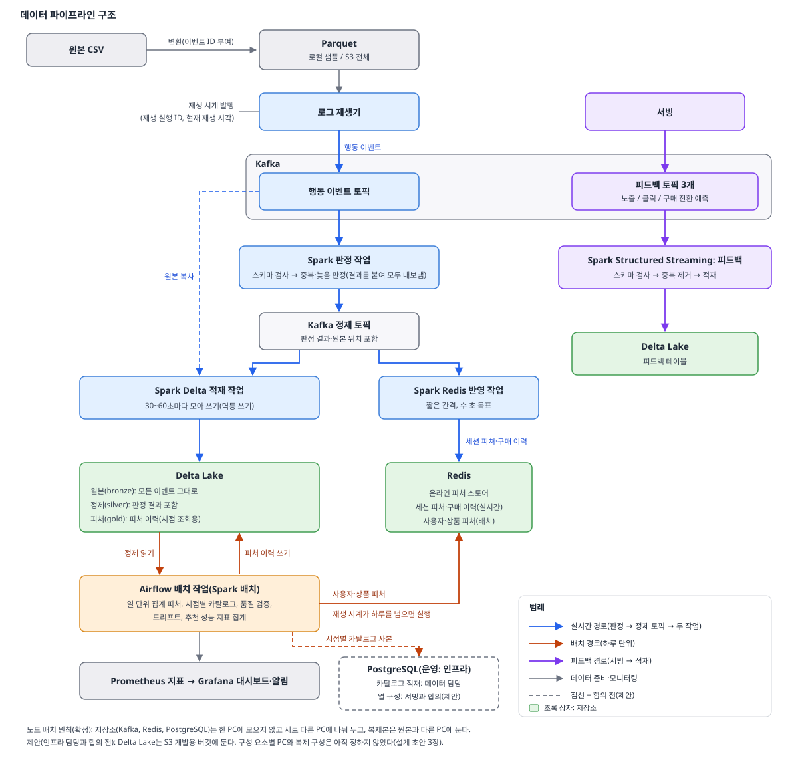
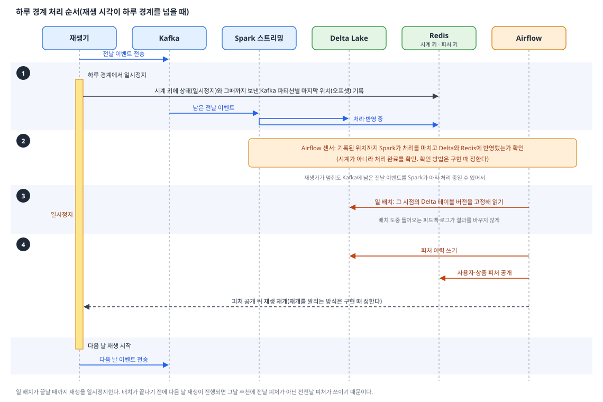
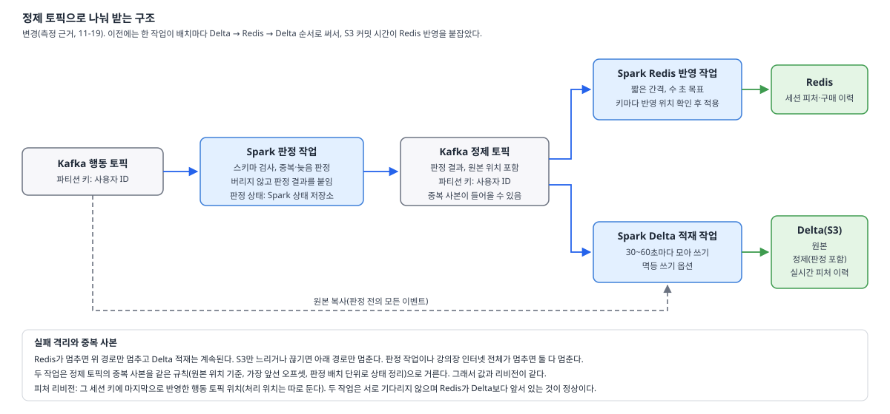

# 데이터 파이프라인·피처 스토어 설계서

전자상거래 실시간 상품 추천 MLOps 파이프라인 · MLO 1기 5팀 · 설계 결정·형식 합의: PM 이여찬 · 구현: 데이터 담당 이재원

- 양식: 「담당별 설계 과제 — 요구조건」 6장의 13개 항목. 이 담당의 핵심인 온·오프라인 일치를 4장으로 따로 뺐다. 양식 항목과의 대응: 1→1장, 2→2장, 3→3장, 4→5장, 5→6장, 6→7장, 7→8장(+4장), 8→9장, 9→10장, 10→11장, 11→12장, 12→13장, 13→14장
- 상태: 초안. 따로 밝히지 않은 수치는 측정 전 추정값이고, "제안"이라고 적은 값은 옆 담당과 합의해 확정한다.

## 1. 담당 범위 요약

공개 쇼핑몰 행동 로그를 실제 서비스에서 발생하는 것처럼 시간 순서대로 다시 흘려보내고(로그 재생), 이를 정제해 두 곳에 피처로 저장한다.
- 학습에 쓰는 오프라인 피처 스토어(Delta Lake)
- 추천 요청 시점에 바로 읽는 온라인 피처 스토어(Redis)

두 스토어가 같은 규칙으로 계산되고 서로 어긋나지 않게 하는 것(학습-서빙 불일치 방지)이 이 담당의 핵심이다. 그 밖에 데이터 품질 검증, 시점별 상품 카탈로그, 재생 시계(배속 재생 중의 "지금 몇 시인가")를 맡는다. 다른 담당이 만드는 PostgreSQL 테이블의 구조도 검토해 공통 데이터 규칙(시각 필드와 기준 시각, 버전 표기, ID 형식 등)을 지키는지 확인한다(검토만 하고, DB 운영은 인프라, 테이블 적재는 각 담당). 중간 발표 이후에는 데이터 드리프트 감지, 추천 성능 지표 집계, 서빙에서 돌아오는 피드백 로그 적재를 맡는다(준비는 4주 차, 제공은 5주 차). 엔드투엔드 흐름으로는 전체 통합과 데모 시나리오를 책임진다.

## 2. 구조

- 실시간 경로: 재생기 → Kafka(행동 토픽) → Spark 판정 작업 → Kafka(정제 토픽) → Spark Redis 반영 작업 → Redis(세션 피처). 세션 안의 행동을 몇 초 안에 반영한다. Redis 반영 작업은 구매 전환 예측 대상 행동마다 예측 요청을 Kafka(예측 요청 토픽)에 쓰고, 예측 요청 처리 작업이 이를 읽어 구매 전환 예측 API를 부른다.
- 적재 경로: 행동 토픽과 정제 토픽 → Spark Delta 적재 작업 → Delta(원본·정제·실시간 피처 이력). 30–60초마다 모아 쓴다(간격은 측정 뒤 확정). Redis 반영과 서로 기다리지 않는다(4장).
- 배치 경로: Delta(정제) → Airflow 위의 Spark 배치 → Delta(피처) → Redis(사용자·상품 피처). 하루 단위로 충분한 피처를 만든다.
- 카탈로그 사본(점선): 일 배치가 PostgreSQL 테이블로 넘긴다(제안). 적재는 데이터 담당, 열 구성은 서빙과 합의, DB 운영은 인프라.
- 배치: AWS(시험·발표 때만 켬)에 요청 경로와 실시간 갱신 작업(판정, Redis 반영)을 두고, Delta 적재·일 배치·재생기와 Delta는 강의장 노트북 클러스터에 둔다(설계 초안 부록 3장). 둘은 VPN으로 잇고, 실시간 갱신 경로는 AWS 안에서 끝나 인터넷을 건너지 않는다. 개발·시험·긴 재생은 노트북 클러스터에 전 구성을 올려 한다.
- 노드 배치: 노트북 클러스터(팀원 PC 5대)에서 저장소(Kafka, Redis, PostgreSQL)는 서로 다른 PC에 나눠 두고, 복제본은 원본과 다른 PC에 둔다(확정 원칙). 개발 단계의 Delta Lake는 가상 머신 준비 뒤 클러스터 위 S3 호환 저장소에 둔다(결정 목록 26번). 구성 요소별 PC와 복제 구성은 제안이다(인프라 담당과 합의 전, 설계 초안 부록 3장).
- 행동 토픽과 피드백 토픽은 스키마가 달라 처리 작업도 나눈다. 한쪽이 멈춰도 다른 쪽은 계속 돈다.
- 실시간과 배치는 같은 피처 계산 함수를 쓴다. 코드 계층은 설계 초안 부록 9장을 따른다.
  - 피처 계산 규칙: 공용 피처 패키지(도메인 계층만, 실시간·배치·학습이 함께 씀)
  - Kafka·Spark·Delta·Redis 연동, 온라인 피처 읽기 라이브러리: 인프라 계층
  - Spark·Airflow 작업 정의: 파이프라인 정의

## 3. 도구와 방식의 선택

| 영역 | 선택 | 검토한 대체재 | 고른 이유 |
|---|---|---|---|
| 로그 재생 | 직접 만든 파이썬 재생기 | NiFi, Kafka Connect 파일 커넥터 | 원래 기록의 시각 간격을 지키며 배속을 조절하고, 일시정지·재개와 재생 시계 발행이 필요하다. 대체재는 이 제어가 어렵다 |
| 메시지 큐 | Kafka(KRaft 모드. AWS는 브로커 3대·복제 계수 3, 노트북은 1대, 설계 초안 부록 3장) | Redpanda, Redis 스트림, AWS Kinesis | 지난 기록을 다시 읽어 재처리할 수 있고 Spark와의 연결이 가장 검증되어 있다. Kinesis는 로컬 개발이 어렵다. Redis 스트림은 Spark 연결이 약하다. 메모리가 모자라면 Kafka 호환인 Redpanda를 검토한다 |
| 스트림 처리 | Spark Structured Streaming | Flink, 파이썬 컨슈머 | 배치와 실시간 피처를 같은 코드로 계산할 수 있고, 협업 필터링도 Spark라 엔진이 하나로 맞는다. 약점은 마이크로 배치 방식이라 지연이 초 단위가 될 수 있다는 점이다. 목표를 못 맞추면 먼저 Spark 쪽을 조정한다(트리거 간격, 배치 크기, 파티션 수). 그래도 안 되면 지연 목표를 데모에 필요한 수준으로 다시 논의한다. 작업은 판정, Redis 반영, Delta 적재 셋으로 나눈다(4장). 판정 결과와 원본 위치가 정제 토픽에 실려 있으므로, Redis 반영 작업만 파이썬 컨슈머로 바꾸는 안은 이전보다 쉬워졌다. 그래도 미확정 대안으로 둔다(13장) |
| 테이블 포맷 | Delta Lake | Apache Iceberg, 일반 Parquet | Spark 스트리밍 쓰기, 과거 버전 조회(타임 트래블), 동시 쓰기 보호, 멱등 쓰기 옵션을 지원한다. Iceberg는 카탈로그 구성이 따로 필요하다. 일반 Parquet에는 버전 관리가 없다 |
| 테이블 계층 | 원본(bronze) → 정제(silver) → 피처(gold) 3단(메달리온 구조) | 원본과 피처 2단 | 정제 규칙이 바뀌어도 원본에서 다시 만들 수 있고, 품질 검증을 정제 단계에 걸 수 있다 |
| 온라인 스토어 | Redis | Valkey, DynamoDB | 최근 본 상품 목록 같은 자료 구조를 그대로 쓸 수 있고, 서버 안에서 여러 명령을 한 번에 처리하는 스크립트로 원자적 갱신이 된다. DynamoDB는 로컬 개발과 비용 관리가 번거롭다 |
| 피처 정의·동기화 | Feast(조건부, 사용자·상품 배치 피처에만), 안 되면 직접 구현 | Hopsworks | 배치 피처를 한 정의로 관리하고 시점 정합 조회(point-in-time join)를 제공한다. Spark 연동이 실험적 기능이라 1주 차에 시험하고 2주 차 말에 판정한다. 세션 피처(목록·조회 수·체류 시간)는 이전 상태에 새 이벤트를 더해 갱신하고, 재실행해도 두 번 더해지지 않게 Redis 서버 안에서 "반영 위치 확인 → 갱신 → 위치 기록 → 유효 기간 연장"을 한 번에 해야 한다(4.1절). Feast는 값 전체를 시각 비교로 덮어쓰는 방식이라 이 갱신을 할 수 없어 처음부터 Spark(Redis 반영 작업)가 직접 쓴다(3.3절). Feast의 푸시 경로로 지연은 맞출 수 있지만 갱신 방식 문제는 남는다 |
| 이벤트 형식 | JSON + 스키마 버전 필드 | Avro + 스키마 레지스트리 | 사람이 읽고 디버깅하기 쉽고 구성 요소가 늘지 않는다. 메시지 크기와 스키마 강제는 Avro가 낫지만 이 규모에서는 이점이 작다. 스키마 검사는 Spark 정제 단계에서 한다 |
| 품질 검증 | Soda Core | Great Expectations, 직접 작성 | 기본 규칙을 YAML로 간결하게 선언하고(일관성 규칙은 SQL) 설정이 가볍고, Spark 데이터를 검사해 통과·실패를 Airflow 관문으로 넘긴다. 결과는 Delta 표에 쌓고 12-04 보고서의 결과표를 거기서 만든다(내장 HTML 보고서가 없다). Great Expectations의 자동 HTML 보고서는 제출물(규칙 근거·결과 해석·대응을 쓰는 문서)을 대신하지 못하고, 분포 검사는 드리프트 감지가 맡는다. 결과 저장·보고서 표 작업이 더해지므로 작업량 절감은 12장 7단계 시험으로 확인하고 2주 차 말에 판정한다. 자동 보고서 화면이 요구되면 Great Expectations로 바꾼다 |
| 드리프트 감지 | Evidently | 직접 계산, NannyML | 보고서와 지표 내보내기를 함께 제공한다. 지표 한두 개만 필요하면 Spark로 직접 계산하는 것이 더 가볍다 |
| 배치 실행 | Airflow 위의 Spark 배치 | DuckDB, Polars | 세 달치(약 1억 7,750만 건)는 단일 PC 도구로도 처리되지만, 스트림 처리와 엔진·피처 코드를 하나로 맞추려고 Spark를 쓴다. 탐색용 분석은 DuckDB를 써도 된다 |

### 3.1 재생 시계와 재생 실행

배속 재생에서는 실제 시계와 데이터 속 시계가 다르다. 그래서 "데이터 속 지금"을 한 곳에서 정한다.
- 재생기가 재생 실행 ID(재생을 처음부터 다시 할 때마다 새로 발급)와 현재 재생 시각을 Redis의 시계 키에 주기적으로 쓴다. Prometheus 지표로도 낸다.
- Airflow 일 배치는 실제 자정이 아니라 재생 시각이 하루 경계를 넘을 때 실행한다. 순서는 다음과 같다.
  1. 재생기가 하루 경계에서 일시정지하고, 그때까지 보낸 Kafka 파티션별 마지막 위치(오프셋)를 시계 키에 남긴다.
  2. Airflow 센서는 시계가 아니라 "그 위치까지의 이벤트가 Delta와 Redis에 모두 반영됐는가"를 확인한다. 재생기가 멈춰도 Kafka에 남은 전날 이벤트를 Spark가 아직 처리 중일 수 있기 때문이다. 작업이 셋이라 두 단계로 본다(4.1절). 경계는 파티션별 위치 묶음이고, "마지막 레코드의 오프셋"이 아니라 "다음에 읽을 위치"로 적는다. ① 행동 토픽 경계 H: 재생기와 데모 화면 등 모든 행동 생산자가 멈춘 뒤의 행동 토픽 끝 위치. 판정 작업의 처리 완료 위치(체크포인트 기록)가 H에 닿고 그 배치가 끝났는지 본다. ② 그러면 정제 토픽에 더 쓰일 것이 없으므로, 그때의 정제 토픽 끝 위치가 경계 E다. Redis 반영 작업이 E까지, Delta 적재 작업이 E(정제 토픽)와 H(행동 토픽)까지 처리를 끝냈는지 각 작업의 진행 기록으로 본다. Redis 키의 반영 위치로는 판단하지 않는다(마지막 이벤트들이 모두 중복·늦음이면 키 위치가 E에 닿지 않는다). Delta 적재 간격(30–60초)만큼 일시정지가 길어진다.
  3. 일 배치는 그 시점의 Delta 테이블 버전을 고정해 읽는다. 배치 도중 들어오는 피드백 로그가 결과를 바꾸지 않게 하기 위해서다.
  4. 배치가 피처를 공개한 뒤 재생을 재개한다. 재생의 "끝" 신호도 같은 완료 확인을 거친 뒤 세션 확정 여부를 처리한다.

  

- 일 배치가 끝날 때까지 재생을 일시정지한다. 배치가 끝나기 전에 다음 날 재생이 진행되면 그날 추천에 전날 피처가 아닌 전전날 피처가 쓰인다. 일시정지를 감수하는 대신 규칙이 단순해진다. 일시정지 시간을 줄이는 방법(배속 낮추기, 배치 축소)은 3주 차 측정 뒤 정한다.
- 재생을 처음부터 다시 할 때: 새 재생 실행 ID를 발급하고, 세 Spark 작업의 체크포인트를 새 경로로 바꾸고, Redis 피처 키를 비운 뒤 시작한다. Spark의 Kafka 읽기는 새 체크포인트에서 기본으로 "최신 위치부터" 읽고, 기존 체크포인트로 재시작할 때는 시작 위치 설정을 무시한다. 그래서 새 실행을 시작할 때 행동·정제 토픽의 파티션별 시작 위치를 시계 키에 기록하고, 세 작업이 그 위치부터 읽도록 명시한다. 혹시 섞여 들어온 이전 실행의 메시지는 상태를 갱신하기 전에 재생 실행 ID로 거른다. Delta 테이블에는 재생 실행 ID 컬럼을 두어 실행끼리 섞이지 않게 한다. 이전 실행의 값이나 중복 표식이 새 실행을 막지 않게 하기 위해서다.
- 재생이 끝나면 재생기가 "끝" 신호를 보낸다. 그때까지 끝나지 않은 세션은 "확정되지 않음"으로 표시한다(정답을 확정할 수 없는 세션, 설계 초안 부록 5.1·5.2절).

### 3.2 피처의 세 가지 시각과 피처 이력

피처 값 하나에 시각 세 개를 남긴다. 시각이 하나뿐이면, 학습할 때 당시에는 아직 쓸 수 없던 값이 붙는다.

| 시각 | 뜻 | 예 |
|---|---|---|
| 이벤트 시각 | 그 행동이 일어난 데이터 속 시각 | 11-04 23:59:50 조회 |
| 기준 시각 | 어느 시점까지의 기록으로 계산했는가 | 11-04 24:00까지의 인기 |
| 사용 가능 시각 | 그 값이 온라인 스토어에 실제로 들어간 재생 시각. 실시간 피처는 Redis 반영 작업이 쓸 때의 재생 시각이다. 판정 작업의 처리 재생 시각(결정적 계산용)과 다르다. Redis 반영이 밀리면 더 늦어지기 때문이다 | 11-05 00:05에 적재 |

- 정의 버전과 리비전을 나눈다. 정의 버전은 계산 규칙이 바뀔 때 올리는 번호다. 리비전은 같은 규칙으로 새로 계산할 때마다 바뀌는 번호다. 배치 피처는 기준 시각이다. 실시간 피처는 아래 두 값을 둔다(서빙 확인 11-27). 둘 다 행동 토픽 위치이고 `실행ID:파티션:오프셋`으로 적는다. 배치와 실시간의 리비전을 섞어 쓰지 않는다. Spark 배치 번호는 쓰지 않는다. Redis 반영 작업과 Delta 적재 작업의 배치 번호가 서로 달라 두 저장소에 공통인 기준이 될 수 없기 때문이다.
  - 피처 리비전(`feature_revision`): 그 세션 키의 피처에 마지막으로 반영한 통과 이벤트의 행동 토픽 위치. 통과 이벤트가 없는 세션은 비어 있다(null). 예측 로그에 남겨 피처 이력을 찾는다. 시연 점검도 실제 추천 응답이 읽은 이 값으로 한다.
  - 처리 위치(`processed_position`): 같은 실행·세션·행동 파티션에서 판정을 마친(통과·늦음·중복) 결과를 앞선 것까지 빠짐없이 기록한 마지막 위치. 관측한 최대값이 아니다. 화면의 반영 확인(5장)에 쓴다. 보장 범위는 세션 피처까지이고, 사용자 구매 키 쓰기는 따로 다룬다.
  - 행동 토픽 위치를 쓰는 이유: 판정 재실행으로 생긴 정제 토픽 사본은 원본 위치가 같아 위치 비교로 걸러진다. 화면 서버가 Kafka 수신 확인으로 받은 위치와 바로 비교할 수 있다. 값을 하나만 두면 늦음·중복 위치에 해당하는 피처 이력 행이 없어 예측 로그와 이력이 어긋난다.
  - 한 세션의 이벤트는 행동 토픽과 정제 토픽에서 각각 한 파티션에 있다(메시지 키 규칙, 결정 목록 40번). 화면·부하 시험은 로그인 여부와 상관없이 브라우저 세션 값(`raw_session_id`)을 키로 쓰므로, 세션 도중 로그인해도 이 성질이 지켜진다. 판정과 반영을 오프셋 순서대로 하므로(4.1절) 피처 리비전은 반영 범위를, 처리 위치는 판정 범위를 나타낸다.
- 피처 이력 테이블(피처 계층)의 키: 재생 실행 ID + 대상 ID(세션·사용자·상품) + 정의 버전 + 리비전. 새 재생 실행은 정제 토픽 기록이 새로 쌓이므로 실행 ID가 키에 있어야 실행끼리 섞이지 않는다.
- 실시간 피처는 정제 이벤트로부터 결정적으로 다시 만들 수 있게 한다. 정제 토픽의 메시지마다 재생 실행 ID, 판정 실행 ID와 판정 배치 번호, 늦음·중복 판정 결과, 처리 재생 시각, 원본 행동 토픽의 위치(파티션, 오프셋)를 싣는다. Delta 정제 표는 여기에 정제 토픽의 위치를 더해 저장한다. 두 위치가 다 있으므로 이력은 원본 위치(행동 토픽 위치)로 찾는다. 그러면 "피처 리비전이 X인 세션 값"은 그 세션의 정제 이벤트 중 판정을 통과하고 원본 위치가 X 이하인 것으로 언제든 같은 값으로 다시 계산된다. 실시간 피처 이력은 이 계산으로 채운다. 판정 결과가 Redis보다 먼저 Kafka에 남으므로, Redis가 유실돼도 이력은 정제 토픽에서 다시 만들 수 있다. 단, 정제 토픽의 보존 기간이 Delta 적재 작업의 최대 밀림보다 길어야 한다. 이력은 통과 이벤트마다 한 행(그 이벤트를 반영한 직후의 상태)씩 남긴다. Redis 반영 작업이 Delta 적재 작업보다 자주 돌기 때문이다. 이벤트마다 행을 남기면 Redis가 내놓은 어느 리비전이든 나중에 이력에서 찾을 수 있다. 단, Delta 적재가 그 위치까지 끝난 뒤의 이야기다. 그 전 30–60초 동안은 이력에 아직 없으므로, 학습 데이터와 피드백 로그를 이력에 붙이는 작업은 그 위치까지 적재가 끝난 것을 확인한 뒤 돈다. 계산은 매번 처음부터 하지 않는다. 직전까지의 이력 값에 이번 적재 분량의 통과 이벤트를 차례로 더하는 방식으로 하고, 처음부터 다시 계산하는 것은 복구와 점검 때만 한다. "직전 값"은 최신 표가 아니라 이 작업의 직전 배치가 커밋한 Delta 버전에서 읽는다. 이력 커밋은 성공했는데 체크포인트 기록 전에 죽으면, 재실행이 최신 표를 기준으로 삼아 같은 분량을 두 번 더할 수 있기 때문이다.
- 갱신 규칙은 하나만 둔다. 실시간 세션 피처의 기준은 파이썬 갱신 함수 하나(이전 상태 + 이번 배치의 통과 이벤트 → 새 상태)다. 피처 이력 계산은 이 함수를 그대로 쓰고, 처음부터 다시 계산(복구·점검)은 빈 상태에서 원본 위치(행동 토픽 오프셋) 순서대로 이 함수를 반복 적용한다. Redis 서버 안 스크립트(4.1절)는 Lua라 코드를 공유할 수 없으므로 이 함수를 옮겨 쓴 것으로 보고, 9장의 "갱신 규칙 동등성" 시험으로 두 구현의 결과가 같은지 확인한다. 갱신 규칙을 바꿀 때는 두 구현과 시험을 함께 고친다.
- 학습 데이터에 피처를 붙이는 규칙:
  - 서빙 로그가 있는 구간: 피처를 읽는 쪽이 실제로 읽은 피처 리비전을 피드백 로그에 남긴다(5.1절). 이 리비전으로 당시 값을 그대로 붙인다. 일시정지 중처럼 재생 시각이 같은 요청도 리비전으로 구별된다.
  - 서빙 로그가 없는 구간(예: 10월 초기 학습 데이터): 실시간 피처는 정제 이벤트 중 늦음·중복 판정을 통과한 것만 순서 키(이벤트 시각, 원본 순서, 동률이면 원본 위치)로 정렬해 예측 지점의 이벤트까지로 계산한다(예측 지점 이벤트를 포함할지는 구매 전환 예측 담당과 맞춘다). 배치 피처는 사용 가능 시각이 예측 지점의 이벤트 시각보다 이른 값 중 가장 최근 것을 붙인다. 같은 재생 시각에 공개된 값은 쓰지 않는 보수적 규칙이다. 위 예에서 11-05 00:01의 요청에는 새 인기 값(00:05 공개)이 아니라 그 전 값을 붙인다. 대가로 하루 경계 직후 몇 초의 예측은 전날보다 하루 더 묵은 값을 쓸 수 있다.
- 카탈로그와 함께 본 상품 집계표도 같은 방식으로 이력을 남긴다.

### 3.3 피처 목록과 계산 규칙(초안)

| 피처 | 단위 | 계산 경로 | 계산 규칙(제안) | 쓰는 곳 |
|---|---|---|---|---|
| 최근 본 상품 목록 | 세션 | 실시간 | 최근 20개. 상품 ID, 이벤트 시각, 체류 시간. 같은 상품을 다시 보면 맨 앞으로 옮긴다 | 추천 |
| 이번 세션에서 본 카테고리·가격대, 카테고리 수 | 세션 | 실시간 | 가격대는 카테고리 안 가격의 5분위 구간(구간 경계는 10월 데이터로 고정) | 추천, 구매 전환 |
| 조회 수, 장바구니 담은 수, 경과 시간 | 세션 | 실시간 | 같은 상품을 여러 번 봐도 조회마다 센다. 경과 시간은 세션 첫 행동부터 | 구매 전환 |
| 상품별 체류 시간의 평균·최댓값(추정값) | 세션 | 실시간 | 다음 행동까지의 시간. 상한을 넘으면 자르고, 마지막 행동은 값 없음 | 추천, 구매 전환 |
| 같은 상품을 다시 본 횟수 | 세션 | 실시간 | 세션 안에서 두 번째 조회부터 센다 | 구매 전환 |
| 시간대, 요일 | 세션 | 실시간 | 이벤트 시각에서 바로 계산 | 구매 전환 |
| 구매한 상품과 구매 시각 | 사용자 | 실시간 | 구매 이벤트마다 추가 | 추천(카테고리별 구매 상품 제외) |
| 선호 카테고리·브랜드, 카테고리별 평균 체류 시간 | 사용자 | 배치(일) | 최근 30일, 행동 종류별 가중 합계 상위 5개 | 추천 |
| 과거 구매 횟수, 구매 비율 | 사용자 | 배치(일) | 구매 비율 = 구매가 있던 세션 수 ÷ 전체 세션 수 | 구매 전환 |
| 상품 인기, 구매 전환율 | 상품 | 배치(일) | 인기는 최근 1일·7일 조회 수. 전환율 = 구매 수 ÷ 조회 수(조회가 적으면 전체 평균 쪽으로 보정) | 추천 |
| 함께 본 상품 집계표 | 상품 쌍 | 배치(일) | 최근 7일, 같은 세션 안에서 함께 본 쌍. 세션당 한 번만 센다. 상품마다 상위 50개 | 추천(베이스라인, 후보 생성) |
| 시점별 상품 카탈로그 | 상품 | 배치(일) | 카테고리 경로·브랜드·가격(기간 내 마지막 값)·표시명·인기·전환율 | 서빙(화면, 추천 이유) |

- 한 세션 안에서 같은 초에 행동이 여럿이면 원본의 행 순서(이벤트 ID에 담긴 위치)로 순서를 정한다.
- 함께 본 상품 집계표는 데이터 담당이 피처로 계산하고, 추천 모델 담당이 베이스라인 모델로 쓰는 것을 제안한다. 집계표를 넘길 때는 기준 시각과 상위 몇 개를 담았는지를 함께 넘긴다.

### 3.4 온라인 스토어 키 설계(초안)

| 키 | 자료 구조 | 쓰는 쪽 | 내용 |
|---|---|---|---|
| `clock:{실행ID}` | 해시 | 재생기 | 현재 재생 시각, 상태(재생 중·일시정지·끝) |
| `feat:session:{세션ID}` | 해시 | Redis 반영 작업 | 세션 집계 피처, 기준 시각, 피처 리비전, 처리 위치(중복 적용 방지·반영 확인), 마지막 반영 이벤트의 순서 키(점검용) |
| `feat:session:{세션ID}:recent` | 리스트 | Redis 반영 작업 | 최근 본 상품 20개 |
| `feat:current_session:{메시지 키}` | 해시 | Redis 반영 작업 | 현재 세션 기록: 진행 중인 세션 ID, 마지막 통과 행동 시각, 처리 위치, 구매 여부. 추천 API·반영 확인·쿠폰 조회가 현재 세션을 찾는 데 쓴다 |
| `feat:session:{세션ID}:actions` | 리스트 | Redis 반영 작업 | 최근 조회·장바구니 담기 5개(반복 포함, 구매 전환 예측 입력용. 형식은 최근 행동 목록 형식 문서) |
| `feat:user:{사용자ID}:purchased` | 정렬 집합 + 별도 해시 | Redis 반영 작업 | 정렬 집합에 상품별 최신 구매 시각, 별도 메타 해시에 행동 토픽 파티션별 마지막 반영 위치(같은 스크립트에서 함께 갱신) |
| `feat:user:v{정의버전}:{사용자ID}` | 해시 | 배치(또는 Feast) | 배치 피처, 기준 시각, 리비전 |
| `feat:item:v{정의버전}:{상품ID}` | 해시 | 배치(또는 Feast) | 배치 피처, 기준 시각, 리비전 |
| `feat:covisit:v{정의버전}:{상품ID}` | 정렬 집합 | 배치 | 함께 본 상품과 점수(기준 시각은 별도 메타 키) |

- 통과 이벤트가 없는 세션은 피처 리비전이 비어 있다(null). 처리 위치는 늦음·중복만 있어도 올라간다.
- 사용자 구매 이력은 행동 토픽 파티션별로 마지막 반영 위치를 따로 두고, 상품별 구매 시각은 큰 값으로 병합한다. 로그인한 사용자가 브라우저 여러 개를 쓰면 한 사용자의 행동이 서로 다른 메시지 키로 여러 파티션에서 올 수 있기 때문이다. 실시간 반영, 30일 만료, Delta 재계산, 복구에 같은 규칙을 쓴다. 만료 경계는 "구매 시각 > 재생 시각 − 30일"인 것만 남기는 것이다(정확히 30일째는 빠진다). 같은 재생 기준 시각과 같은 경계로 판단해, 늦게 들어온 오래된 구매가 만료된 상품을 되살리지 않게 한다. 쓰기가 없는 사용자도 만료되도록 읽기 라이브러리가 읽을 때 같은 조건으로 한 번 더 거른다.
- 실시간 키와 배치 키를 나눈다. 한 키는 한 작업만 쓴다. 그래서 "오래된 배치 결과가 최신 실시간 값을 덮어쓰는" 일이 구조적으로 생기지 않는다.
- 배치 키는 리비전(기준 시각)이 저장된 것보다 새로울 때만 쓴다. 같은 기준 시각의 재실행은 같은 입력(고정한 Delta 버전)으로 계산한 같은 값이라 덮어써도 된다. 뒤늦게 끝난 어제 작업이 오늘 값을 덮지 못한다.
- 배치 피처의 정의 버전은 키 이름에 넣는다. 계산 규칙을 바꾸면 새 버전의 키를 따로 채우고, 이전 버전 키는 그것을 쓰는 모델이 모델 레지스트리에 남아 있는 동안(운영 중이거나 롤백 대상) 지우지 않는다. 모델 아티팩트에는 쓰는 피처의 정의 버전을 기록하고(모델 담당), 읽기 라이브러리는 정의 버전을 인자로 받는다.
- 실시간 피처의 정의는 한 재생 실행 동안 고정한다. 실시간 키는 버전별로 두지 않는다. 실시간 계산 규칙을 바꾸려면 새 재생 실행을 시작하고, 그 실행에 맞춰 학습한 모델을 쓴다. 따라서 실시간 피처 규칙이 다른 이전 모델로의 롤백은 지원하지 않는다(롤백은 같은 실시간 정의를 쓰는 모델 사이에서만). 실시간 키까지 버전별로 두면 키와 메모리가 정의 수만큼 늘고 쓰기 스크립트도 복잡해지는데, 8주 동안 실시간 규칙을 바꿀 일은 많지 않다고 보았다.
- Feast를 쓰면 사용자·상품 배치 피처는 Feast의 저장 형식이 되어 위 키 이름과 달라진다(정의 버전은 Feast의 피처 묶음 이름으로 구분). 그래서 서빙은 Redis를 직접 읽지 않고, 데이터 담당이 제공하는 읽기 라이브러리 하나로 읽는다. 읽기 라이브러리는 외부 제품이 아니라 데이터 담당이 직접 만드는 작은 파이썬 패키지(온라인 피처 조회 클라이언트, 업계 용어로 피처 스토어 클라이언트)다. 위치는 인프라 계층이고, 패키지 이름과 호출 방식은 11-25까지 서빙과 합의한다(5장). Feast의 `get_online_features()`에 해당하는 역할을, Feast 사용 여부와 상관없이 같은 모양으로 제공한다. 저장 방식이 바뀌어도 서빙 코드는 바뀌지 않는다. 라이브러리는 값과 함께 세 가지 시각과 리비전을 돌려준다. 추천 API가 비동기(FastAPI)라 비동기 버전(`redis.asyncio` 기반)을 함께 제공한다. 동기 클라이언트로 읽으면 기다리는 동안 API 서버 전체가 멈추기 때문이다(설계 초안 부록 4.4절). 한 요청에 필요한 키는 묶어 한 번에 읽는다(9장 피처 읽기 부하).
- 만료: Redis의 자동 만료(TTL)는 실제 시계로 동작해 재생 시각과 맞지 않는다. 세션 키는 재생 시각 기준으로 세션 종료를 판정해 지운다. TTL은 메모리를 지키는 안전장치로만 걸되 배속을 반영해 정하고(예: 재생 시각으로 하루 이틀에 해당하는 실제 시간. 10배속에서 실제 24시간은 재생 시각 10일이라 세션 정리에 실패했을 때 키가 너무 오래 남는다), 세션의 두 키(해시·리스트)를 갱신하는 같은 스크립트 안에서 함께 연장한다. 재생을 TTL보다 오래 멈췄다가 재개하면, 재개 전에 4.3절의 재적재 작업으로 살아 있어야 할 세션을 되살린다.
- 메모리 정책(트래픽 피크에 대비):
  - 메모리를 채우는 것은 초당 건수가 아니라 살아 있는 키의 수다. 세션 키는 재생 시각 기준으로 지우므로 배속을 올려도 동시 세션 수는 그대로이고, 피크 메모리는 그 시간대 동시 세션 수로 정해진다. 크기가 큰 것은 사용자 배치 피처(사용자마다), 함께 본 상품 집계표(상품마다 50개), 사용자 구매 이력, 남겨 둔 이전 정의 버전 키다.
  - 상한: Redis 메모리 상한을 컨테이너 메모리 한도보다 충분히 낮게 둔다(예: 60–70%). 영속 파일을 저장할 때 복사본을 만들며 메모리를 추가로 쓰기 때문이다. 수치는 1주 차 측정 뒤 정한다.
  - 가득 찼을 때: 쓰기 거부(Redis 기본 정책 noeviction)로 둔다. 읽기는 계속되므로 추천은 직전 피처로 응답하고, Redis 반영 작업의 쓰기가 실패해 갱신이 멈추며 갱신 신선도 위반으로 드러난다. 판정 작업과 Delta 적재 작업은 계속 돈다. 오래된 키 자동 삭제(LRU 등)는 쓰지 않는다. 세션 집계나 중복 방지용 처리 위치가 조용히 지워져 값이 틀린 채로 계속 돌아가기 때문이다.
  - 알림: 사용량 70%와 85%에서 Prometheus 알림을 낸다.
  - 키 줄이기: 사용자 구매 이력은 재생 시각 기준 30일이 지난 항목을 같은 쓰기 스크립트에서 잘라 낸다. 사용자 배치 피처는 최근 N일 안에 활동한 사용자만 올리고(N은 측정 뒤), 없는 사용자는 읽기 라이브러리가 "값 없음"으로 돌려줘 서빙이 기본값이나 대체 추천을 쓴다. 이전 정의 버전 키는 그 버전을 쓰는 모델이 레지스트리에서 빠지면 바로 지운다. 추천 관계표를 PostgreSQL에 두는 안(추천 모델 설계 검토 문서)이 채택되면 함께 본 상품 집계표는 Redis에서 뺀다.

## 4. 중복·누락 없이 두 스토어에 쓰는 방법

이 구조를 택한 이유: Spark 작업 하나가 마이크로 배치마다 Delta 원본·정제 → Redis → Delta 피처 이력 순서로 쓰면, Delta를 S3에 둘 때 Redis에 쓰기 전에 배치마다 3–5.6초가 지나간다(12.1절 측정). 반영 지연 목표(수 초)를 지킬 수 없어서, 판정 결과를 Kafka의 정제 토픽에 한 번 내보내고 두 저장소가 각자 읽게 했다.

Spark의 마이크로 배치 출력은 실패하면 같은 배치를 같은 입력 범위로 다시 실행한다(최소 한 번 전달). 그래서 세 작업이 각자 "같은 것을 두 번 적용하지 않게" 만들어야 한다.

### 4.1 쓰기 규칙

| 작업·대상 | 방법 |
|---|---|
| 판정 작업 (행동 토픽 → 정제 토픽) | 스키마 검사(재생·화면·부하 시험 세 출처를 토픽 메시지 형식의 출처별 ID 규칙으로 받는다), 이벤트 ID 기준 중복 판정, 늦음 판정(4.2절)을 한다. 이벤트를 버리지 않고 모두 판정 결과(통과·중복·늦음)와 함께 정제 토픽에 내보낸다. 메시지에는 세션 ID, 재생 실행 ID, 판정 실행 ID와 판정 배치 번호, 처리 재생 시각(판정 배치의 이벤트에서 정한 값, 결정적 계산용), 원본 행동 토픽의 위치(파티션, 오프셋)를 싣는다. 판정에 쓰는 상태는 이 작업의 Spark 상태 저장소에 둔다(4.2절). 행동 토픽과 정제 토픽의 메시지 키는 재생이면 사용자 ID, 화면·부하 시험이면 로그인 여부와 상관없이 `raw_session_id`다. 그래서 같은 키의 이벤트(여러 세션 포함)는 같은 파티션에서 보낸 순서대로 읽힌다. 이 성질을 지키려고 한 재생 실행 동안 파티션 수, 키 직렬화, 분할 함수를 바꾸지 않는다(바꾸려면 새 재생 실행). 세션 도중 로그인해도 키가 바뀌지 않는다. 세션은 출처·재생 실행과 메시지 키가 같은 행동을 30분 규칙으로 나눠 이 작업이 배정하고, 세션 ID는 그 세션의 첫 통과 행동의 이벤트 ID다. 늦음·중복 판정 이벤트는 세션을 시작하거나 늘이지 않는다. 판정과 정제 발행은 행동 토픽 파티션 안의 오프셋 순서대로 한다. 순서 키(이벤트 시각, 원본 순서, 원본 위치)가 그 세션의 마지막 순서 키보다 앞서는 이벤트는 순서를 옮기지 않고 "늦음"으로 판정한다(4.2절). 그래서 처리 위치가 내 행동 위치 이상이면 같은 세션의 앞선 행동도 처리된 것이다. 순서 키의 앞 둘이 같으면 출처·브라우저가 달라도 원본 위치로 순서를 정한다 |
| 정제 토픽의 중복 사본 | Spark의 Kafka 쓰기는 최소 한 번 전달이다. 판정 작업이 배치를 다시 실행하면 같은 메시지가 정제 토픽에 한 번 더 들어간다. 두 소비 작업(Redis 반영, Delta 적재)은 같은 규칙으로 이 사본을 거른다. 기준은 원본 위치(행동 토픽의 파티션, 오프셋)이고, 정제 토픽 오프셋이 가장 앞선 사본 하나만 남긴다. 한 배치 안에 사본이 함께 있으면 가장 앞선 오프셋을 명시적으로 고른다. 이벤트 ID가 아니라 원본 위치를 기준으로 하는 이유가 있다. 재생기가 같은 이벤트를 다시 보낸 경우는 판정 작업이 "중복"으로 판정해 Delta 정제 표에 남겨야 하기 때문이다. 거르기 상태는 워터마크(소비 작업마다 다르게 움직인다)로 지우지 않는다. 대신 판정 배치 단위로 지운다. 사본은 판정 배치를 다시 실행할 때만 생기고, Spark는 배치 N을 끝내야 N+1을 시작한다. 그래서 한 파티션에서 (판정 실행 ID, 판정 배치 번호)가 더 큰 메시지가 나오면, 그보다 앞선 배치의 사본은 그 파티션에 더 오지 않는다. 각 작업은 파티션마다 "지금 판정 배치의 원본 위치 집합"만 들고 있으면 된다. 이 규칙은 소비 작업의 배치 경계와 상관없이 같은 토픽 내용에서 같은 사본을 남기므로, 양쪽 결과와 리비전이 같아진다. 공용 함수 하나로 구현한다 |
| Redis 반영 작업 (정제 토픽 → Redis 실시간 키) | 짧은 트리거 간격으로 돈다. 반영 지연 목표를 지는 경로다. 판정을 통과한 이벤트로 배치 안에서 세션별 변화량과 사용자별 구매 변화량을 계산한다(같은 배치에서 한 사용자의 여러 세션 구매는 사용자 단위로 모아 한 번에). 서버 안 스크립트 하나로 "처리 위치 확인 → 변화량 적용 → 피처·최근 목록·피처 리비전·처리 위치 기록 → TTL 연장"을 세션 키마다 한 번에 한다. 위치 검사는 처리 위치(행동 토픽 위치)로 한다. 처리 위치 이하인 원본은 이미 적용한 것이므로 변화량을 계산하기 전에 뺀다. 늦음·중복 판정 이벤트는 피처를 바꾸지 않고 처리 위치만 올린다. 사용자 구매 키는 행동 토픽 파티션별 마지막 반영 위치로 같은 검사를 하고, 상품별 구매 시각은 큰 값으로 병합한다(3.4절). 한 세션의 이벤트는 행동 토픽에서 한 파티션에 있고 오프셋은 그 파티션 안에서 늘기만 한다. 그래서 재실행(같은 입력 범위)이나 일부 키만 적용된 뒤의 재실행에서도 키마다 한 번만 적용된다. 이 검사가 맞으려면 불변조건이 있다. 한 키에 대한 적용은 한 작업이 순서대로만 하고, 각 배치의 변화량은 직전에 적용한 범위 바로 다음 이벤트만으로 만든다(범위가 겹치거나 뒤바뀌지 않음). 복구 때 경계 이하 이벤트는 집계 전에 뺀다(4.3절). Redis 스크립트는 원자적으로 실행되지만 오류가 나도 앞서 한 쓰기를 되돌리지 않는다. 그래서 쓰기 전에 인자의 타입·범위를 모두 검사한다. 스크립트 안에서 오류가 나면(네트워크 오류와 구분) 그 키는 일부만 바뀌었을 수 있으므로 단순 재시도하지 않는다. 작업을 멈추고 알린 뒤 재적재(4.3절)로 다시 만든다. 배치 번호가 아니라 위치로 확인하는 이유는 두 가지다. 처리 위치가 화면의 반영 확인에도 쓰는 값이고(3.2절), 복구 때 체크포인트를 새로 만들어 배치 번호가 0부터 다시 시작해도 그대로 맞기 때문이다. 같은 스크립트에서 메시지 키마다 현재 세션 기록(세션 ID, 마지막 통과 행동 시각, 처리 위치, 구매 여부)도 갱신한다. 구매 전환 예측 대상 행동은 반영한 직후 그 행동까지만 반영한 입력으로 예측 요청을 만들어 예측 요청 토픽에 쓴다(형식과 대상은 토픽 메시지 형식 6장). 같은 배치에 한 세션의 행동이 여럿이면 행동 하나씩 반영한 중간 상태에서 각 행동의 입력을 뗀다. 요청은 배치를 끝냈다고 기록하기 전에 쓰고, 다시 처리해 두 번 가도 예측은 한 건만 남는다. 예측 요청 처리 작업이 늦게 읽거나 API가 느려도 이 작업은 기다리지 않는다. 다만 토픽 쓰기 자체가 막히면 배치를 끝냈다는 기록이 늦어져 다음 배치의 반영도 늦어진다 |
| Delta 적재 작업 (행동 토픽 → 원본 표, 정제 토픽 → 정제 표·실시간 피처 이력) | 30–60초 간격으로 모아 쓴다(측정 뒤 확정). 간격이 길수록 커밋 수, S3 요청 요금, 작은 파일 수가 준다. Delta의 멱등 쓰기 옵션(작업 ID + 배치 번호)을 써서, 같은 배치를 다시 쓰면 Delta가 건너뛴다. 작업 ID는 재생 실행 ID와 체크포인트 세대를 넣어 만든다. 체크포인트를 새로 만들면(새 재생 실행이든 같은 실행 안의 복구든) 작업 ID도 새로 바꾼다. Delta는 같은 작업 ID에서 배치 번호가 0부터 다시 시작하면 새 쓰기를 이미 쓴 것으로 보고 건너뛰기 때문이다. 장애 뒤 체크포인트에서 재시작할 때는 작업 ID를 유지한다. 원본 표는 행동 토픽을 그대로 복사한다. 정제 표에는 판정 결과와 정제 토픽 위치를 함께 남긴다. 피처 이력은 통과 이벤트로 계산하고 Redis 값을 읽지 않는다(3.2절) |
| 작업 사이 순서 | 두 소비 작업은 서로 기다리지 않는다. Redis가 Delta보다 앞서 있는 것이 정상 상태다. 둘을 잇는 기준은 정제 토픽 위치다. 일치 점검(4.4절)과 하루 경계 확인(3.1절)은 이 위치로 맞춘다 |
| 실패 격리 | 한 작업이 실패하면 그 작업만 같은 배치를 다시 실행하고, 다른 작업은 계속 돈다. Redis가 멈추면 Redis 반영만 멈추고 Delta 적재는 계속된다. 예측 요청 처리 작업이나 구매 전환 예측 API가 멈추면 요청이 예측 요청 토픽에 쌓이고 Redis 반영은 계속된다. Delta 저장소 쓰기가 느리거나 저장소에만 닿지 못하면 Delta 적재만 멈추고 Redis 반영은 계속된다. 판정 작업이 멈추면 두 저장소가 모두 멈춘다. 강의장 인터넷이나 VPN이 끊기면 노트북의 Delta 적재만 멈추고, AWS 안에서 도는 실시간 경로는 계속된다(AWS 실시간 작업의 체크포인트를 AWS 안의 공유 파일 저장소(EFS)에 둔다는 전제). 다만 재생은 하루 경계에서 Delta 적재 완료를 기다리므로(3.1절) 끊김이 길면 거기서 멈춘다. 분리로 얻는 격리는 Delta 저장소만의 지연·장애와 Redis만의 장애에 한정된다. AWS의 실시간 작업은 작업마다 드라이버 1개와 실행기 2개를 작업 서버 3대에 하나씩 두어, 실행기 하나가 죽으면 영향받은 태스크만 다시 돌고 드라이버가 죽으면 Spark Operator가 작업을 다시 제출한다. 멈춘 작업은 재시작 뒤 체크포인트에서 이어 간다. 그러려면 그동안의 입력이 Kafka 보존 기간 안에 있어야 한다 |

- 원본 이벤트 ID: Parquet로 바꿀 때 원본 파일 이름과 행 위치로 만들어 컬럼으로 남긴다. 다시 변환해도 같은 값이 나온다. 형식은 `원본 파일명:0부터 시작하는 행 순번`(예: `2019-Oct.csv.gz:0`)이고, 원본 파일명과 행 순번은 별도 열로도 둔다. 원본 csv.gz 세 파일의 체크섬을 함께 기록해 원본을 고정한다. 문자열 ID의 메모리가 문제가 되면 처리 단계에서 월과 행 순번으로 정수 ID를 만들어 쓴다(결정 목록 27번).
- 소비 밀림(Kafka에 쌓인 처리 전 메시지 수)은 작업별로 따로 낸다: 판정(행동 토픽), Redis 반영(정제 토픽), Delta 적재(두 토픽), 예측 요청 처리(예측 요청 토픽). 어느 작업이 밀리는지가 바로 보인다(9장).

### 4.2 늦게 도착한 이벤트

- 원본(bronze) 표는 Delta 적재 작업이 행동 토픽을 그대로 복사해 만든다. 중복 제거와 늦음 판정 전의 모든 이벤트가 남는다. 판정 결과는 정제 메시지에 실린다. 그래서 이전에 미결로 남겼던 "원본 보존과 중복 제거의 실행 순서" 문제((가) 한 작업 안에서 직접 판정, (나) 쿼리 둘로 나누기)는 이 구조로 해소됐다. 원본 복사와 판정이 다른 작업이 되었고, 두 작업의 순서를 맞출 필요도 없다(원본 표는 다른 표의 입력이 아니다).
- 늦음 판정은 직접 한다: "지금까지 처리한 가장 늦은 이벤트 시각 − 허용 지연"보다 이른 이벤트는 늦은 이벤트로 표시한다. Spark의 워터마크 설정만으로는 허용 범위를 넘은 이벤트가 반드시 버려지지 않는다.
- 세션 단위로도 판정한다: 순서 키(이벤트 시각, 원본 순서, 원본 위치)가 그 세션에서 이미 반영한 마지막 이벤트의 순서 키보다 앞서는 이벤트는 허용 지연 안이라도 늦은 이벤트로 본다. 같은 초 안에서 원본 순서가 뒤바뀐 경우도 여기에 걸린다. 배치 안에서는 행동 토픽 오프셋 순서대로 판정한다(4.1절).
- 이미 본 이벤트 ID는 재생 시각 기준 보존 기간이 지나면 지운다. 지우지 않으면 판정 상태가 재생 내내 커진다. 보존 기간은 데이터 담당이 12-01에 안을 내고 PM이 정한다.
- 판정 상태: 이미 본 이벤트 ID(보존 기간 안), 세션별 마지막 순서 키, 지금까지 처리한 가장 늦은 이벤트 시각은 판정 작업의 Spark 상태 저장소(상태 기반 처리 API)에 둔다. 세션 해시나 Delta 정제 기록에서 읽으면 판정 작업이 Redis나 Delta가 멈출 때 함께 멈춘다. Spark는 배치를 다시 실행할 때 직전 배치 끝의 상태에서 다시 계산한다. 그래서 판정이 외부의 바뀌는 값(Redis, 현재 시계)을 읽지 않는 한, 다시 실행해도 같은 판정이 나온다. 처리 재생 시각도 시계 키가 아니라 그 배치 이벤트의 재생 시각에서 정한다. "판정 재사용" 규칙(정제 기록이 이미 있으면 다시 판정하지 않기)은 두지 않고 이 성질로 대신한다. 상태의 그룹은 출처·재생 실행과 메시지 키(재생은 사용자 ID, 화면·부하 시험은 `raw_session_id`)다. 행동 메시지에 세션 ID가 없어 판정 전에는 세션을 알 수 없으므로, 그룹 안에서 30분 규칙으로 세션을 배정하고, 세션 ID는 그 세션의 첫 통과 행동의 이벤트 ID로 한다. 순서 키 늦음 판정과 Redis 실시간 키는 세션 단위다. 이벤트 ID 중복 검사도 같은 메시지 키 상태 안에서 한다. 판정 상태가 상태 연산 하나로 끝나야 하기 때문이다(Spark 4.2.0은 상태 연산 뒤에 다른 상태 연산을 잇는 구성을 제한한다). 전제는 같은 이벤트 ID가 늘 같은 메시지 키로 온다는 것이다. 재생은 같은 사용자로, 화면 재전송은 같은 브라우저 세션 값으로 보내고, 화면 행동의 키는 로그인해도 바뀌지 않는다. 다른 키로 들어온 중복은 이 판정에서 잡지 못하며, 4.4절 일치 점검에서 키를 가로질러 같은 이벤트 ID를 찾는 검사로 잡는다. 가장 늦은 이벤트 시각은 키 하나에 모이는 전역 값이다. Spark 상태 API는 그룹 키별 상태라 그룹끼리 값을 공유할 수 없다. 기준은 "직전 배치까지의 최대값"으로 한다. 구현은 두 방식 중 시험(최초 배치, 경계와 같은 시각, 아주 오래된 행, 재시작 재처리)으로 고른다: (가) 처리 시각 모드 상태 함수에서 워터마크 값만 읽어 직접 판정, (나) 배치별 입력 범위와 직전 최대 이벤트 시각을 직접 저장해 넘김. 입력 행을 거르는 워터마크(이벤트 시각 모드 상태 연산자, EventTimeTimeout)는 쓰지 않는다. 워터마크 이하 입력이 상태 함수에 닿기 전에 걸러져(Spark 4.2.0 GroupState 문서) "늦음으로 표시해 모두 내보내기" 요구와 충돌하기 때문이다. 이벤트 ID는 만료시키되 만료 시계, 경계, 만료 뒤 재전송의 기대 결과를 정한다. 재생 일시정지 중 실제 시간으로 만료되면 재전송이 통과할 수 있기 때문이다. 판정 상태의 구현을 바꾸면 체크포인트를 이어 쓸 수 없으므로 새 재생 실행으로 시작한다. 결정성의 범위도 분명히 한다. 외부 값을 읽지 않는 것만으로는 부족하고, 동률 순서(순서 키에 원본 위치 포함), 상태 만료, 출력 순서까지 결정적이어야 같은 판정이 나온다. Redis의 마지막 순서 키는 점검용으로만 남긴다.
- 최근 본 상품 목록과 체류 시간은 이벤트 순서에 의존하므로, 역순으로 도착한 행동을 나중에 끼워 넣으려면 목록과 앞뒤 체류 시간을 다시 계산해야 한다. 재생은 시간 순서대로 보내므로 이 규칙으로 버려지는 이벤트는 드물 것으로 보고, 대신 규칙을 단순하게 둔다(건수를 재서 많으면 다시 정한다).
- 늦은 이벤트는 정제 계층에 표시만 하고 온라인과 오프라인 피처 모두에 반영하지 않는다. 한쪽만 반영하면 같은 기준 시각의 두 값이 달라진다. 건수는 지표로 남긴다.
- 재생은 시간 순서대로 보내므로 행동 이벤트의 늦은 도착은 드물 것으로 본다(측정 필요). 피드백 로그는 서빙 쪽 사정으로 늦을 수 있어 허용 지연을 따로 정한다.

### 4.3 복구

| 상황 | 복구 |
|---|---|
| Spark 작업 하나가 죽었다 | 그 작업만 체크포인트에서 이어서 실행한다. 4.1절 규칙으로 중복 없이 이어진다. 다른 작업은 계속 돈다. 판정 작업이 죽으면 두 소비 작업은 새 입력이 없어 기다린다 |
| Redis 값이 사라지거나 과거 상태로 돌아갔다 | Redis 반영 작업은 이미 처리한 범위를 다시 쓰지 않으므로 자동 복구되지 않는다. 재적재 작업(Airflow, 수동 실행)으로 복구한다. 순서: ① 재생기와 데모 화면 등 모든 행동 생산자를 멈추고 Redis 반영 작업을 멈춘다. 판정 작업과 Delta 적재 작업은 계속 돌게 둔다 ② 3.1절 하루 경계와 같은 방법으로 경계를 정한다. 행동 토픽 끝 위치 H까지 판정 작업이 끝난 것을 확인한 뒤, 정제 토픽의 파티션별 끝 위치 E를 정한다(E[p]는 파티션 p에서 다음에 읽을 위치. 이때부터 정제 토픽은 더 늘지 않는다). Delta 적재 작업이 E 직전까지 적재할 때까지 기다린다(적재 간격만큼) ③ 실시간 키 공간(세션 피처, 최근 목록, 구매 이력)을 통째로 비운다. 끝나지 않은 배치가 만든 키가 남지 않게 하기 위해서다 ④ Delta 정제 표에서 같은 재생 실행의 이벤트 중 정제 토픽 위치가 파티션별 E[p] 미만인 것으로, 재생 시각 기준 아직 끝나지 않은 세션과 모든 사용자의 구매 이력을 다시 계산해 쓴다. 세션 키의 피처 리비전은 통과 행으로, 처리 위치는 늦음·중복을 포함한 판정 행으로 각각 복원하고 마지막 순서 키를 함께 기록한다. 구매 이력은 행동 토픽 파티션별 마지막 반영 위치를 복원한다 ⑤ 배치 키는 피처 이력의 최신 리비전으로 다시 넣는다 ⑥ Redis 반영 작업을 새 체크포인트로 다시 시작한다. 판정 작업이 이미 E까지 끝났으므로 E 이전 이벤트의 사본이 E 뒤에 새로 생기지 않는다. 그래도 중복 사본 거르기(4.1절) 상태를 맞추려고, 파티션마다 E 직전 판정 배치의 첫 메시지 위치(Delta 정제 표에서 찾는다)부터 읽는다. E 미만 이벤트는 거르기 상태만 채우고 집계 전에 뺀다 ⑦ 일치 점검(4.4절) 후 재생을 재개한다 |
| 가상 머신(PC)이 재시작됐다 | Kafka 데이터, Spark 체크포인트, Redis 영속 파일은 영속 볼륨에 두고(인프라에 요청), Delta는 클러스터 위 S3 호환 저장소에 둔다(결정 목록 26번). 재시작 뒤 일치 점검(4.4절)으로 확인하고, 어긋나면 재적재 작업을 돌린다. 영속 볼륨은 그 PC의 디스크에 있으므로, 그 PC가 꺼져 있는 동안 Spark 스트리밍을 다른 PC에서 이어 돌리지는 못하고 PC가 돌아올 때까지 기다린다. 노트북 클러스터에서는 이 한계를 그대로 둔다. AWS에서는 Kafka 데이터와 Redis 영속 파일을 EBS에, 실시간 작업의 체크포인트를 공유 파일 저장소(EFS)에 두어 서버 한 대가 꺼져도 다른 서버에서 이어 간다(설계 초안 부록 3장) |
| Redis 장애 전환(AWS, 4주 차 구성부터) | 복제본·Sentinel은 AWS에만 두고 노트북 클러스터는 1대라, 이 절차는 AWS에 적용한다. Redis 반영 작업과 노트북 일 배치는 Sentinel에 주 서버 주소를 물어 접속하고 전환 뒤 다시 묻는다(일 배치는 VPN으로, 설계 초안 부록 3장). Redis 복제는 비동기라, 주 서버가 죽고 Sentinel이 복제본을 주 서버로 올리면 옛 주 서버에만 반영됐던 최근 쓰기가 빠질 수 있다. Redis 반영 작업은 그 배치를 끝난 것으로 기록했으므로 다시 쓰지 않고, 다음 배치는 빠진 값 위에 더해진다. 키별 반영 위치만 비교해서는 이를 찾을 수 없다(변화가 없던 키는 원래 위치가 앞서 있고, 빠진 값 위에 다음 배치가 더해지면 위치는 맞아 보인다). 그래서 전환은 Redis 유실과 같게 다룬다: Redis에 쓰는 모든 작업(재생기의 시계, Redis 반영 작업, 일 배치)을 멈추고, 위 재적재 작업으로 실시간 키와 배치 키를 다시 만든 뒤 재개한다. 그동안 Delta 적재는 계속된다. 전환 감지는 Sentinel의 알림과, 재생 재개 전 일치 점검(4.4절) 두 가지로 한다. 재적재 동안 추천 API는 실시간 피처 없이 응답한다(대체 추천 방식은 서빙과 합의) |

### 4.4 "일치한다"의 기준과 확인

- 기준: 같은 피처 정의로, 같은 기준 시각까지의 이벤트로 계산한 값이 두 스토어에서 같다.
- 확인: 정해진 주기마다 표본 키(세션·사용자·상품)를 뽑아 온라인 값과, 정제 계층에서 같은 함수로 다시 계산한 값을 대조해 일치율을 지표로 낸다. 재생이 끝나면 전체를 대조한다. Redis가 Delta보다 앞서 있는 것이 정상이므로, 세션 피처는 피처 리비전(행동 토픽 위치)에 해당하는 정제 행이 Delta 적재 작업이 끝낸 정제 위치 E 미만으로 적재된 것만 대조하고, 같은 피처 리비전의 피처 이력 행과 비교한다. 아직 적재되지 않은 키는 다음 주기로 미룬다. 구매 이력은 같은 기준 시각과 행동 토픽 파티션별 경계로 따로 대조한다.
- 빠짐·겹침 확인은 이벤트 수만 세지 않고 이벤트 ID 집합으로 대조한다. 수만 세면 빠진 하나와 겹친 하나가 서로 상쇄된다.
- 서로 다른 메시지 키로 들어온 같은 이벤트 ID는 ID 집합 대조로 드러나지 않는다. 키마다 한 번씩 통과하면 ID 집합에는 한 번만 보이기 때문이다. 그래서 판정 재실행 사본을 원본 위치(행동 토픽 파티션·오프셋)로 접은 뒤, 같은 이벤트 ID가 여러 키나 여러 통과 행에 나오는지 따로 검사한다.
- 모델 입력 일치(제안, 서빙·모델 담당과 합의 필요): 위 대조는 두 스토어의 값까지만 본다. 서빙이 전처리를 거쳐 모델에 실제로 넣은 값은 따로 확인한다. 서빙이 요청 일부(예: 1%)의 모델 입력값을 읽은 피처 리비전과 함께 남기면, 같은 리비전의 피처 이력(실시간 피처는 피처 리비전, 즉 행동 토픽 위치 기준, 3.2절)에 모델 아티팩트의 전처리 함수를 적용해 다시 만든 입력과 비교하고 피처별 불일치 비율을 지표로 낸다(설계 초안 부록 8장). 전처리를 학습과 서빙이 각자 만들어 생기는 차이를 여기서 잡는다.

## 5. 옆 담당에게 요구하는 것

| 상대 | 무엇을 | 형식 | 언제까지 |
|---|---|---|---|
| 추천 모델 | 필요한 피처와 계산 규칙 확인(3.3절 표), 학습 데이터를 만들 때의 시점 조회 규칙(3.2절) 합의, 함께 본 상품 집계표의 소유(제안: 데이터가 계산, 추천 모델이 사용), 평가 구간의 경계 | 피처 목록 표 | 11-25(11-27 데이터 요구사항 정의서 전) |
| 구매 전환 예측 | 세션 종료 기준은 무활동 30분으로 정했다(원본 세션 ID와 어긋나면 이 규칙을 따른다). 남은 요구: 필요한 세션 피처 확인, 예측 로그에 정답을 붙일 때 필요한 필드 | 표, 필드 목록 | 필드는 12-03 |
| 서빙 | 피드백 로그 3종을 5.1절 공통 필드에 맞춰 Kafka 토픽으로 전송, 온라인 피처 읽기 라이브러리의 호출 방식 합의, 카탈로그를 받을 곳(제안: PostgreSQL 테이블), 요청 일부의 모델 입력값 로그(4.4절 모델 입력 일치, 제안), Kafka 수신 확인 뒤에만 성공 응답(메모리에 쌓아 두지 않고, 실패하면 실패로 응답해 화면이 다시 보냄. 화면 행동과 피드백 로그는 다시 만들 원본이 없다, 설계 초안 부록 3장 재시작 관리) | 로그 스키마, 함수 목록 | 읽기 방식은 11-25, 로그 스키마는 12-03 |
| 인프라 | 1–4주 차: Kafka·Redis·Spark 컨테이너(Docker Compose, 컨테이너별 메모리·CPU 상한, 통합 때 저장소는 서로 다른 PC에), Kafka 토픽 2개 추가(정제 토픽: 파티션 수는 행동 토픽과 같게, 보존은 시간과 크기 상한을 함께 정해 Delta 적재의 최대 밀림과 복구 시간보다 길게, 삭제 정책은 압축이 아닌 시간·크기 삭제(`cleanup.policy=delete`). 행동 토픽도 같은 기준. 예측 요청 토픽: 보존을 예측 요청 처리 작업의 최대 밀림과 복구 시간보다 길게), 상시 실행 Spark 스트리밍 작업 3개(판정, Redis 반영, Delta 적재. 피드백 작업은 별도, 4.1절, 인프라 담당 동의 필요), 영속 볼륨(Kafka 데이터, 세 작업의 Spark 체크포인트, Redis 영속 파일), AWS는 Kafka 브로커 3대(복제 계수 3, `min.insync.replicas=2`, 보내는 쪽 `acks=all`)와 실시간 작업의 파드 배치(작업마다 드라이버 1·실행기 2를 서버마다 하나)·재시작 정책(Spark Operator), EBS(Kafka·Redis)와 EFS(실시간 작업 체크포인트), Delta를 둘 클러스터 위 S3 호환 저장소와 접속 키(가상 머신 준비 뒤, 결정 목록 26번). AWS Redis 주 1·복제본 1과 Sentinel 3개(4주 차, 설계 초안 부록 3장). 5주 차 이후: Kubernetes에서 데이터 담당 네임스페이스의 자원 할당량. 그 밖에 Airflow 작업 공통 템플릿, Prometheus 수집 경로, 3주 차 AWS 최소 배포에 샘플 재생 포함, 부하 시험 때 Kafka·Spark 자원 사용량 대시보드 | 접속 설정값, 템플릿 | 컨테이너·볼륨·버킷은 1주 차, 템플릿은 2주 차, AWS 항목은 3주 차 AWS 최소 구성(Redis 복제는 4주 차) |

- 데모 화면 행동의 실시간 반영(기본 범위, 설계 초안 부록 10장 "반드시". 방식은 서빙과 합의 필요): 지금은 실시간 피처가 재생기의 행동 토픽에서만 만들어지고, 화면에서 나오는 기록은 피드백 로그(노출·클릭·예측, Delta까지 수 분)뿐이다. 그래서 사람이 화면에서 상품을 보거나 장바구니에 담아도 세션 피처가 바뀌지 않아 추천 목록과 구매 전환 확률이 그대로일 수 있다. 두 가지를 제안한다.
  - 행동 전송(데이터 쪽 규칙, 서빙이 구현): 화면의 조회·장바구니 행동을 재생기와 같은 형식으로 행동 토픽에 보낸다. 이벤트 시각은 실제 시각이 아니라 그 순간의 재생 시각(3.1절)으로 찍고, 출처를 "데모 화면(사람)"으로 표시한다(5.1절과 같은 구분). 같은 Spark 처리를 그대로 타므로 처리 경로를 새로 만들지 않고, 출처 표시로 성능 집계와 품질 집계에서 뺄 수 있다. 이벤트 ID 규칙(원본 파일과 행 번호)이 적용되지 않으므로 화면 이벤트용 ID 규칙을 따로 정한다.
  - 화면 갱신 시점(설계 초안 부록 4.4절): 보고 있는 화면의 추천은 바꾸지 않고, 추천 영역이 있는 다음 화면을 열 때 반영을 확인한다. 행동 직후 바로 추천을 요청하면 아직 Redis에 반영되기 전이라 옛 목록이 올 수 있기 때문이다.
    1. 다음 화면을 열 때 화면이(Django 서버를 거쳐, 설계 초안 부록 4.4절) 그 브라우저 세션 값(메시지 키)의 현재 세션 기록에서 처리 위치를 묻는다. Redis 값 하나만 읽는 싼 요청이다. 새 세션의 첫 행동이 아직 처리 전이면 기록이 이전 세션을 가리켜 위치가 모자라므로 처리되지 않은 것으로 본다. 아직 Kafka 수신 확인을 못 받은 행동(전송 중·재전송 중)이 있으면 처리되지 않은 것으로 본다. 브라우저 뒤로 가기로 페이지가 복원될 때도 같은 확인을 한다.
    2. 처리 위치가 마지막 행동 위치(화면 서버가 Kafka 수신 확인으로 받은 행동 토픽 위치) 이상이면 바로 추천을 한 번 요청한다. 같은 실행·같은 파티션 안에서 오프셋으로 비교한다. 아니면 짧은 간격으로 다시 묻다가, 대기 한도가 지나면 기존 추천을 보여 준다. 기다리는 동안은 추천 영역에 "불러오는 중"을 표시한다.
    - 간격은 고정값이 아니라 설정값이다. 반영 지연을 잰 뒤(12장 1단계) 코드 수정 없이 바꿀 수 있게 설정으로 뺀다.

      | 설정값 | 정하는 법 | 측정 전 예시 |
      |---|---|---|
      | 다시 묻는 간격 | 짧게 고정. 화면에서 늦다고 느끼지 않을 정도 | 0.3초 |
      | 대기 한도 | 반영 지연의 p99에 여유를 더한 값 | 5–10초 |

      - 확인 요청도 추천 API 목표 부하에 넣는다(설계 초안 부록 3장 부하 대응). 화면을 열 때마다 1건이 생기고, 반영이 늦을 때만 몇 건이 더 생긴다.
      - 대기 한도를 넘긴 횟수를 사용자 증상 지표로 센다. 원인은 이 횟수만으로 정하지 않고 소비 밀림(9장), Redis 반영 시각, 확인 요청의 응답 시간을 함께 본다. 파이프라인이 밀려도, 확인 API나 화면 서버가 느려도 같은 증상이 나기 때문이다.
    - 이유: 보고 있는 카드가 바뀌면 누르려던 상품이 사라지고 클릭이 어느 노출에 붙는지 흐려진다. 조사한 커머스 사례도 보고 있는 목록은 두고 다음 화면이나 아직 안 보인 칸에 반영한다(사례조사_커머스_추천표시와_화면흐름.md). 확인 요청이 화면을 열 때만 생겨 계속 묻는 방식보다 적고, Django 기본(동기) 구성 그대로 되며, 갱신 알림 경로와 프록시 설정이 필요 없다.
    - 데이터 쪽 할 일: 읽기 라이브러리에 "세션의 현재 처리 위치만 읽기" 함수를 둔다.

    | 방식 | 동작 | 장점 | 약점 |
    |---|---|---|---|
    | 다음 화면에서 확인(결정) | 위 1·2 | 보고 있는 화면이 흔들리지 않음, 확인 요청이 적음 | 화면을 옮겨야 바뀐 목록이 보임, 너무 빨리 옮기면 대기 한도만큼 기다림 |
    | 두 단계 폴링 | 보고 있는 화면에서 행동 직후부터 처리 위치를 계속 묻다가 바뀌면 추천 다시 요청 | 화면을 옮기지 않아도 바뀜 | 보고 있는 카드가 바뀜, 멈출 때까지 확인 요청이 계속 생김 |
    | SSE(Server-Sent Events) | 화면이 연결 하나를 열어 두고 서버가 갱신될 때마다 새 목록을 내려보냄 | 바로 반영, 헛요청 없음 | Django를 비동기(ASGI)로 바꿔야 함. 파드 재시작·배포 때 연결이 끊기고, 부하가 열린 연결 수라 CPU 기준 자동 확장이 반응하지 않음. 갱신 알림 경로가 필요함 |
    | 추천 API가 반영될 때까지 기다렸다 응답 | 추천 요청 자체를 붙잡음 | 화면 단순 | 응답 시간 목표를 깎음 |

    - 보고 있는 화면에서 바로 바뀌어야 하는 요구가 새로 생기면 두 단계 폴링, 그다음 SSE 순으로 검토한다.
  - 장바구니 행동이 구매 전환 확률은 바꾸지만 추천 목록까지 바꾸는지는 추천 모델이 실시간 입력으로 장바구니 행동을 쓰는지에 달려 있다(추천 모델과 확인, 3.3절 표).

### 5.1 피드백 로그 공통 필드(제안)

| 필드 | 설명 |
|---|---|
| 로그 ID | 중복 제거 키. 같은 로그를 다시 보내도 같은 값 |
| 요청 ID | 한 추천 요청에서 나온 노출·클릭·예측을 잇는다 |
| 재생 실행 ID, 출처 | 출처는 "재생", "데모 화면(사람)", "부하 시험"을 구분한다. 부하 시험 데이터는 사람 데이터와 같은 규칙으로 뺀다. 데모 세션은 정답이 없어 성능 집계에서 뺀다. 사람 데이터는 쌓되 학습·평가·드리프트 계산에서는 기본으로 뺀다(8장 마지막 행) |
| 이벤트 시각, 재생 시각 | 3.1절과 같은 시계 |
| 사용자·세션 ID | 로그인한 사용자(중간 발표 뒤)는 `web-` + 화면 서버 계정 ID를 사용자 ID로 쓴다(예: `web-17`). 공개 데이터의 숫자 사용자 ID와 겹치지 않는다. 로그인하지 않은 사용자는 `raw_session_id`만 있고 사용자 ID는 비운다. 이메일·이름은 넣지 않는다 |
| 모델 버전, 피처 기준 시각, 읽은 피처 리비전 | 어느 모델이 어느 계산 결과의 피처로 냈는가. 리비전은 읽기 라이브러리가 돌려준 값을 그대로 남긴다(3.2절). 실시간 피처 리비전은 행동 토픽 위치다(3.2절). 서빙은 해석하지 않고 문자열 그대로 남긴다 |
| 내용 | 노출: 상품 목록과 위치. 클릭: 상품과 위치. 예측: 예측 ID와 확률 |

- 적재 지연 목표: 서빙이 보낸 뒤 Delta 피드백 테이블에 들어가기까지 수 분 이내(제안). 이후 조회 적중률과 정답 붙이기는 이 테이블을 읽는다.
- 재처리: 피드백 토픽도 이벤트 ID(로그 ID) 기준 중복 제거와 Delta 멱등 쓰기를 쓴다.

## 6. 옆 담당에게 제공하는 것

| 무엇을 | 형식 | 갱신·실패 시 | 언제 |
|---|---|---|---|
| 개발용 샘플 데이터(사용자 기준 일부) | Parquet, 컬럼 설명, 원본 이벤트 ID 포함 | 샘플 규칙이 바뀌면 버전을 올려 다시 배포 | 1주 차 말 |
| 실시간 행동 이벤트 스트림 | Kafka 토픽. 이벤트 ID, 이벤트 시각, 재생 시각, 재생 실행 ID, 행동 종류, 상품·카테고리·브랜드·가격, 사용자·세션 ID, 스키마 버전 | 스키마를 바꿀 때는 버전을 올리고 이전 버전도 한동안 읽게 한다 | 1주 차 말(최소판) |
| 정제 데이터 | Delta 테이블(정제 계층), 컬럼 명세 | Delta 적재 간격(30–60초)마다 | 2주 차 |
| 오프라인 피처 | 피처 이력 테이블과 시점 조회 함수(또는 Feast 정의) | 실시간 피처 이력은 Delta 적재 간격마다, 배치 피처는 일 배치. 일 배치가 실패하면 재생 일시정지를 유지하고 알림 | 2–3주 차 |
| 온라인 피처 | 읽기 라이브러리(값과 세 가지 시각을 함께 돌려줌) | 값이 없으면 "없음"을 명시해 돌려줌(0으로 채우지 않음) | 2–3주 차 |
| 시점별 상품 카탈로그 | Delta 테이블, 서빙과 합의한 사본 | 일 배치 | 3주 차 |
| 재생 시계 | Redis 시계 키, Prometheus 지표 | 상시 | 1주 차 |
| 데이터 품질 검증 결과 | 검증 보고서, 실패 시 알림 | 일 배치마다 | 12-04 보고서 |
| 피처 스토어 명세 | 문서(피처 정의, 세 가지 시각, 갱신 주기, 키 규칙, 읽기 라이브러리) | — | 12-11 |
| 학습 데이터 버전 | 학습에 쓴 Delta 테이블 버전 번호를 돌려주는 함수(모델 담당이 MLflow에 기록) | Delta 과거 버전 보존 기간을 프로젝트 기간 이상으로 설정 | 3주 차 |
| 피드백 로그 적재 | 노출·클릭·예측 Delta 테이블 | 수 분 이내(제안) | 5주 차 |
| 추천 성능 지표 | 이후 조회 적중률과 상위 20개 재현율(설계 초안 부록 5.1절 평가 정답 규칙: 세션 종료 후 확정, 제외 규칙, 세션 같은 무게), 데모 화면 클릭률(분모는 노출된 상품 수, 같은 노출의 중복 클릭은 한 번). Prometheus 지표와 Delta 집계 테이블 | 정답이 확정된 구간만 집계 | 5주 차 |
| 데이터 드리프트 지표 | Prometheus 지표, Evidently 보고서 | 일 배치 | 5주 차 |
| PostgreSQL 테이블 구조 검토 | 각 담당의 테이블 정의에 대한 검토 의견(공통 데이터 규칙 점검표: 시각 필드와 기준 시각, 버전 표기, ID 형식 등) | 테이블을 새로 만들거나 바꿀 때 | 점검표는 2주 차(제안), 이후 수시 |

## 7. 데이터 한계와 대응

| 한계 | 대응 |
|---|---|
| 상품명·설명이 없다 | 카탈로그에 "브랜드 + 카테고리 + 가격"으로 만든 표시명을 둔다. 브랜드가 비면 카테고리만 쓴다 |
| 검색 로그가 없다 | 이 담당에서는 대응하지 않는다. 조회·장바구니·구매로 대체한다 |
| 추천 노출 로그가 없다 | 재생 중 추천 API가 내놓은 목록(노출 로그)을 이후 행동과 맞춰 이후 조회 적중률을 집계한다. 클릭률이라 부르지 않는다 |
| 구매로 끝나는 세션이 일부다 | 1주 차 데이터 탐색에서 비율을 재서 구매 전환 예측 담당에게 넘긴다 |
| 원본 세션 ID를 그대로 쓸 수 없다 | 원본 ID 대신 무활동 30분 규칙으로 세션을 나눈다(표 아래) |
| 이벤트 고유 ID가 없다 | 원본 파일 이름과 행 위치로 만든다(4.1절) |
| 카테고리·브랜드에 빈 값이 있다 | 저장은 원본 값 그대로 두고, 모델 입력에서 "알 수 없음"으로 쓴다. 비율을 품질 보고서에 적는다. 같은 상품의 직전 값으로도 채우지 않는다(10·11월 브랜드 빈 행 가운데 채워지는 행이 0.03% 이하) |
| 가격 0인 기록이 있다(10·11월 25.7만 건) | 가격 없음으로 본다. 저장은 원본 값 0 그대로 두고, 모델 입력에서 빈 값으로 바꾸며, 화면은 "가격 정보 없음"으로 표시한다. 구매가 한 건도 없고, 해당 상품의 94%는 다른 기록에 정상 가격이 있으며, 브랜드가 모두 비어 있어 덜 입력된 상품 정보로 본다 |
| 원본이 크다(세 달 CSV 24.0GB) | 한 달치씩 Parquet(zstd, 세 달 3.2GB)로 바꾸고 CSV는 지운다. 재생은 전체 사용자로 한다(10장) |
| 가격의 통화 단위를 모른다 | 데이터 출처 설명을 확인한다. 확인될 때까지 화면에는 단위 없이 숫자만 쓴다 |

세션 규칙과 근거

- 규칙(팀 공통): 출처·재생 실행과 메시지 키(재생은 사용자, 화면·부하 시험은 브라우저 세션 값)가 같은 행동의 간격이 30분을 넘으면 새 세션이다. 정확히 30분이면 같은 세션이고, 월이 바뀌어도 이어진다.
- 실측(2026-11-19): 서로 다른 사용자가 같은 원본 세션 ID를 쓴 경우가 2,412개다(세 달 약 3,860만 개 중). 원본 세션 ID가 빈 행은 33건이다(달마다 2·10·21건).
- 세션 길이 분포와 비정상적으로 긴 세션은 품질 검증에서 계속 본다.

## 8. 시간·품질 원칙을 지키는 방법

| 원칙(요구조건) | 이 담당에서 지키는 방법 |
|---|---|
| 기준 시계는 로그 시각(3.4) | 재생 시계(3.1절)를 모든 작업이 따른다. 일 배치도 재생 시각으로 실행한다 |
| 그 시점까지의 정보만(3.4) | 세 가지 시각과 "사용 가능 시각 < 예측 시각" 조회(3.2절, 같은 재생 시각은 제외). 배치 피처는 기준 시각 이전 기록만 |
| 정답은 확정된 것만(3.4) | 세션 종료 기준과 "끝" 신호로 세션의 확정 여부를 표시해 제공한다. 정답을 붙이는 일은 모델 담당 |
| 내놓는 값에 기준 시각(3.4) | 피처, 카탈로그, 집계 결과, 피드백 로그 모두 시각 필드를 둔다 |
| 베이스라인·평가(3.5) | 함께 본 상품 집계표를 넘길 때 기준 시각과 상위 개수를 함께 넘긴다. 평가 자체는 모델 담당 |
| 검증·테스트 분리(3.5) | 모델 담당이 정한 평가 구간의 테이블 버전을 고정해 제공한다 |
| 지표 이름과 집계 규칙(3.5) | 6장의 추천 성능 지표 정의. 분모·인정 범위·중복 처리를 명세에 적는다 |
| 온·오프라인 일치(3.5) | 4장 전체 |
| 버전 단위 배포·롤백(3.5) | 배치 피처는 정의 버전을 키 이름에 넣어 이전 모델이 쓰던 피처도 남긴다. 실시간 피처는 재생 실행 동안 정의를 고정하고, 롤백은 같은 실시간 정의를 쓰는 모델 사이에서만 한다(3.4절). 버전 전환 기능 자체는 인프라 |
| 당시의 예측 로그로 평가(3.5) | 피드백 로그 공통 필드(5.1절)로 모델 버전·피처 기준 시각·출처를 보존해 적재한다 |
| 사실에 맞는 추천 이유(3.5) | 카탈로그·통계에 기준 시각과 계산 규칙을 붙여 제공한다. 이유 판단은 모델·서빙 |
| 재시작해도 이어짐(3.5) | 4.3절 복구 표 |
| 데모 화면(사람) 데이터 분리(제안) | 사람이 화면에서 만든 행동·피드백은 출처를 표시해 원본과 정제 기록에 그대로 쌓는다. 실시간 피처(Redis)에는 반영해 화면이 반응하게 한다. 학습 데이터, 평가 구간, 드리프트 기준·현재 분포, 일 배치 피처(상품 인기, 함께 본 상품)와 품질 집계에서는 출처 조건으로 기본 제외한다. 양이 적고 시연용 반복 행동이라 실제 쇼핑 분포와 다르며, 섞이면 드리프트 가짜 경보가 날 수 있기 때문이다. 제외는 읽는 쪽 조건(출처 = 재생)으로 하고, 테이블을 나누지 않는다 |
| 개인정보(로그인 도입 뒤, 설계 초안 부록 4.4절) | 사용자 계정 정보(이메일·이름·비밀번호)는 PostgreSQL 사용자 계정 테이블에만 두고 Kafka·Delta·Redis에는 내부 사용자 ID만 흘린다. 행동 기록 분석은 가입 때 동의한 사용자만 한다. 팀 테스트 계정은 표시해 분석에서 뺀다. 탈퇴·삭제 요청이 오면 그 사용자 ID의 행동을 분석 대상에서 빼고, Delta에서 지우는 방법(삭제 후 과거 버전 정리)은 그때 정한다. PostgreSQL 테이블 구조 검토(6장)에서 이 분리를 점검한다 |

## 9. 평가·검증 방법

| 무엇을 | 어떻게 재는가 | 목표 |
|---|---|---|
| 갱신 신선도(설계 초안 부록 3장 가용성 목표) | Kafka가 받은 시각(실제 시계)부터 Redis 반영 시각까지가 N초 안인 비율을 5분 구간마다 낸다. 구간 끝에 미처리인 행동도 N초가 지났으면 실패로 센다. PC 시계는 시간 동기화로 맞춘다. Kafka·Spark·Redis 재시작으로 멈춘 시간과 따라잡은 시간을 함께 기록한다. 정의는 작업이 셋으로 나뉜 뒤에도 그대로다(Kafka 수신 → Redis 반영) | 행동의 99%가 N초 안에 반영(N은 아래 반영 지연 측정 뒤 정한다) |
| 반영 지연 | 재생기가 보낸 시각부터 Redis에 쓴 시각까지, 95% 기준(p95). 노트북 클러스터에서는 구성 요소가 다른 PC에 있을 수 있으므로 구간별(재생기 → 행동 토픽 → 판정 작업 → 정제 토픽 → Redis 반영 작업 → Redis)로 기록해 PC 사이 네트워크 몫을 구분한다. AWS에서도 같은 구간으로 잰다 | 수 초 이내(논의용 목표) |
| 온·오프라인 일치 | 표본 키 대조 일치율(4.4절) | 정해진 시간 안에 100% |
| 모델 입력 일치(제안) | 서빙이 남긴 모델 입력값과 학습 경로로 다시 만든 입력의 피처별 불일치 비율(4.4절) | 측정 뒤 정한다 |
| 재실행 중복 | 같은 구간을 두 번 처리한 뒤 이벤트 ID 집합과 집계 값 비교 | 차이 0 |
| 정제 토픽 중복 사본 | 판정 작업이 정제 토픽에 쓴 직후, 배치를 끝내기 전에 강제로 실패시켜 같은 메시지가 두 번 들어가게 한다. 재생기 재전송(같은 이벤트 ID, 다른 원본 위치)도 함께 넣는다 | 두 소비 작업이 같은 사본을 남겨 두 스토어 모두 한 번만 반영, 리비전이 같음. 재생기 재전송은 정제 표에 "중복"으로 남고 피처에는 반영되지 않음 |
| 작업 격리 | ① Delta 적재 작업 쪽의 S3 연결을 끊고 몇 분 재생 ② Redis를 멈추고 몇 분 재생 | ①에서 갱신 신선도가 유지되고 연결이 돌아오면 Delta가 따라잡음 ②에서 Delta 적재가 계속되고 Redis 재개 뒤 따라잡음. 둘 다 빠짐·겹침 0 |
| 재시작 복구 | 처리 중 세 작업을 각각 강제 종료했다 다시 켠 뒤 이벤트 ID 집합 비교 | 빠짐·겹침 0 |
| Redis 유실 복구 | Redis를 비운 뒤 재적재 작업 실행, 일치 점검. 늦은 이벤트가 섞인 구간으로 시험 | 일치율 100%, 늦은 이벤트가 되살아나지 않음 |
| 같은 초·늦은 이벤트 | 같은 초 행동 여러 개, 허용 지연 안팎의 늦은 이벤트, 세션 안 역순 행동을 넣은 시험 데이터 | 순서 규칙대로 반영, 늦은 이벤트는 양쪽 모두 미반영 |
| 갱신 규칙 동등성 | 무작위로 만든 짧은 이벤트 순서(같은 초 행동, 순서 역전, 같은 상품 재조회, 20개를 넘는 목록, 여러 배치로 나눔)를 시험용 Redis의 Lua 스크립트와 파이썬 갱신 함수에 각각 넣어 결과 비교(속성 기반 시험, 예: Hypothesis). 갱신 규칙이나 스크립트를 바꾼 커밋에서 CI로 실행하며 운영 중에는 돌지 않는다 | 모든 경우에서 두 결과가 같음 |
| 날짜 경계 | Kafka에 전날 이벤트가 밀려 있는 상태에서 하루 경계 도달 | 밀린 처리가 끝난 뒤에만 일 배치 실행 |
| 일시정지 전후 요청 | 같은 재생 시각에 배치 공개 전과 후로 요청 | 학습 데이터에 각 요청이 실제로 읽은 리비전이 붙음 |
| 재생 재실행 | 같은 재생을 새 실행 ID로 처음부터 다시 | 새 실행의 쓰기가 하나도 빠지지 않음, 이전 실행 값과 섞이지 않음 |
| Redis 일부 적용 후 실패 | 배치 도중 일부 키만 적용된 상태에서 실패. 같은 사용자의 두 세션이 같은 배치에서 구매한 경우, 같은 세션의 "구매 A → 조회 B"에서 세션 키만 적용되고 사용자 구매 키 전에 실패한 경우 포함 | 재실행이 같은 입력 범위와 같은 판정으로 나머지 키만 적용해 구매 A가 빠지지 않음. 모든 키가 한 번씩만 반영되고 한 리비전이 한 값만 가리킴 |
| Delta 적재가 밀린 상태에서 Redis 유실 | Delta 적재 작업을 멈춰 Redis가 크게 앞선 상태에서 Redis를 비우고 재적재(4.3절 순서) | 이력이 정제 토픽에서 채워지고, 로그에 남은 리비전의 값이 재현됨. 재시작한 Redis 반영 작업이 경계(E) 앞뒤의 중복 사본을 두 번 적용하지 않음 |
| 끝나지 않은 배치가 만든 키 | Redis 반영 작업의 배치에서 새 세션 키만 만들어진 채 실패, 그 상태에서 재적재 | 그 배치의 흔적이 지워지고, 재개 뒤 중복·누락 없음 |
| 두 실행의 이력 조회 | 세션·정의 버전·행동 파티션·오프셋이 같고 실행 ID만 다른 두 재생 실행 | 실행 ID로 각 실행의 이력이 정확히 선택됨 |
| 로그 없는 구간의 조회 | 같은 초·원본 순서 역전이 있는 세션, 하루 경계 직후의 예측 지점 | 순서 키와 보수적 규칙대로 결정됨 |
| Redis 장애 전환(AWS, 4주 차) | 재생 중 AWS Redis 주 서버가 있는 작업 서버를 끄거나 주 서버 파드를 멈춘다. 그동안 추천 요청을 계속 보낸다 | 모든 Redis 쓰기가 멈추고(Delta 적재는 계속) 재적재 뒤 일치율 100%, 이벤트 ID 기준 빠짐·겹침 0. 요청의 성공 비율·응답 지연·복구 시간을 기록한다(합격 수치는 측정 뒤 정한다) |
| 데이터 품질 | 검증 항목 통과율, 실패 시 알림 | 보고서에 결과 기록 |
| 처리 성능(목표 부하, 설계 초안 부록 3장) | 목표 처리량은 초당 약 2,100건(가안, 계산은 10.2절)이다. 피크 구간을 배속을 올려 가며 재생하고, Kafka 파티션별 최신 위치와 Spark가 처리를 마친 위치의 차이(소비 밀림)를 작업별(판정, Redis 반영, Delta 적재)로 Prometheus 지표에 낸다. Spark 구조적 스트리밍은 소비 그룹에 읽은 위치를 커밋하지 않으므로 Spark 진행 기록의 위치로 계산하고, 두 위치를 잰 시각을 맞춘다. 하루 경계에서는 Kafka 잔량을 다 처리한 뒤 일 배치를 돌리므로(3.1절) 재개 때 밀린 양이 없다. 대신 Spark를 멈춘 동안 행동이 쌓였다가 재시작하는 경우의 따라잡는 시간을 잰다 | 목표 처리량에서 소비 밀림이 계속 늘지 않음(단계마다 10분 이상 유지), 재시작 뒤 정한 시간 안에 따라잡음(수치는 측정 뒤 정한다). 밀림이 늘기 시작하는 한계 배속을 기록 |
| Redis 메모리(피크) | 1주 차에 피크 시간대 동시 세션 수, 사용자 수, 상품 수를 세고, 키 종류별 한 건 크기를 Redis 메모리 측정 명령으로 재서 곱한다. 피크 구간을 재생하며 사용량 추이를 Prometheus로 본다 | 피크 사용량이 메모리 상한의 70% 미만, 재생이 길어져도 계속 늘지 않음(구매 이력 잘라 내기와 세션 정리가 동작) |
| 피처 읽기 부하 | 추천 API 부하 시험(서빙) 중 읽기 라이브러리의 호출당 시간과 Redis 왕복 수 | 한 요청의 키를 묶어 한 번에 읽음, 목표 부하에서 읽기 시간 p95(측정 뒤 정한다) |

전체 통합과 데모 시나리오(이 담당이 끝까지 책임지는 흐름)
- 데모 시나리오를 대본으로 고정한다. 예: 정해 둔 사용자가 이어폰 세 개를 본다 → 홈으로 가면 추천 목록이 바뀌어 있다 → 장바구니에 담는다 → 구매 전환 확률이 갱신된다.
- 장바구니에 담았다고 확률이 반드시 오르지는 않는다. 판정은 "새 행동 이후의 피처 기준 시각으로 확률이 다시 계산됐는가"로 한다. 확률이 오르는 장면을 보여 주려면 실제 모델로 확인한 사례를 대본에 고른다.
- 대본을 자동으로 실행하는 점검 스크립트를 만들어 단계마다 기대 결과를 확인한다. 통합 테스트 때마다 돌린다.
- 중간 발표의 완료 기준(행동 → 온라인 스토어 반영 → 추천 응답의 지연 측정값, 재시작 후 복구)을 이 스크립트로 판정한다.
- 대본에 "학습에 없던 새 사용자가 화면에서 상품 3개를 본다 → 홈이나 목록으로 가면 세 번째 조회까지 반영한 추천 목록이 보인다"를 넣는다. 화면 행동이 행동 토픽 → Redis로 반영되는지(5장)를 사람 입장에서 확인하는 단계이고, 중간 발표 완료 기준에 들어간다. 세 번째 조회가 판정을 통과했고 실제 추천 응답이 읽은 피처 리비전이 그 조회 위치 이상인지로 판정한다. 세 번째 조회부터 그것을 반영한 첫 추천 응답까지, 첫 화면 노출까지의 지연을 따로 기록한다(결정 목록 34번). 허용 시간은 반영 지연 측정 뒤 정한다.

## 10. 자원 견적(원본 규모는 실측, 처리 성능·메모리는 2주 차 측정 예정)

전체 사용자 재생 기준으로 데이터 파이프라인은 노트북 클러스터에서 메모리 34–43GB(상한 약 48GB), AWS에는 Kafka 브로커 3대·Redis 주 서버와 복제본(메모리 약 26–31GB)과 판정·Redis 반영 작업(2주 차 측정)을 두고(서버 사양은 2주 차 견적 재계산), 노트북 클러스터의 객체 저장소에서 약 55–145GB를 쓴다. 원본 규모만 실측이고 나머지는 추정이라 2주 차 측정 뒤 고친다. 계산 과정과 근거는 "데이터 파이프라인 자원 견적" 문서에 있다.

### 10.1 전제

- 재생 규모는 전체 사용자다. 개발용 표본(사용자 0.5%·2%)은 개발과 빠른 시험에만 쓴다.
- 배치 기본안은 혼합 배치다. AWS에는 요청 경로(Kafka, Redis 포함)와 실시간 갱신 작업 두 개(판정, Redis 반영)를 두고, Delta 적재 작업·일 배치·Airflow·재생기와 Delta는 강의장 노트북 클러스터에 둔다. 둘은 사설망(VPN)으로 잇는다. 실시간 갱신 경로(행동 토픽 → 판정 → 정제 토픽 → Redis 반영 → Redis)는 AWS 안에서 끝난다. 개발·시험용으로는 전 구성을 노트북 클러스터에 올린다.
- 데이터 파이프라인에서 VPN을 건너는 것은 세 가지다: ① Delta 적재 작업이 AWS Kafka의 행동·정제·피드백 토픽을 읽는다(30–60초 지연 허용) ② 재생기가 AWS Kafka로 보낸다 ③ 일 배치 결과를 AWS Redis에 쓴다. ①의 Kafka 읽기 지연은 데이터 담당이 3주 차에 확인한다.
- Delta는 노트북 클러스터의 객체 저장소에만 둔다. AWS에는 Delta를 두지 않으므로 두 클러스터가 같은 Delta 테이블에 동시에 쓰는 일이 없다.
- 긴 재생은 노트북 클러스터에서 하고, AWS는 시연·시험할 때만 켠다.
- 11월 한 달은 10배속으로 재생한다. 실제 약 72시간이고, 일 배치 동안 멈추는 시간(재생 하루마다 10–30분, 추정)을 더하면 1회 약 77–87시간이다.
- 12월 한 달은 로컬에서만 한 번 재생한다(약 74시간, 멈추는 시간을 더하면 약 79–90시간). 재생 중 자동 재학습은 돌리지 않고 11월 재생을 마친 모델을 고정해 둔다. 일 배치(피처 갱신)는 그대로 돈다.
- Redis 메모리는 12월을 기준 달로 잡는다. 사용자 수는 12월 값을, 동시 세션 수는 더 큰 11월 값을 쓴다.
- Delta·Parquet 압축은 zstd로 한다. 실시간 적재 작업의 CPU 부담은 2주 차에 snappy와 비교해 재고, 문제가 되면 다시 정한다.

### 10.2 원본 규모(실측, 2026-11-19)

| 달 | 행 수 | 원본 CSV | Parquet(zstd) | 고유 사용자 | 고유 상품 |
|---|---|---|---|---|---|
| 2019-10 | 42,448,764 | 5.67GB | 0.76GB | 302만 | 16.7만 |
| 2019-11 | 67,501,979 | 9.01GB | 1.20GB | 370만 | 19.1만 |
| 2019-12 | 67,542,878 | 9.36GB | 1.24GB | 458만 | 20.5만 |
| 합계 | 177,493,621 | 24.0GB | 3.19GB | | |

- 초당 이벤트 수(11월): 평균 26건, 1분 평균 최대 140건(11-17 14:37 UTC. 그 1분의 건수를 60으로 나눈 값), 순간(1초) 최대 243건(11-15 02:51 UTC)이다. 12월은 평균 25건, 1분 평균 최대 59건으로 더 낮아 처리량 기준은 11월 값을 쓴다.
- 10배속이면 평균 초당 약 260건, 1분 평균 최대 약 1,400건이다. 순간 최대 약 2,430건은 원본 1초 최대를 10배로 환산한 값이고, 실제 유입 최대는 재생기의 전송 방식에 따라 달라진다. 목표 처리량은 초당 약 2,100건(가안, 1,400건 × 여유 1.5배)이다.
- 동시 세션 최대(무활동 15·30·60분 기준): 11월 2.6만·4.5만·8.1만, 12월 1.6만·2.9만·5.5만이다. 원본 세션 ID 안에서 무활동 시간으로 끊어 잰 값이다. 팀 규칙(재생은 같은 사용자 기준 30분)으로 잰 값은 아직 없다.
- 최근 7일 활동 사용자 최대: 11월 160만 명, 12월 184만 명이다.

### 10.3 위치별 자원

| 위치 | 쓰는 것 | 메모리 | CPU | 디스크 |
|---|---|---|---|---|
| AWS(요청 경로, 켤 때만) | Kafka 브로커 3대, Redis 주 1·복제본 1·Sentinel 3개, 판정·Redis 반영 작업 | Kafka 6–9GB·Redis 20–22GB(주·복제본) + 두 작업(2주 차 측정) | Kafka·Redis 5–8개 + 두 작업 | 브로커마다 40–70GB + Redis 서버마다 10–20GB |
| 노트북 클러스터 | Kafka, Redis, Spark, Airflow, 재생기, 드리프트 감지 | 34–43GB(상한 약 48GB) | 12–18개(상한 약 20.5개) | 노드별 20–80GB(Kafka가 있는 노드가 가장 큼) |
| 노트북 객체 저장소 | 원본 Parquet, Delta 3계층과 과거 버전 | — | — | 약 55–145GB |

- AWS 줄의 Kafka 값은 브로커 3대 기준이다(복제 3이라 브로커마다 Kafka 로그 전체를 한 벌씩 가진다). 판정·Redis 반영 작업 몫은 작업마다 드라이버 1개·실행기 2개 기준으로 2주 차 측정에서 더한다. 대안인 전체 AWS에서는 로컬과 같은 배포 설정을 올리므로 로컬 줄과 같은 크기가 기준이다(AWS에서는 짧은 구간만 재생하므로 Kafka 로그와 일 배치 임시 파일은 더 작을 수 있다).
- Redis 복제본과 Sentinel은 AWS에만 두므로 로컬 메모리 상한은 약 48GB 그대로다.
- 클러스터 전체는 가상 머신 5대(CPU 30개, 메모리 80GB)다. 운영체제·Kubernetes 몫과 모델 학습 몫을 빼면 약 58GB가 남는다. 상한 48GB는 들어가지만, PostgreSQL 복제·서빙·모니터링 같은 공통 자원까지 넣으면 더 모자라므로 인프라 전체 배치표로 확인한다. 일 배치와 모델 학습은 같은 시간에 돌리지 않는다.
- 데이터 담당 할당량은 2주 차에 전 구성을 동시에 띄워 잰 값으로 확정한다(11장). 복제 구성 뒤에는 여러 PC에 나뉜 상태에서 다시 잰다.

### 10.4 구성 요소별 메모리(로컬)

| 구성 요소 | 메모리 | 기준 |
|---|---|---|
| Kafka(브로커 1대) | 2–3GB | 자바 힙 1GB + 파일 캐시 |
| Redis | 10–11GB | 컨테이너 크기. 피크 사용량 최대 약 4.6GB |
| Spark 실시간 작업 4개 | 7–10GB | 판정 2–3GB, Redis 반영 1.5–2GB, Delta 적재 2–3GB, 피드백 1.5–2GB |
| Spark 일 배치 | 8–16GB | 재생 하루마다 10–30분(추정) |
| Airflow | 2–3GB | 스케줄러, 웹 화면, 실행기 |
| 재생기 | 0.5–1GB | |
| 드리프트 감지 | 2–4GB | 5주 차 이후, 배치로 잠깐 |

- Redis 컨테이너는 사용자 배치 피처를 "최근 7일 활동 사용자"(12월 최대 184만 명)로 줄이고, 배치 피처를 정의 버전 두 벌까지 둔다는 전제다. 최근 30일 활동 사용자(12월 최대 451만 명)를 모두 올리면 컨테이너가 20–24GB 필요하다.
- 판정과 Redis 반영 두 작업(AWS)을 한 Spark 애플리케이션 안의 쿼리 둘로 돌리면 드라이버가 하나라 메모리가 1–2GB 줄지만, 드라이버가 죽으면 둘이 함께 멈춘다. AWS에서는 실패 격리를 위해 따로 돌린다. 노트북에서는 메모리가 모자랄 때만 묶고, 11-30 측정으로 정한다. Delta 적재 작업은 노트북에서 따로 돈다.
- 일 배치는 행동 스트림이 밀린 처리를 끝낸 뒤(3.1절) 돌아 처리 부하는 줄지만, 실시간 작업의 상태 메모리와 피드백 스트림은 그대로 남는다. 그래서 동시에 떠 있는 상태로 측정하고, 할당량 상한은 항목 상단의 합으로 잡는다.
- 이 표는 노트북 클러스터(Kafka 1대) 기준이다. AWS는 10.3절 AWS 줄을 본다.

### 10.5 디스크와 S3

| 항목 | 크기 | 보존 |
|---|---|---|
| Kafka 로그(정제 토픽 포함) | 40–70GB | 크기·시간 상한을 두고 오래된 것부터 삭제 |
| Redis 영속 파일 | 10–20GB | 상시 |
| Spark 임시 파일(일 배치) | 20–50GB | 작업이 끝나면 삭제 |
| Spark 체크포인트(작업별) | 1–2GB(추정) | 재생 실행이 바뀌면 이전 것 삭제 |
| 원본 변환 작업 공간 | 최대 15–20GB | 한 달치씩 변환 후 삭제 |
| S3: 원본 Parquet 세 달 | 3.2GB | 상시 |
| S3: Delta 3계층 + 과거 버전 | 재생 1회분 20–40GB | 과거 버전은 프로젝트 기간 동안 보존(학습 재현용) |
| S3: 오프라인 처리 결과 | 10–20GB | 평가용 등 |

- S3 합계 약 55–145GB는 11월 재생 1–2회와 12월 재생 1회 기준이다. 원본만 실측이고 Delta 크기는 압축 방식을 반영하지 않은 추정이다.
- 가상 머신 디스크는 150GB로 잡는다. Kafka 로그, Redis 영속 파일, 일 배치 임시 파일은 서로 다른 노드에 둔다.

### 10.6 AWS 가동 시간과 비용

- AWS를 켜는 시간은 가동 예시 기준으로 프로젝트 전체 약 70시간이고, 여유 1.5배를 두면 약 105시간이다. 실제 일정은 인프라와 정한다.
- 기본안(혼합 배치)의 서버 구성과 비용은 2주 차 견적 재계산에서 정한다. 대안인 전체 AWS는 인프라 견적 기준 105시간에 할인 서버 2대로 약 19.0만–20.0만 원, 전부 온디맨드로 약 26.8만–27.8만 원이다(부가세 포함).
- 데이터 파이프라인 때문에 더 드는 AWS 비용은 노트북의 Delta 적재 작업이 AWS Kafka에서 읽는 전송 요금과, Kafka 브로커 3대·Redis·실시간 갱신 작업을 올리는 AWS 작업 서버와 EBS·EFS 몫이다(서버 몫은 2주 차 견적 재계산). Delta를 노트북 객체 저장소에 두므로 S3 저장·요청 요금은 들지 않는다. 금액은 2주 차 견적 재계산에서 낸다.
- 이 값은 짧은 간격으로 도는 실시간 작업(판정, Redis 반영)의 체크포인트를 S3가 아닌 파일 저장소(AWS는 공유 파일 저장소 EFS, 노트북은 노드 디스크)에 둔다는 전제다. EFS에서 짧은 트리거 간격의 체크포인트 쓰기 지연은 3주 차 AWS 측정에서 확인한다.
- 전체 AWS 대안에서는 Delta를 S3에 두므로 S3 저장·요청 요금이 들고, 서버 차액은 인프라 견적에 들어 있다.
- 서버 기본 비용, 공인 IP, 세금은 인프라 견적에 들어간다. 이 금액을 PM이 팀 예산(30만 원)에서 배분한다.

비용에서 큰 변수는 두 가지다.

- Delta 저장소 요청: 요청 수 ≈ (실시간 작업을 켠 시간 ÷ Delta 적재 간격) × 간격마다 보내는 요청 수다. 기본안에서는 노트북 객체 저장소라 요금은 없고 커밋 시간에만 영향을 준다. 대안인 전체 AWS에서는 S3 요청 요금이 된다. 간격마다 Delta 표 3개(원본·정제·피처 이력)와 피드백 표를 커밋하고 두 작업의 체크포인트를 쓴다. 커밋당 요청 수는 아직 재지 않았다.
- AWS에서 노트북으로 나가는 전송: 노트북의 Delta 적재 작업이 AWS Kafka에서 행동·정제·피드백 이벤트를 읽는 양이다. 계정 전체 무료 한도는 월 100GB이며, 양은 2주 차 측정으로 낸다.

## 11. 일정

주별 작업과 날짜는 일정표(WBS)가 기준이다. 여기에는 데이터 파이프라인의 주별 큰 순서만 적는다.

| 주 | 할 일 | 제출물 |
|---|---|---|
| 2 | 원본 변환·이벤트 ID, 공용 표본, 재생기, 판정·정제 토픽·Redis 반영·Delta 적재 최소판, 반영 지연·한계 배속 측정, Feast·Soda Core 판정 | 11-27 데이터 요구사항 정의서·구조도 |
| 3 | 세션 특징과 LightGBM 특징 18개 계산, 학습용 데이터·세션 결과 표, 로그 적재, 품질 검증 규칙, 재생 시작 상태 적재 | 12-04 데이터 품질 검증 보고서 |
| 4 | 긴 재생 처리 검증, 종단 지연·처리량 측정(AWS), 예측별 정답 표, 실제 성능 감시 | 12-11 피처 스토어 명세 |
| 5 | 지표 집계, 드리프트 감지, 12월 데이터 준비 | — |
| 6 | 품질·드리프트 알림 기준 | — |
| 7 | 파이프라인 작업 CI 테스트, AWS·노트북 클러스터 전체 데이터 처리·통합 테스트 | 12-31 자동 재학습 흐름도·소스 코드(데이터 단계) |

중간 발표까지의 최소 기능: 재생기 → Kafka → 판정 작업 → 정제 토픽 → Delta 적재·Redis 반영 작업, 세션 피처, 배치 피처 일부(상품 인기, 함께 본 상품), 품질 검증, 카탈로그, 반영 지연 측정값. 드리프트, 성능 지표 집계, 피드백 로그 적재는 그 뒤에 붙인다.

## 12. 사전 검증

가장 막힐 것 같은 연결은 **판정 작업이 정제 토픽에 내보내고 두 작업이 각자 Delta와 Redis에 쓰는 부분**이다. 지연, 중복, 재시작이 모두 여기서 걸린다. 한 작업이 두 저장소에 차례로 쓰는 구조는 측정(12.1절)에서 반영 지연 목표를 지킬 수 없다고 나와 택하지 않았다.

1주 차 계획과 통과 조건:

| 단계 | 내용 | 통과 조건 |
|---|---|---|
| 1 | 샘플 하루치를 10배속으로 재생, 세 작업(판정, Redis 반영, Delta 적재)을 함께 돌리기. | p95 반영 지연과 구간별 지연(행동 토픽 → 판정 → 정제 토픽 → Redis 반영 → Redis) 측정값을 얻는다. Redis 반영 작업의 트리거 간격 후보 두세 개를 비교한다 |
| 2 | 처리 중 Spark 강제 종료 후 재시작 | 이벤트 ID 집합 빠짐·겹침 0 |
| 3 | 판정 작업이 정제 토픽에 일부만 쓴 뒤 강제 실패(중복 사본 만들기), 재생기 재전송(동률 순서 키), Redis 반영 작업이 일부 키만 적용한 뒤 강제 실패, Delta 피처 이력 커밋 직후 체크포인트 기록 전 강제 실패. 두 소비 작업의 트리거 간격을 서로 다르게 두고 반복 | 두 소비 작업이 같은 사본을 남겨 두 스토어 모두 한 번만 반영, 배치 경계가 달라도 같은 리비전이 같은 값을 가리킴, 재시도 뒤 판정이 같음, 이력이 두 번 더해지지 않음 |
| 4 | 같은 구간 재처리 | 집계 값 차이 0 |
| 5 | 전 구성 동시 실행(다른 담당 도구 포함, 노트북 클러스터가 없으면 한 PC에서) | 메모리·디스크 최대 사용량 측정값을 얻는다(데이터 담당 할당량의 근거) |
| 6 | 판정 상태를 Spark 상태 저장소에 두는 판정 작업(4.2절): 같은 이벤트를 두 번 보내고, 판정 직후 강제 실패시켜 재실행. 전역 값(가장 늦은 이벤트 시각)을 상태 API에서 다루는 방법을 정한다. Delta 적재 간격(30·60초)별 커밋 시간과 S3 요청 수도 잰다 | 원본 표에는 두 번 보낸 이벤트가 모두 남고, 정제 표에는 한 건만 통과·나머지는 중복으로 표시. 재실행 뒤 판정이 첫 시도와 같음. 판정 배치 처리 시간과 Delta 적재 간격 결정의 근거 측정값을 얻는다 |
| 7 | Soda Core 시험(1–2주 차, 2주 차 말 판정): 고정한 버전 조합으로 Spark·Delta 하루치에 모든 규칙 실행. 정상, 규칙 위반, SQL 오류, 검사 누락을 각각 일으킨다 | 위반·실행 오류·검사 누락이면 다음 작업(피처 계산·재학습)이 막히고 경고는 진행됨. 실패한 실행도 결과가 Delta 결과 표에 남고 재시도와 구분됨. 저장한 결과만으로 12-04 보고서 결과표 한 장을 만듦. 하루치 검사 시간·메모리 측정값을 얻는다(일 배치 동안 재생이 멈추므로 데모 정지 시간에 들어간다) |
| 8 | 한계 배속(2주 차): 원본의 초당 이벤트 수는 실측했다(10.2절). 1분 평균이 가장 높은 구간(11-17 14:37 전후)을 배속을 올려 가며 재생한다. Kafka 파티션 수와 Spark가 배치마다 읽을 최대량을 두세 가지로 바꿔 비교한다. Spark를 몇 분 멈췄다 재시작해 쌓인 행동을 따라잡게 한다 | 목표 처리량(초당 약 2,100건)에서 밀리는지, 밀림이 늘기 시작하는 한계 배속, 재시작 직후 첫 배치 크기와 따라잡는 시간 측정값을 얻는다(2주 차 말 데이터 경로 목표 고정과 파티션 수 결정의 근거) |

| 9 | 작업 격리(9장): Delta 적재 작업의 S3 연결을 끊은 채, 그리고 Redis를 멈춘 채 각각 몇 분 재생 | 한쪽이 멈춰도 다른 쪽 갱신이 계속되고, 재개 뒤 빠짐·겹침 0 |

중단 조건: 지연이 목표를 크게 넘으면 2주 차에 Spark 조정(트리거 간격, 배치 크기, 파티션 수)을 시도하고, 2주 차 말까지 안 되면 지연 목표를 팀과 다시 논의한다. Redis 반영 작업의 파이썬 컨슈머 전환은 13장의 미확정 대안이다.

Feast 시험(같은 주 또는 2주 차 초): 반영 지연, 재실행 시 중복, 과거 시점 조회. 과거 시점 조회는 사용 가능 시각이 다른 값 두 개를 넣고, 그 사이 시각으로 조회해 앞의 값이 나오는지로 확인한다.

### 12.1 쓰기 시간 측정(11-19)

구조를 바꾸기 전에, 한 작업이 마이크로 배치마다 "판정 → Delta 원본·정제(커밋 2번) → Redis → Delta 피처 이력(커밋 1번)" 순서로 쓸 때 단계별 시간을 쟀다.

- 환경: 노트북 한 대의 Docker 안에서 Spark 4.2.0과 Delta 4.4.1(local[4]), Redis 8.2. S3 대신 S3 호환 저장소 SeaweedFS 3.97을 썼다. 원격 왕복은 저장소와 Redis 앞에 둔 지연 주입 프록시(toxiproxy)로 응답마다 지연을 넣어 흉내 냈다. 이 PC에서 서울 리전 S3까지의 연결 왕복은 약 15ms(8–24ms)였다. 여기에 S3 서버 처리 시간이 더해지므로 현실 범위는 요청당 20–50ms로 본다.
- 작업량: 가짜 행동 이벤트(재전송 중복 2%, 늦은 이벤트 1%). 배치 크기 1천·1만·5만 건이고, 크기마다 10배치 중 처음 2개를 뺀 중간값이다. Delta는 멱등 쓰기 옵션을 켜고 스냅샷 계산 조각 수를 1로 낮췄다(버전표 2.4절). Redis는 키마다 서버 스크립트로 적용하고 1천 개씩 묶어 보냈다.

| Delta 위치 / 요청당 지연 | 판정 | Delta 원본·정제(커밋 2번) | Redis | Delta 피처 이력(커밋 1번) | 배치 전체 |
|---|---|---|---|---|---|
| 로컬 디스크 | 0.3초 | 0.8–1.0초 | 0.2–0.4초 | 0.5초 | 1.8–2.1초 |
| S3 흉내, 0ms | 0.2–0.3초 | 0.8–0.9초 | 0.2–0.4초 | 0.5초 | 1.9–2.2초 |
| S3 흉내, 20ms | 0.2–0.3초 | 2.7–2.8초 | 0.3–0.9초 | 1.5초 | 4.7–5.6초 |
| S3 흉내, 50ms | 0.2–0.3초 | 5.2–5.3초 | 0.4–1.5초 | 2.7초 | 8.5–9.9초 |
| S3 흉내, 100ms | 0.2–0.3초 | 9.3–9.4초 | 0.6–2.5초 | 4.7초 | 14.9–17.0초 |

- Delta 커밋 시간은 배치 크기와 거의 상관없고 지연에 비례했다. 지연을 늘린 만큼 늘어난 시간으로 환산하면, 커밋 한 번에 왕복 약 43번분의 지연이 차례로 쌓였다. 지연 주입 프록시는 S3 요청이 아니라 TCP 데이터 묶음 단위로 지연을 넣으므로, 이 값이 HTTP 요청 수와 같다고 단정할 수는 없다. 요청 수와 종류는 1주 차에 S3 요청 지표나 접근 기록으로 확인한다.
- 현실 범위(20–50ms)에서는 Redis에 쓰기 전에 이미 3–5.6초가 지났고, 배치 전체는 4.7–9.9초였다. 막 들어온 행동은 진행 중인 배치가 끝나기를 기다린 뒤 다음 배치에서 처리되므로, 행동 하나가 Redis에 반영되기까지 약 10–20초로 추정했다. 반영 지연 목표(수 초)를 넘어서 4장의 구조를 택했다.
- Redis 쓰기 자체는 같은 지연에서도 대부분 1초 안팎이었다. Redis 경로만 떼어 내면 목표 안에 들 수 있다는 근거다.
- 덤으로 찾은 것: 멱등 쓰기 옵션을 켜면 Delta가 커밋마다 테이블 상태를 다시 계산한다. 기본 설정(조각 50개)에서는 로컬 디스크에서도 커밋 한 번이 약 1.6초였고, 조각 수를 1로 낮추면 약 0.37초였다(옵션 없이는 0.1–0.2초). 버전표에 설정값을 고정했다.
- 이 측정은 구조를 바꾼 이유이지 새 구조가 목표를 지킨다는 증거는 아니다. 새 구조의 지연은 12장 1단계에서 잰다.
- 한계: 실제 S3가 아니라 흉내 낸 S3라 S3 서버 처리 시간과 지연 흔들림이 빠졌다. Kafka 구간과 배치 사이 대기는 재지 않았고(위 10–20초는 계산한 추정), 노트북 한 대에서 쟀다. 1주 차 사전 검증(1·6단계)에서 실제 S3와 새 구조로 다시 잰다.
- 측정 스크립트는 저장소에 넣지 않았다.

## 13. 위험과 대응

| 위험 | 대응 |
|---|---|
| Spark 마이크로 배치 지연이 목표를 넘는다 | 먼저 Spark 쪽을 조정한다(트리거 간격, 배치 크기, 파티션 수). 그래도 안 되면 지연 목표를 데모에 필요한 수준으로 다시 논의한다. Redis 반영 작업만 파이썬 컨슈머로 바꾸는 안은 미확정 대안으로 둔다. 판정 결과와 원본 위치가 정제 토픽에 실려 있으므로, 컨슈머가 같은 토픽을 읽고 4.1절의 중복 사본 규칙과 위치 기반 적용만 지키면 된다. 이전 구조보다 전환 비용이 작다. 판정 작업의 마이크로 배치 지연은 남으므로 실제 효과를 먼저 재 본다 |
| Feast의 Spark 연동이 안 된다 | 2주 차 말에 직접 구현으로 전환(피처 정의 파일 + 피처 이력 테이블 + 시점 조회 함수). 서빙은 읽기 라이브러리를 쓰므로 영향이 없다 |
| Soda Core 시험(12장 7단계)이 막힌다: 설치·버전 호환 실패, 쓸 수 없는 규칙, 하루치 검사 시간 초과, 결과표 생성 실패 | 쓸 수 없는 규칙은 SQL 검사나 직접 작성한 검사 코드로 보완한다. 설치·호환 실패나 검사 시간 초과면 2주 차 말 판정에서 Great Expectations나 직접 작성한 검사로 전환한다. 자동 보고서 화면이 요구될 때도 Great Expectations로 전환한다 |
| 목표 처리량에서 Spark가 밀린다 | 파티션 수와 실행기 코어를 늘리고 배치당 최대 읽기량·트리거 간격을 조정한다. 자원 할당량 안에서 안 되면 배속을 낮추고, 측정한 한계 처리량을 근거로 목표를 다시 정한다 |
| 원본 세션 ID를 믿을 수 없다(실측: 여러 사용자가 함께 쓴 ID 2,412개) | 원본 ID를 쓰지 않고 무활동 30분 기준으로 세션을 나눈다(7장). 팀 공통 규칙으로 정했다 |
| 디스크가 모자란다 | 한 달치씩 변환·삭제, Kafka 보존 크기 축소, Spark 임시 파일 정리, 가상 머신 디스크 증설(인프라와) |
| Kafka 메모리가 모자란다 | Redpanda 검토(호환 범위, 기존 데이터와 읽은 위치의 이전 절차 확인) |
| 일 배치가 길어 재생이 오래 멈춘다 | 배속 낮추기, 배치 대상 축소(최근 기간만 다시 계산) |
| Delta 커밋이 느리다 | S3 방식 커밋이 느리다는 점은 11-19 측정(12.1절)으로 확인했다. 그래서 Delta 적재를 Redis 반영과 분리하고 적재 간격을 30–60초로 늘렸다(4.1절). Delta는 노트북 클러스터의 객체 저장소에 두어 인터넷과 S3 요금에 기대지 않는다. 객체 저장소만 느리거나 끊기면 Delta 적재만 멈추고 Redis 반영은 계속된다. 행동과 정제 이벤트는 Kafka에 쌓였다가 재개 때 적재된다(Kafka 보존 한도 안이어야 하므로, 행동 토픽과 정제 토픽의 보존 기간을 예상 최대 끊김 시간보다 길게 둔다) |
| 노트북 클러스터나 VPN이 끊긴다 | 실시간 갱신 경로는 AWS 안에서 끝나므로 Redis 반영은 계속된다. Delta 적재, 일 배치, 재학습만 멈추고, 적재할 이벤트는 AWS Kafka에 쌓였다가 돌아온 뒤 이어서 적재한다(행동·정제·피드백 토픽의 보존 기간을 예상 최대 끊김 시간보다 길게 둔다). 일 배치가 멈춘 동안 Redis의 배치 피처는 직전 값으로 남는다 |
| VPN이 강의장에서 연결되지 않는다 | 전체 AWS(설계 초안 부록 3장 대안)로 바꾼다. 비용은 할인 서버 2대 기준 105시간 약 20만 원이다 |
| 정제 토픽의 중복 사본을 두 작업이 다르게 거른다 | 두 저장소의 값과 리비전이 어긋난다. 거르기 규칙을 공용 함수 하나로 두고, 12장 3단계와 9장 "정제 토픽 중복 사본" 시험으로 확인한다. 일치 점검(4.4절)에서 어긋남이 보이면 재적재한다 |
| Delta 표에 작은 파일이 쌓여 커밋과 읽기가 느려진다 | 작은 파일 합치기(OPTIMIZE)를 주기적으로 돌리고(버전표 2.4절), 커밋 시간을 지표로 낸다 |
| Redis 메모리가 상한에 닿는다(트래픽 피크가 예상보다 큼) | 쓰기 거부로 Redis 반영만 멈추고(판정과 Delta 적재는 계속) 추천은 직전 피처로 응답한다. 85% 알림에서 사용자 배치 피처를 올리는 범위를 줄이고 이전 버전 키를 지운다. 그래도 모자라면 VM 메모리 할당을 늘린다. 공간을 확보한 뒤 Redis 반영 작업을 재시작해 밀린 정제 이벤트를 처리한다(Kafka 보존 한도 안이어야 한다). Redis를 여러 대로 나누는 클러스터 구성은 이번 규모에 과해 쓰지 않는다 |
| Redis 장애 전환 때 최근 쓰기가 빠진다(복제 구성 뒤) | 4.3절대로 전환을 Redis 유실로 다루고 재적재한다 |
| 데이터 담당의 4주 차 이후 부담이 크다 | 4주 차 말에 판단해, 추천 성능 지표 집계를 추천 모델 담당에게 넘긴다 |

## 14. 모르는 것과 확인이 필요한 것

- 데이터 이용 조건, 가격의 통화 단위(행 수와 용량은 실측했다. 10.2절)
- 구매로 끝나는 세션 비율, 세션 길이 분포와 비정상적으로 긴 세션(원본 세션 ID 품질과 종료 기준은 7장에 정리했다: 무활동 30분)
- 체류 시간 분포(몇 초 미만 비율, 상한), 카테고리별 재구매 비율, 재조회 비율
- 이 구성에서 Spark 스트리밍의 실제 지연(세 작업 구조, 구간별), 밀리지 않는 최대 배속, 일 배치에 걸리는 시간
- 목표 부하(설계 초안 부록 3장 부하 대응): 목표 처리량 초당 약 2,100건(10배속, 여유 1.5배)은 가안이다. 이 값에서 밀리지 않는지와 Kafka 파티션 수, 배치당 최대 읽기량은 2주 차 측정으로 정한다. 추천 API의 목표 초당 요청 수는 재생 중 요청 빈도(아래)와 함께 서빙과 정한다
- Feast·Soda Core와 Spark·Delta 버전의 호환성
- 전 구성을 띄웠을 때의 메모리·디스크 사용량(데이터 담당 자원 할당량을 정하는 근거)
- VPN 구간 지연(Delta 적재 작업의 Kafka 읽기)과 강의장 인터넷의 안정성, Delta 적재 간격(30–60초 중). 전체 AWS 대안으로 갈 때는 Delta를 실제 S3에 둘 때의 커밋 시간과 요금(흉내 낸 S3 측정은 12.1절)
- S3 위 Delta에서 같은 테이블을 여러 Spark 작업(드라이버)이 동시에 쓰는 경우가 있는지(예: 실시간 피처 이력과 일 배치 피처 이력이 같은 테이블인지). 있으면 S3에서는 별도 구성이 필요할 수 있어, 테이블별로 쓰는 작업을 1주 차에 정리하고 Delta 공식 문서의 S3 조건과 대조한다
- 노트북 클러스터에서 PC 사이 네트워크가 반영 지연에 더하는 몫
- AWS에서 데이터 구성 요소를 서버 몇 대에 어떻게 나눌지와 실제 AWS 가동 일정(인프라와 정한다, 2주 차 견적 재계산)
- 10장 견적의 추정 입력: Redis 키 1건의 실제 크기, Delta 커밋 한 번의 S3 요청 수, zstd 압축이 실시간 적재에 주는 CPU 부담
- 10장 Redis 견적의 전제를 지키는 규칙: 배치 피처를 올릴 사용자 범위(최근 7일 활동 사용자)와 남겨 둘 정의 버전 수(두 벌). 3.4절에는 아직 규칙으로 정해져 있지 않다
- 팀 세션 규칙(같은 메시지 키 기준 30분)으로 잰 동시 세션 수
- 12월 재생을 11월과 같은 재생 실행으로 이을지, 새 실행으로 시작하며 진행 중 세션·구매 이력·배치 피처를 넘길지
- 3.3절 계산 규칙의 제안값(목록 길이, 가격대 구간, 집계 기간, 상위 개수)이 적절한지
- 판정 상태 구현(4.2절): (가)·(나) 방식 중 무엇을 쓸지는 시험으로 정한다. 이미 본 이벤트 ID의 보존 기간은 12-01 데이터 담당 안을 받아 PM이 정한다.
- 정제 토픽 구조의 세부(4.1절): 중복 사본을 "오프셋이 가장 앞선 것"으로 남기는 구현(배치 안에서 명시적으로 고르기), 노트북 작업 묶음 여부(AWS는 따로 확정, 노트북은 11-30 측정으로, 10장), 정제 토픽의 보존 기간
- 피처 리비전·처리 위치(3.2절): 피처 리비전은 해석하지 않고 그대로 남기고, 처리 위치는 같은 실행·같은 파티션일 때만 오프셋으로 비교하는지(5장 반영 확인과 같은 규칙, 11-27 서빙 확인), 피처 이력을 통과 이벤트마다 한 행씩 남길 때의 크기
- 세션 값 계약(결정 목록 40번)의 데이터·서빙 확인(11-30)
- 예측 요청(4.1절): 재생 행동의 예측 시점 규칙(PM이 정한다), 행동 반영 뒤 요청을 쓰기 전에 작업이 멈췄을 때 다시 처리하면서 그 행동 직후의 입력을 되살리는 방법
- Redis 반영 작업은 AWS에 둔다(결정 목록 30번). 전체 AWS 전환 조건(강의장 VPN 연결 실패, 노트북 PostgreSQL 조회 지연 초과)에서도 AWS다
- 데모 화면 행동의 실시간 반영(5장, 기본 범위): 화면 행동을 행동 토픽으로 보내는 방식과 화면의 다시 요청 방식을 서빙이 받아들이는지, 화면 이벤트의 ID 규칙, 다시 요청을 멈출 시간(반영 지연 측정값을 보고 정한다), 장바구니 행동이 추천 모델의 실시간 입력에 들어가는지
- 사람 데이터 활용 추가 구현(설계 초안 부록 10장): 새 사용자 취향 벡터 즉시 계산(그다음)에 넘길 입력 행동의 형식과 읽는 곳, 사람 데이터를 재학습에 섞을 때(여유 있을 때)의 거르기 규칙 기준값과 학습 데이터 버전에 남길 사람 데이터 비율·건수
- 로그인 도입 뒤(중간 발표 뒤, 서빙과 합의): 동의하지 않은 사용자·테스트 계정을 거르는 필드, 탈퇴·삭제 요청 때 Delta 과거 버전까지 지우는 절차(과거 버전 보존 기간 설정과 충돌하는지)
- 학습-서빙 입력 일치(4.4절, 설계 초안 부록 8장): 랭킹·구매 전환 모델의 전처리를 아티팩트의 함수 하나로 두는 것을 모델·서빙 담당이 받아들이는지, 모델 입력값 로그의 표본 비율과 남기는 필드, 피처별 불일치 비율의 허용 기준
- 재생 중 추천 요청을 누가 얼마나 자주 보내는지(서빙과 합의): 재생기가 행동마다 요청하는지, 일부 시점만 요청하는지. 이 빈도가 서빙 로그가 있는 구간의 촘촘함을 정한다. 드물면 재생 중에도 대부분의 예측 지점은 로그 없는 구간의 재구성 규칙(3.2절)으로 피처를 붙여야 하고, 학습 데이터 중 실제로 읽은 값을 쓰는 비율을 보고할 수 있게 집계한다
