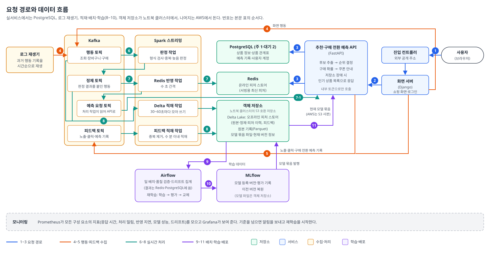
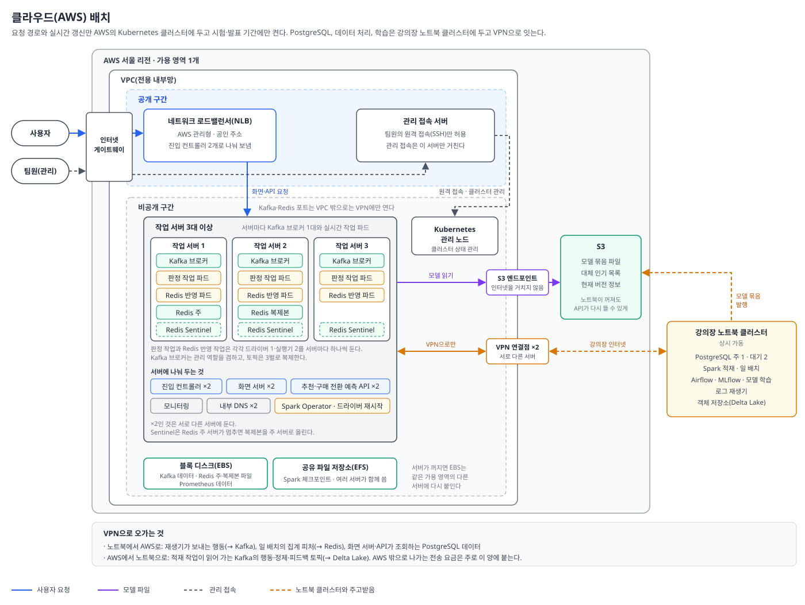
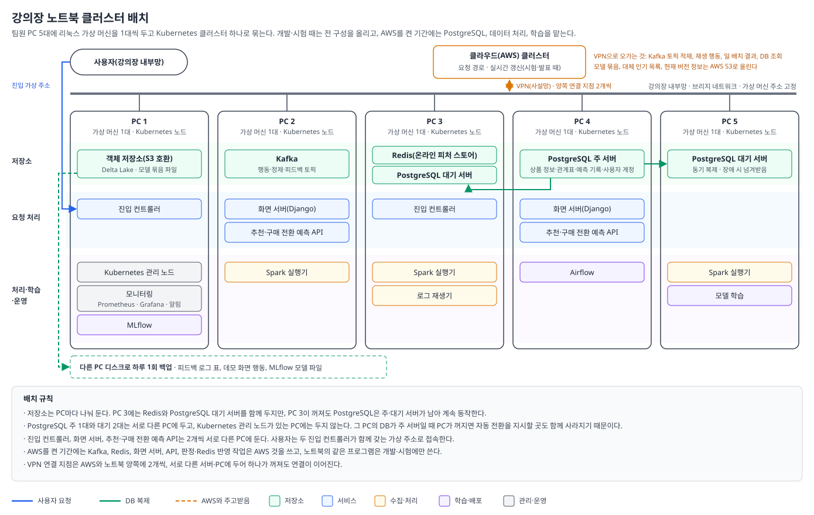

# 시스템 아키텍처 구조도

| 항목 | 내용 |
|---|---|
| 작성 | PM 이여찬 |
| 기준일 | 2026-11-24 |

## 1. 요청 경로는 AWS, 데이터 처리와 학습은 노트북 클러스터

실서비스는 두 Kubernetes 클러스터가 나눠 맡는다. 사용자 요청이 지나가는 경로(진입 컨트롤러, 화면 서버, 추천·구매 전환 예측 API, Kafka, Redis)와 실시간 갱신 작업은 클라우드(AWS)에 두고, PostgreSQL, 데이터 적재, 일 배치, 학습은 강의장 노트북 클러스터에 둔다. 두 클러스터는 따로 운영하고 VPN(암호화된 사설망)으로 잇는다. 전 구성을 AWS에 올리면 한도 30만 원에 여유가 거의 없어서 이렇게 나눴다.

| 환경 | 맡는 것 | 가동 | 파일 저장 |
|---|---|---|---|
| 클라우드(AWS) | 실서비스 주소, 요청 응답, 실시간 갱신, 시연, 부하 시험 | 시험·발표 기간만 | S3(모델 묶음, 대체 인기 목록, 현재 버전 정보) |
| 노트북 클러스터 | PostgreSQL, 적재·일 배치·학습, 재생, 개발, 통합 시험, 장애 전환 시험 | 상시 | 클러스터 안 S3 호환 저장소(Delta Lake, 모델 파일) |

노트북 클러스터에는 개발·시험용으로 전 구성을 같은 배포 설정으로 올린다. 노트북 클러스터가 꺼지거나 강의장 인터넷이 끊기면 AWS는 비로그인 응답과 대체 추천으로 응답을 이어 간다. 이를 위해 화면 서버는 PostgreSQL 없이도 비로그인 화면을 띄울 수 있어야 한다. 화면에서 들어오는 행동은 AWS 안에서 계속 Redis에 반영되지만, 재생기가 보내는 행동은 멈춘다. 적재, 일 배치, 재학습, PostgreSQL을 읽는 기능(로그인, 상품 관계표 조회)도 멈추며, 노트북이 돌아오면 Kafka 보존 기간 안에 쌓인 행동부터 이어서 처리한다.

그림은 최종 목표 구성이다. 로그인, 진입 컨트롤러·화면 서버·API 이중화, 드리프트에 따른 재학습은 중간 발표 뒤에 넣는다.

## 2. 요청 경로와 데이터 흐름

| 번호 | 흐름 | 내용 |
|---|---|---|
| 1 | 사용자 → 진입 컨트롤러 → 화면 서버 | 쇼핑 화면 요청 |
| 2 | 화면 서버 → 추천·구매 전환 예측 API | 내부 토큰으로 추천 요청, 다음 화면의 쿠폰 조회 |
| 3 | API → Redis, PostgreSQL | 실시간 피처, 상품 관계표·상품 정보 조회 |
| 4 | 로그 재생기·화면 서버 → 행동 토픽 | 과거 기록 재생, 화면에서 만든 행동 |
| 5 | API → 피드백 토픽 | 노출·클릭·구매 전환 예측 기록 |
| 6 | 행동 토픽 → 판정 작업 → 정제 토픽 | 형식 검사, 중복·늦음 판정 |
| 7 | 정제 토픽 → Redis 반영 작업 → Redis | 온라인 피처 스토어 갱신(수 초) |
| 7-1 | Redis 반영 작업 → 예측 요청 토픽 → 예측 요청 처리 작업 → 구매 전환 예측 API | 예측 대상 행동마다 입력을 실어 예측 요청, API가 계산해 PostgreSQL에 저장 |
| 8 | 행동·정제·피드백 토픽 → 적재 작업 → Delta Lake | 원본·정제·피처 이력, 피드백을 오프라인 피처 스토어에 적재(30–60초) |
| 9 | Delta Lake → Airflow | 일 배치(집계 피처를 Redis로, 상품 정보를 PostgreSQL로), 품질 검증, 재학습 |
| 10 | Airflow → MLflow → 객체 저장소 | 평가를 통과한 모델 등록, 모델 묶음 파일 발행(AWS S3에도 올림), 상품 관계표는 PostgreSQL에 적재 |
| 11 | 객체 저장소(AWS는 S3) → API | 현재 모델 묶음을 읽어 교체. 순위 모델·관계표·피처 정의를 한 묶음으로 교체·복원 |

Redis 반영(AWS)과 Delta 적재(노트북 클러스터)는 같은 정제 토픽을 따로 읽어 서로 기다리지 않는다. 구매 전환 예측도 예측 요청 토픽을 사이에 두어, 예측이 밀려도 Redis 반영은 늦어지지 않는다. 다만 토픽 쓰기 자체가 막히면 Redis 반영 작업의 다음 배치가 늦어진다.

## 3. 클라우드(AWS) 배치

| 구성 | 대수 | 구간 | 두는 것 |
|---|---|---|---|
| 네트워크 로드밸런서(NLB) | AWS 관리형 | 공개 | 공인 주소. 요청을 진입 컨트롤러 2개로 나눠 보냄 |
| 관리 접속 서버 | 1 | 공개 | 팀원 원격 접속(SSH) 전용 |
| Kubernetes 관리 노드 | 1 | 비공개 | 클러스터 상태 관리 |
| 작업 서버 | 3대 이상 | 비공개 | 진입 컨트롤러, 화면 서버·API, 예측 요청 처리 작업, Kafka, 판정·Redis 반영 작업, Redis, 모니터링 |

사용자 요청은 로드밸런서 → 진입 컨트롤러(2개 중 하나) → 화면 서버 → 추천·구매 전환 예측 API로 흐른다. 로드밸런서는 작업 서버와 같은 가용 영역의 공개 구간에 둔다. 작업 서버는 한 가용 영역에 3대 이상 두고, 요청 경로와 실시간 경로를 서버마다 나눠 둔다. 작업 서버 한 대가 꺼져도 요청 응답, 행동 수집과 실시간 갱신(행동 토픽 → 판정 → 정제 토픽 → Redis 반영)이 이어지고, 이 갱신은 AWS 안에서 끝나 인터넷을 건너지 않는다.

| 프로그램 | 대수 | 나눠 두는 법 |
|---|---|---|
| Kafka | 브로커 3대(관리 역할 겸용) | 서버마다 1대. 토픽은 3벌 복제 |
| 판정 작업, Redis 반영 작업 | 작업마다 드라이버 1, 실행기 2 | 세 파드를 서버마다 하나씩 |
| 진입 컨트롤러 | 2개 | 서로 다른 서버 |
| 화면 서버, API | 각 2개 | 서로 다른 서버 |
| 내부 DNS(CoreDNS) | 2개 | 서로 다른 서버 |
| Redis | 주 서버 1, 복제본 1 | 서로 다른 서버 |
| Redis Sentinel | 3개 | 서버마다 하나. 주 서버가 멈추면 복제본을 주 서버로 올림 |
| 모니터링, Spark Operator | 각 1개 | 작업 서버 중 한 곳 |

Spark 작업의 드라이버가 멈추면 Spark Operator가 그 작업을 다시 띄운다. Kafka 데이터, Redis 영속 파일(주 서버와 복제본 각각), 모니터링(Prometheus) 데이터는 서버와 분리된 블록 디스크(EBS)에 두고, 서버가 꺼지면 같은 가용 영역의 다른 서버에 다시 붙인다. EBS는 만든 가용 영역 안에서만 붙일 수 있어 작업 서버를 한 가용 영역에 둔다. 실시간 작업의 체크포인트는 드라이버와 여러 서버의 실행기가 함께 쓰므로, 여러 서버가 함께 붙는 공유 파일 저장소(EFS)에 둔다. 작업 서버 크기는 부하와 예산에 맞춰 정한다.

VPN으로 오가는 주된 데이터는 아래와 같다. AWS 밖으로 나가는 전송 요금은 주로 노트북 적재 작업이 Kafka에서 읽어 가는 양에 붙는다.

| 방향 | 오가는 것 |
|---|---|
| 노트북 → AWS | 재생기가 보내는 행동(Kafka), 일 배치의 집계 피처(Redis), 화면 서버·API가 조회하는 PostgreSQL 데이터 |
| AWS → 노트북 | 적재 작업이 읽는 행동·정제·피드백 토픽(Delta Lake로 적재) |

배포한 모델 묶음, 대체 인기 목록, 현재 버전 정보는 노트북 클러스터에서 AWS S3로 직접 올린다(HTTPS). 노트북이 꺼져도 AWS의 API가 다시 뜰 때 S3에서 읽을 수 있게 하기 위해서다.

## 4. 노트북 클러스터 배치

| PC | 저장소 | 요청 처리 | 처리·학습·운영 |
|---|---|---|---|
| 1 | 객체 저장소(S3 호환) | 진입 컨트롤러 | Kubernetes 관리 노드, 모니터링, MLflow |
| 2 | Kafka | 화면 서버, API | Spark 실행기 |
| 3 | Redis, PostgreSQL 대기 | 진입 컨트롤러 | Spark 실행기, 재생기 |
| 4 | PostgreSQL 주 | 화면 서버, API | Airflow |
| 5 | PostgreSQL 대기 | — | Spark 실행기, 모델 학습 |

PC마다 리눅스 가상 머신을 1대씩 두고, 프로그램은 가상 머신 안에서 컨테이너(파드)로 나눈다. 한 PC가 꺼져도 저장소가 한꺼번에 멈추지 않게 저장소를 PC마다 나눠 둔다. PostgreSQL은 관리 노드가 있는 PC 1에 두지 않는다. 그 PC의 DB가 주 서버일 때 PC가 꺼지면 자동 전환을 지시할 곳도 함께 사라지기 때문이다. 세 번째 DB는 Redis가 있는 PC 3에 둔다. PC 3이 꺼져도 PostgreSQL은 주·대기 서버가 남아 계속 동작한다. 관리 노드는 1대라, PC 1이 꺼져 있는 동안에는 DB 자동 전환과 파드 재배치가 일어나지 않는다. 표준 Kubernetes는 관리 노드에 일반 프로그램을 올리지 못하게 막아 두므로, PC 1의 객체 저장소·모니터링·MLflow·진입 컨트롤러에는 허용 설정을 붙인다.

## 5. 저장소 위치

| 저장소 | 실서비스 위치 | 노트북 클러스터(개발·시험) | 담는 것 |
|---|---|---|---|
| Kafka | AWS 작업 서버 3대(브로커 3대) | PC 2(브로커 1대) | 행동·정제·피드백·예측 요청 토픽 |
| Redis | AWS 작업 서버(주 1·복제본 1) | PC 3(1대) | 온라인 피처 |
| PostgreSQL | 노트북 클러스터 | 주 PC 4, 대기 PC 5·PC 3 | 상품 정보, 상품 관계표, 예측 기록, 사용자 계정 |
| 객체 저장소 | 노트북 클러스터(모델 묶음·현재 버전 정보는 AWS S3에도) | PC 1(S3 호환 저장소) | Delta Lake, 원본 기록, 모델 묶음 파일, DB 백업 |

노트북 클러스터에서는 Kafka 기록, Redis 영속 파일, PostgreSQL 데이터, Spark 체크포인트를 그 프로그램이 도는 PC의 영속 볼륨에 둔다. 컨테이너가 다시 떠도 남지만 그 PC의 디스크 고장까지는 막지 못하므로, PostgreSQL은 하루 한 번 객체 저장소에 백업한다. 객체 저장소는 1대이므로, 다시 만들 수 없는 피드백 로그 표, 데모 화면 행동, MLflow 모델 파일을 하루 한 번 다른 PC 디스크로 백업한다. AWS의 Kafka·Redis·체크포인트는 3장대로 EBS와 EFS에 둔다.

## 6. 네트워크와 접근

- 노트북 클러스터: 가상 머신을 브리지 네트워크로 강의장 내부망에 직접 붙이고 주소를 고정한다. 개발·시험 때 사용자는 두 진입 컨트롤러가 함께 갖는 가상 주소로 접속한다.
- AWS 공개 구간에는 로드밸런서와 관리 접속 서버만 둔다. 나머지 서버는 인터넷에서 직접 닿지 않는다.
- 두 클러스터 사이는 VPN으로만 잇는다. VPN 연결 지점은 AWS와 노트북 양쪽에 2개씩, 서로 다른 서버·PC에 두어 하나가 꺼져도 연결이 이어진다. Kafka·Redis·PostgreSQL 포트는 인터넷에 열지 않고 VPN에만 연다. 추천·구매 전환 예측 API는 내부 토큰으로만 호출한다.
- AWS의 Redis에 붙는 프로그램은 Sentinel에 현재 주 서버 주소를 물어 접속한다. 노트북의 일 배치도 VPN으로 Sentinel에 물어 붙는다.
- AWS 서버는 S3 엔드포인트로 S3에 접근해 인터넷을 거치지 않는다.
- 모든 프로그램은 PostgreSQL에 관리 도구(CloudNativePG)가 주는 대표 주소로 접속한다. 주 서버가 바뀌어도 주소는 그대로다. 이 주소는 클러스터 안에서만 닿으므로, AWS의 화면 서버·API를 위해 VPN 쪽에서 닿는 주소(노드 포트나 로드밸런서 주소)로 따로 연다. AWS Kafka도 같은 이유로, 노트북 적재 작업이 VPN 쪽 주소로 브로커 3대에 각각 닿도록 브로커마다 외부 접속 경로를 둔다.
