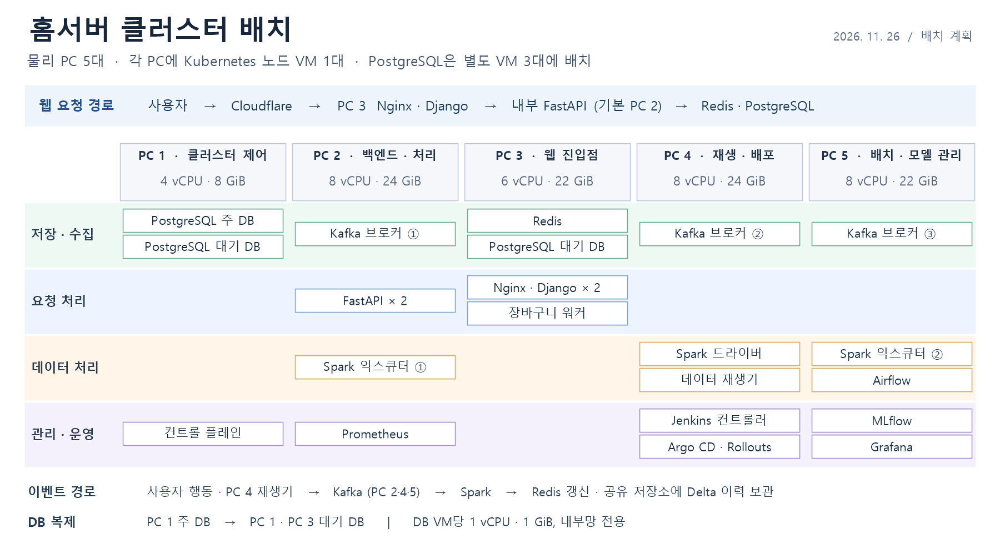
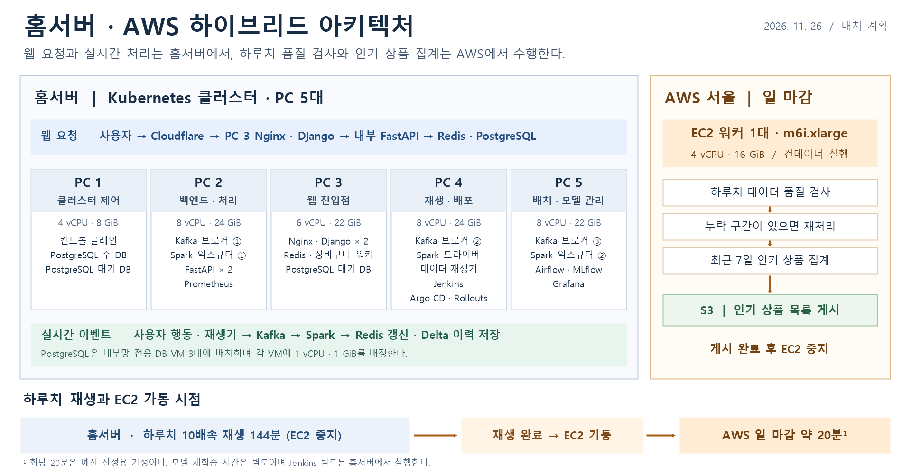
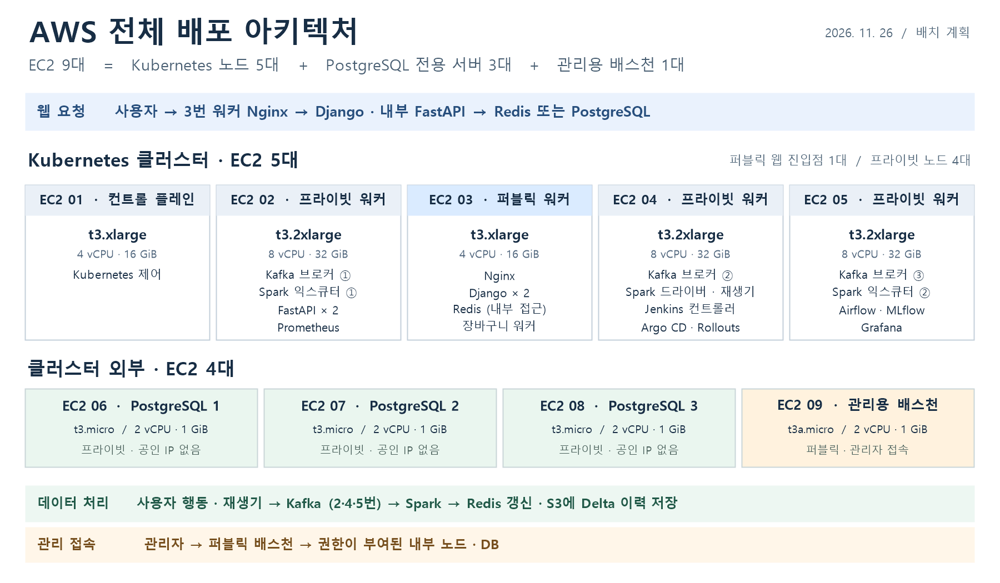

# MLO01-FINAL-5TEAM 인프라

홈서버에서 시작해 하이브리드(홈서버 + AWS), AWS 클라우드로 확장합니다. 세 환경은 Ubuntu 24.04 LTS를 기준으로 하며, VM 생성·AWS 자원 생성·서비스 설치 중 필요한 작업만 선택하도록 설계합니다.

쇼핑·추천 서비스의 웹 요청은 Django와 FastAPI가 처리합니다. 사용자 행동 이벤트는 Kafka가 수집하고 Spark가 처리해 Redis에 최신 상태를 반영하고 Delta Lake에 이력을 저장합니다.

## 인프라 배포 계획

2026년 11월 26일 기준으로 검토한 세 가지 배치안입니다.

| 구성 | 서버 | 웹·실시간 처리 위치 | 선택 근거 |
|---|---|---|---|
| 홈서버 | 물리 PC 5대 | 강의장 홈서버 | 기존 장비와 공유 저장소로 운영해 추가 클라우드 지출을 줄입니다. 외부 접속은 강의장 회선에 의존합니다. |
| 홈서버 중심 하이브리드 | 홈서버 5대 + 일 마감용 EC2 1대 | 강의장 홈서버 | 마감 작업을 AWS로 옮겨 웹과 배치가 홈서버 자원을 두고 경쟁하는 시간을 줄입니다. |
| AWS 전체 배포 | EC2 9대 | AWS | 웹·데이터 처리를 AWS에 배치해 강의장 회선에 대한 의존을 줄입니다. |

### 1. 홈서버



Cloudflare를 통해 강의장 홈서버에 접속합니다. 웹 서비스와 데이터 처리는 기존 장비에서 운영합니다.

### 2. 홈서버 중심 하이브리드



하루치 재생이 끝나면 AWS 워커가 품질 검사와 집계를 수행합니다. 결과를 S3에 게시한 뒤 워커를 중지합니다.

### 3. AWS 전체 배포



서비스는 AWS에서 운영하며 웹 요청과 관리자 접속에 서로 다른 진입점을 사용합니다.

PC별 자원 산정, 카나리 배포 여유분, AWS가 웹 요청을 받는 팀 목표안과의 차이는 상세 문서에서 확인할 수 있습니다. [아키텍처와 설계 근거](docs/architecture/홈서버_11월_아키텍처와_설계근거.md) · [Kubernetes 자원 배치 계획](docs/architecture/cost/AWS·홈서버_Kubernetes_비용_계산.md)

## 폴더 구조

```text
infra/
├── docs/
│   ├── vm/                    # VMware 구축 문서
│   ├── ansible/environment/   # 설치 환경 설계 기록
│   ├── infra-routing/         # 소스 파일별 경로 안내
│   ├── architecture/          # 아키텍처 설계 근거와 배치도 3장
│   │   └── cost/              # 환경별 비용 계산과 자원 배치
│   ├── cost-planning/         # Spark 일 배치 품질 검사 자료
│   └── support/
│       ├── nextcloud/         # 팀 파일 공유 운영 문서
│       └── compatibility/     # 검증 결과와 실행 로그
└── srcs/
    ├── vm/                    # VMware에서 선택한 VM 생성
    ├── terraform/             # 환경별로 필요한 AWS 자원 묶음 생성
    ├── ansible/               # 대상 서버에 선택한 서비스 설치
    │   ├── inventories/
    │   │   ├── homeserver/
    │   │   ├── hybrid/
    │   │   └── cloud/
    │   ├── playbooks/         # 서비스별 실행 절차
    │   └── roles/             # 세 환경에서 공유하는 설치·설정 작업
    └── support/               # 팀 지원 작업
        ├── nextcloud/         # 팀 파일 공유
        └── compatibility/     # Kafka·Spark·Delta Lake·Feast 호환성 검사
```

VM·Terraform·Ansible은 폴더를 마련한 단계입니다. 작업별 실행 범위는 [VM·Terraform·Ansible 선택 기준](docs/infra-layout.md)에서 확인합니다.

[환경별 배치 계획](docs/architecture/cost/) · [호환성 검증 결과](docs/support/compatibility/README.md) · [검증 실행 파일](srcs/support/compatibility/) · [인프라 경로 안내](docs/infra-routing/README-ROUTING.md)
